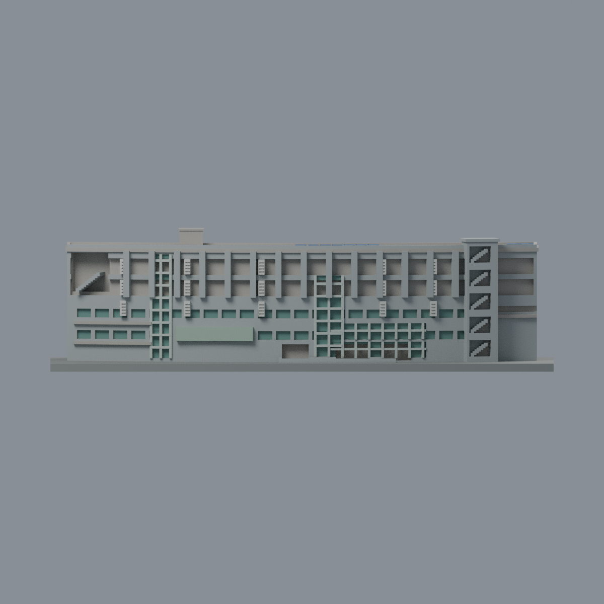
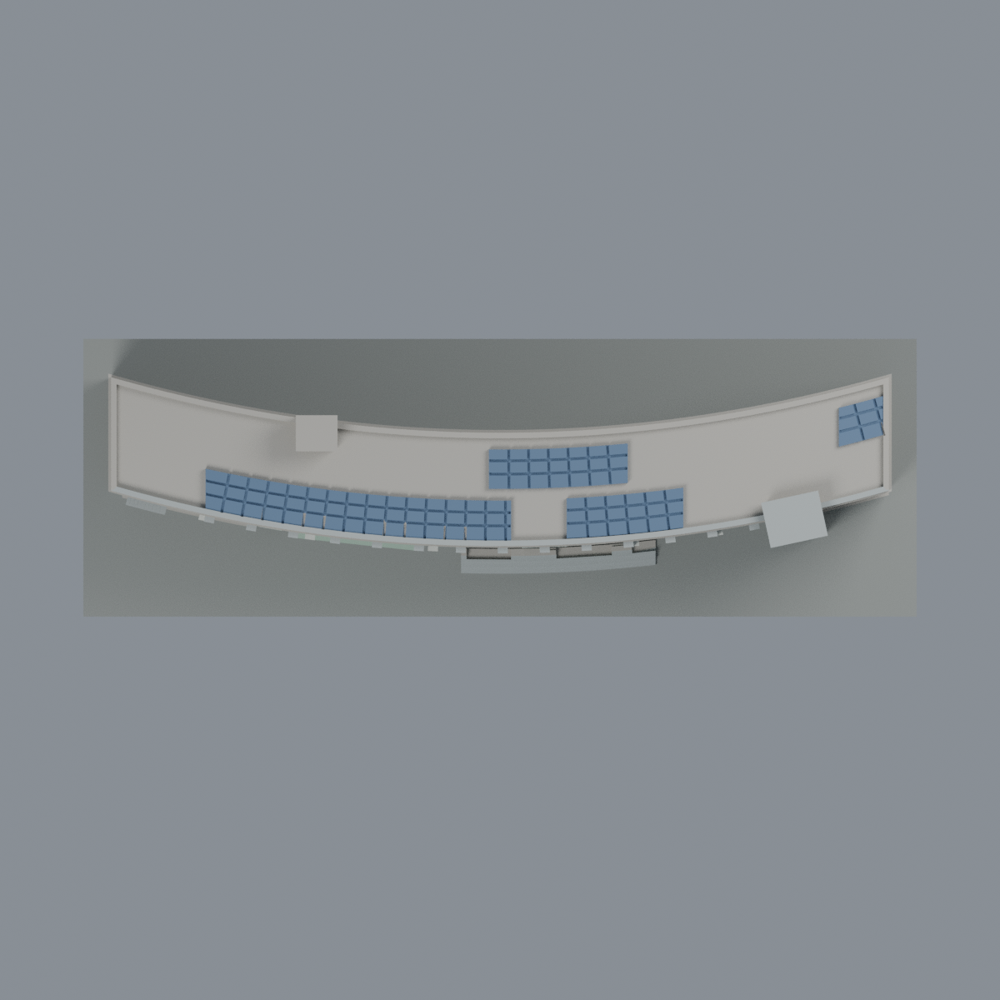

# 聯大八甲 B2 電子工程館：八材質外觀版

沿用原 **35,546 三角面／17,695 頂點**，不改原 STL 位元、座標、面序或幾何；這是既有模型外觀改版，不增加模型包數。

| 正面 | 背面保持中性 |
|---|---|
|  |  |
|  |  |

[表面色 3MF](nuub2-appearance.3mf) · [可編輯 Blender](scene.blend) · [材質色表](palette.json) · [逐面指派與依據](face-materials.json) · [原 STL](../model.stl)

## 來源與配色邊界

親自核對官方 [理工一館相簿](https://secretary.nuu.edu.tw/p/132-1003-1098.php?Lang=zh-tw) 的 [照片 22](https://secretary.nuu.edu.tw/var/file/3/1003/gallery/98/1098/gallery_1098_6009736_26274.jpg)：可辨「電子工程學系」，曲面長翼、兩個高窗帶、左開放梯間、右階梯塔及原屋頂板與 B2 既有網格匹配。EXIF DateTimeOriginal **2025-03-10 15:16:49**，不把修改時間當拍攝時間；日期與時區未另行核實，不聲稱 2026 現況。照片不隨包散布。

- 已見曲面正面採灰色混凝土代理，原直立百葉淺色、原窗梃銀灰、既有空白牌牆淺鼠尾草綠；不新增金色字樣或招牌。
- 只有原兩個高玻璃槽、已登錄的低層窗槽及右下橫向窗槽凹背使用低彩度灰綠玻璃。原入口深凹與兩處梯間不當玻璃，保留原封實背板限制；不增室內或透明厚度。
- **兩條上層連續凹槽的背面保持中性**：實景混合黃色牆與窗／走廊，原網格沒有足夠的逐窗邊界。本版不把整條染藍玻璃，也不任意切三角形假造黃色窗間牆。這是保守未還原區，不是實景沒有黃色。
- 只對原四組屋頂光伏薄板配藍色，保留原粗溝槽；不將整片屋頂染藍。原板面範圍和實景更大棚架不完全相同，本版沒有擴增。
- 未見背牆、兩短端、屋頂其他面和服務方塊中性；右端已觀察的正面階梯塔灰色，凹槽仍是開放梯間之簡化代理。
- 原弧形由多邊分段近似，樓層、窗數、入口和樓梯比例未經測量，材質無法補正形狀。照片陰影、冷氣、樹木、車輛、前景相鄰樓都不添加。原 STL／面序／座標不變，不增加模型數，不宣稱物理列印成功。

[原幾何與來源限制](../README.md) · [來源覆核](qa/source-review.json)

## 重建與核驗

安裝 [依賴](source/requirements.txt)，Blender 使用 4.3.2。由本資料夾上層提供原 model.stl：

1. `python appearance/source/build_appearance.py`
2. `python appearance/source/verify_exchange.py`
3. `blender -b -t 3 --python-exit-code 1 -P appearance/source/render_appearance.py`
4. `blender -b -t 3 --python-exit-code 1 -P appearance/source/verify_scene.py`

[獨立重建 ZIP](rebuild-source.zip)含原 STL、四支程式及依賴，不含第三方照片；不取代原建模腳本。[逐檔 SHA256](SHA256SUMS)

[交換／拓撲 QA](qa/exchange-validation.json)核對原座標與面序、全部面材質、單連通、有向水密邊、頂點 link 單環、正體積與零退化／重複面；lib3mf 嚴格讀取零警告，實際編輯單材質再存讀，其他材質及面指派不變。SDK 六位小數量化誤差另列。

[Blender 存讀與編輯](qa/scene-validation.json) · [渲染記錄](qa/render-manifest.json) · [獨立重建](qa/rebuild-validation.json)

## 製造限制照舊

尺寸仍為 150 × 50 × 41.5 mm；原 STL、建模程式、場景及歷史 QA 保留。原層檢與薄特徵檢查本次未重跑，不能由材質 QA 代替。

3MF 是同一網格的表面色，不是八個封閉分色實體、切片專案、噴頭映射或 G-code。切片 GUI、多材料路徑與實體列印未測；柱頭、屋簷、窗框及薄邊仍須評估材料、支撐及拆除風險，沒有保證可印或免支撐。
