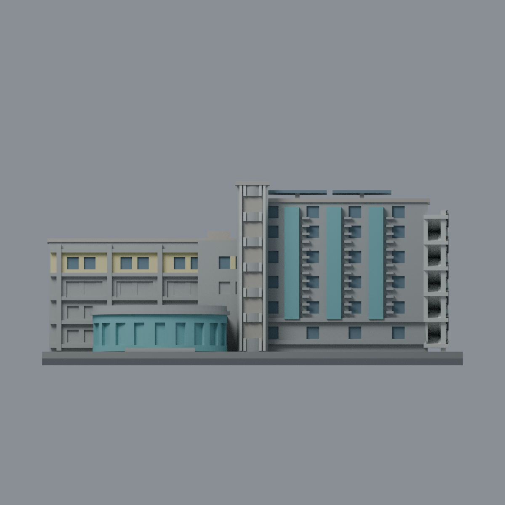
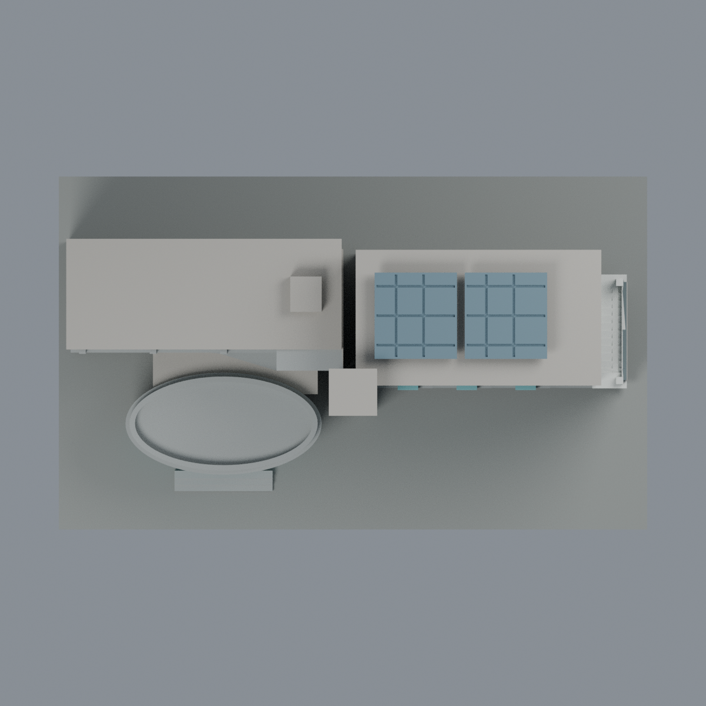

# 聯大八甲 B3 光電館：八材質外觀版

沿用原 **14,880 三角面／7,364 頂點**，不改原 STL 位元、座標、面序或幾何；這是既有模型外觀改版，不增加模型包數。

| 模型預覽 | 模型預覽 | 模型預覽 |
| :---: | :---: | :---: |
| 正面  | 背面保持中性  |  |
|  |  |  |

[表面色 3MF](nuub3-appearance.3mf) · [可編輯 Blender](scene.blend) · [材質色表](palette.json) · [逐面指派與依據](face-materials.json) · [原 STL](../model.stl)

## 來源與配色邊界

親自查看聯大官方 [理工一館相簿](https://secretary.nuu.edu.tw/p/132-1003-1098.php?Lang=zh-tw) 的 [第 12 張](https://secretary.nuu.edu.tw/var/file/3/1003/gallery/98/1098/gallery_1098_8728292_26273.jpg)、[第 13 張](https://secretary.nuu.edu.tw/var/file/3/1003/gallery/98/1098/gallery_1098_8363343_26273.jpg) 和 [第 15 張](https://secretary.nuu.edu.tw/var/file/3/1003/gallery/98/1098/gallery_1098_3056146_26273.jpg)。影像明確標示「光電工程學系」，與 B3 的圓塔、青綠翼板、低橢圓入口和右端外梯一致；**這三張是 B3，不是 B4 資訊工程館**。EXIF 拍攝日期為 **2025-03-10**，時區與日期未另行核實，不聲稱 2026 現況。照片不隨包散布。

- 已見主立面灰混凝土，三片直立翼板及低入口外側青綠陶磚。實景低入口灰色直框未在原網格逐一存在，故不切面或補條帶；原入口槽不逐窗對應，維持牆色，不一律塗成玻璃。
- 左翼頂層原內填牆淡黃，原柱和樓層帶保持灰色；只配該層可辨窗凹背灰藍。下層走廊槽灰色，**不把開放走廊當成玻璃**。原退縮、轉角和窗列仍有簡化差異。
- 中央樓梯塔灰色、四條既有粗肋近白，封實凹背中性而非玻璃。原粗肋遠少於實景密排細條，材質不能補足幾何差異。
- 右端既有外梯踏步、樓板與柱近白，最外側欄杆區深灰；原粗化欄杆與交錯梯段不改。已見承梯牆灰色，但未登錄的側窗背中性。
- 兩塊既有架高屋頂板使用灰藍光伏面代理，保留原粗溝槽和支柱；實景棚架及板數更複雜，不補設備。未登錄平屋頂、背牆、左端和設備方塊中性。
- 不添加金字、校徽、冷氣、鏽蝕或樹影。色值未校準，原 STL 位元組、面序、座標、幾何和歷史 QA 不變；這是外觀改善，不是新幾何或實體列印驗證。

[原幾何與來源界線](../README.zh-TW.md) · [本次來源覆核](qa/source-review.json)

## 重建與核驗

安裝 [依賴](source/requirements.txt)，Blender 使用 4.3.2。由本資料夾上層提供原 model.stl：

1. `python appearance/source/build_appearance.py`
2. `python appearance/source/verify_exchange.py`
3. `blender -b -t 3 --python-exit-code 1 -P appearance/source/render_appearance.py`
4. `blender -b -t 3 --python-exit-code 1 -P appearance/source/verify_scene.py`

[獨立重建 ZIP](rebuild-source.zip)含原 STL、四支程式及依賴，不含第三方照片；不取代原建模腳本。[逐檔 SHA256](SHA256SUMS)

[交換／拓撲 QA](qa/exchange-validation.json)核對原座標與面序、全部面材質、單連通、有向水密邊、頂點 link 單環、正體積與零退化／重複面；lib3mf 嚴格讀取零警告，實際編輯單材質再存讀，其他材質及面指派不變。SDK 六位小數量化誤差另列。

[Blender 存讀與編輯](qa/scene-validation.json) · [渲染記錄](qa/render-manifest.json) · [獨立重建](qa/rebuild-validation.json)

## 製造限制照舊

尺寸仍為 150 × 90 × 64 mm；原 STL、建模程式、場景及歷史 QA 保留。原層檢與薄特徵檢查本次未重跑，不能由材質 QA 代替。

3MF 是同一網格的表面色，不是八個封閉分色實體、切片專案、噴頭映射或 G-code。切片 GUI、多材料路徑與實體列印未測；柱頭、屋簷、窗框及薄邊仍須評估材料、支撐及拆除風險，沒有保證可印或免支撐。
