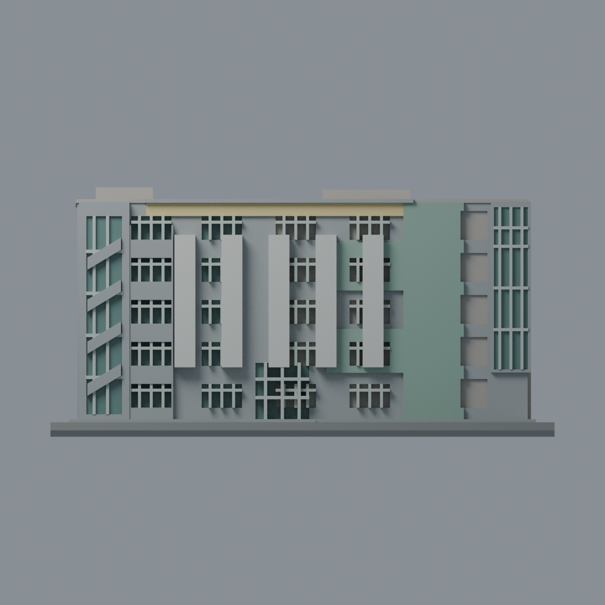
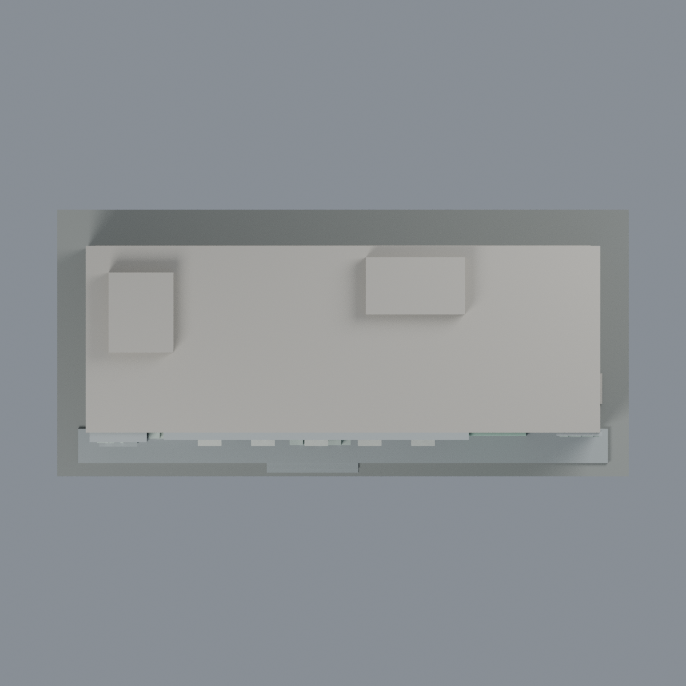

# 聯大八甲 B4 資訊工程館：八材質外觀版

沿用原 **6,480 三角面／3,242 頂點**，不改原 STL 位元、座標、面序或幾何；這是既有模型外觀改版，不增加模型包數。

| 模型預覽 | 模型預覽 | 模型預覽 |
| :---: | :---: | :---: |
| 正面  | 背面保持中性  |  |
|  |  |  |

[表面色 3MF](nuub4-appearance.3mf) · [可編輯 Blender](scene.blend) · [材質色表](palette.json) · [逐面指派與依據](face-materials.json) · [原 STL](../model.stl)

## 來源與配色邊界

本次先更正原來源登錄錯誤，再配色。親自核對官方相簿 [照片 3 正面](https://secretary.nuu.edu.tw/var/file/3/1003/gallery/98/1098/gallery_1098_5488276_26275.jpg) 和 [照片 8 左斜俯視](https://secretary.nuu.edu.tw/var/file/3/1003/gallery/98/1098/gallery_1098_4540814_26277.jpg)：照片 8 可見「資訊工程學系」，白直片、綠 H 區、右前窗格和左斜梯帶均與原 B4 網格相符。原 README／manifest 所列 **12／13／15 實際是 B3 光電館，已撤除錯引**；只更正來源文件、相應雜湊與外觀，不改模型幾何。來源 EXIF 為 **2025-03-10**，時區及日期未獨立核實，不聲稱 2026 現況。照片不隨包散布。

- 已見正面混凝土灰色，原五片寬凸板近白，原綠色 H 形浮凸區使用鼠尾草綠，上層原窄帶淡黃。原浮凸區的高度、輪廓和窗洞關係仍是簡化，不承諾每一片磚色的位置完全吻合。
- 明確左側原窗背、中央雙層入口、右前高窗與左斜梯窗背使用低彩度灰綠；原窗梃淡色。中央重複窗列混合真窗和開放廊口，無法逐一登錄的窗背中性，**右側開放樓梯廊口不是玻璃**。
- 左塔原斜梯浮帶灰色，與後方玻璃分離；不補實景細框、室內梯段或牌字。原左短端另有規律小窗，與照片 8 的複雜端面不能逐窗對應，保持中性。
- 原右短端實牆沒有被照片 8 直接支持（該照片為左端），本版不沿用舊文字推論去配右端色。未知背面、平屋頂及屋頂方塊中性。
- 來源有屋頂光伏設備，但原 B4 網格沒有獨立板幾何；**不把平屋頂塗藍假裝已有光伏板**，也不新增設備、字樣、招牌、冷氣或樹影。
- 原 STL／OBJ、場景、預覽、生成器及歷史幾何 QA 不變；根 README、manifest 及兩者在根 SHA256SUMS 的雜湊變化屬明列的來源文件更正。本 appearance 的 SHA256SUMS 另行涵蓋新檔案。外觀改善不增加模型包數，不是測繪還原或實體列印驗證。

[更正後來源文件](../manifest.json) · [原模型與更正說明](../README.zh-TW.md) · [本次來源覆核](qa/source-review.json)

## 重建與核驗

安裝 [依賴](source/requirements.txt)，Blender 使用 4.3.2。由本資料夾上層提供原 model.stl：

1. `python appearance/source/build_appearance.py`
2. `python appearance/source/verify_exchange.py`
3. `blender -b -t 3 --python-exit-code 1 -P appearance/source/render_appearance.py`
4. `blender -b -t 3 --python-exit-code 1 -P appearance/source/verify_scene.py`

[獨立重建 ZIP](rebuild-source.zip)含原 STL、四支程式及依賴，不含第三方照片；不取代原建模腳本。[逐檔 SHA256](SHA256SUMS)

[交換／拓撲 QA](qa/exchange-validation.json)核對原座標與面序、全部面材質、單連通、有向水密邊、頂點 link 單環、正體積與零退化／重複面；lib3mf 嚴格讀取零警告，實際編輯單材質再存讀，其他材質及面指派不變。SDK 六位小數量化誤差另列。

[Blender 存讀與編輯](qa/scene-validation.json) · [渲染記錄](qa/render-manifest.json) · [獨立重建](qa/rebuild-validation.json)

## 製造限制照舊

尺寸仍為 150 × 70 × 73.2 mm；原 STL、建模程式、場景及歷史 QA 保留。原層檢與薄特徵檢查本次未重跑，不能由材質 QA 代替。

3MF 是同一網格的表面色，不是八個封閉分色實體、切片專案、噴頭映射或 G-code。切片 GUI、多材料路徑與實體列印未測；柱頭、屋簷、窗框及薄邊仍須評估材料、支撐及拆除風險，沒有保證可印或免支撐。
