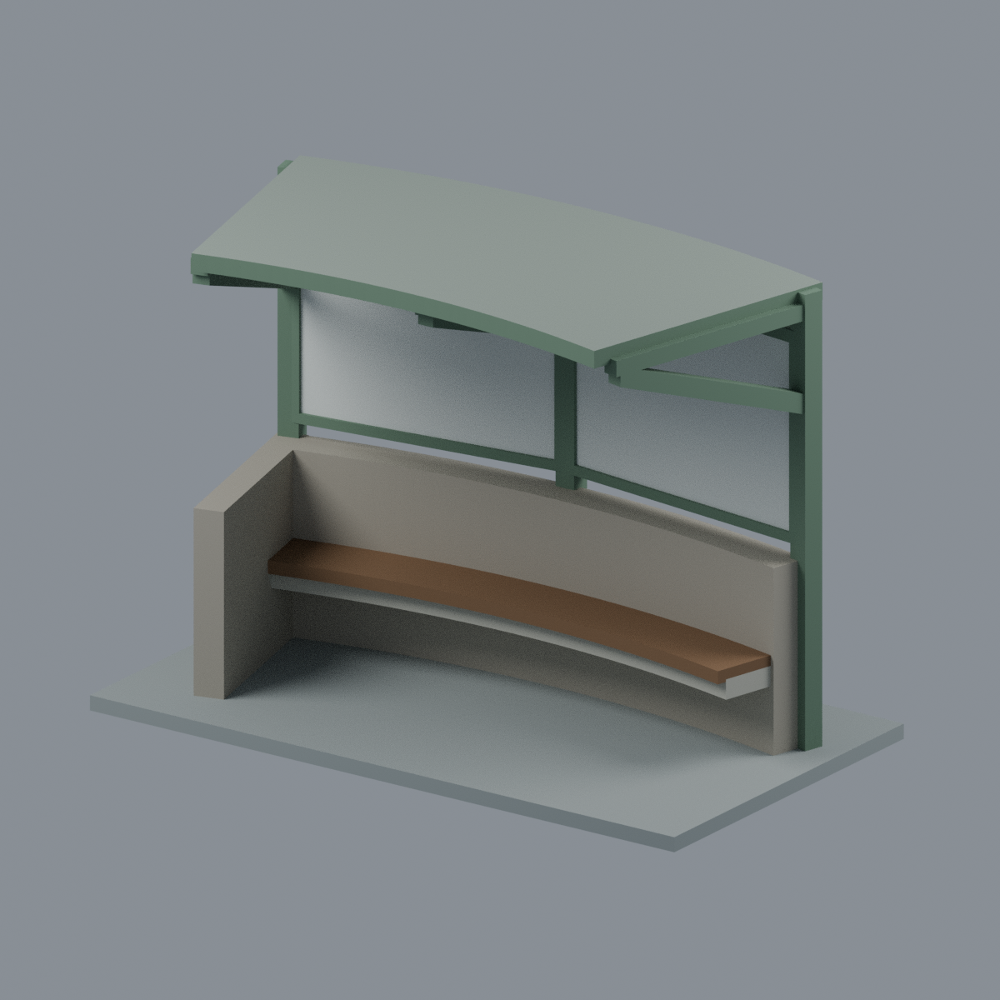
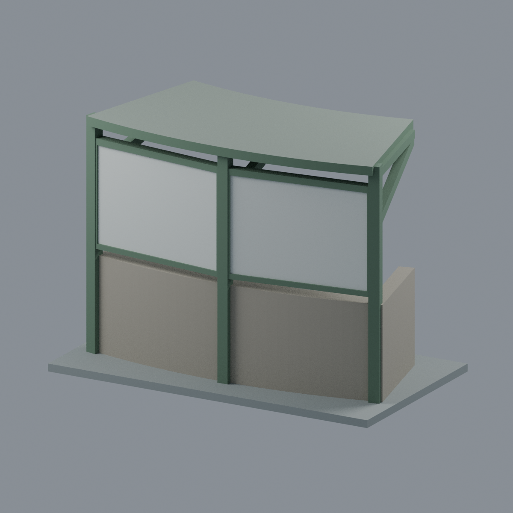
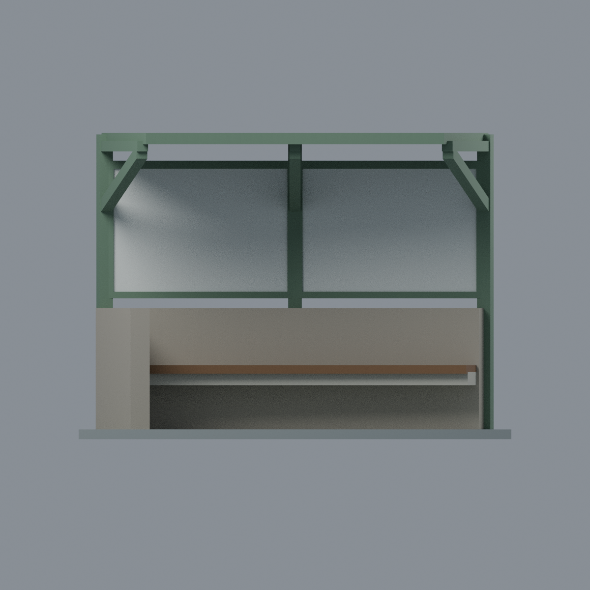
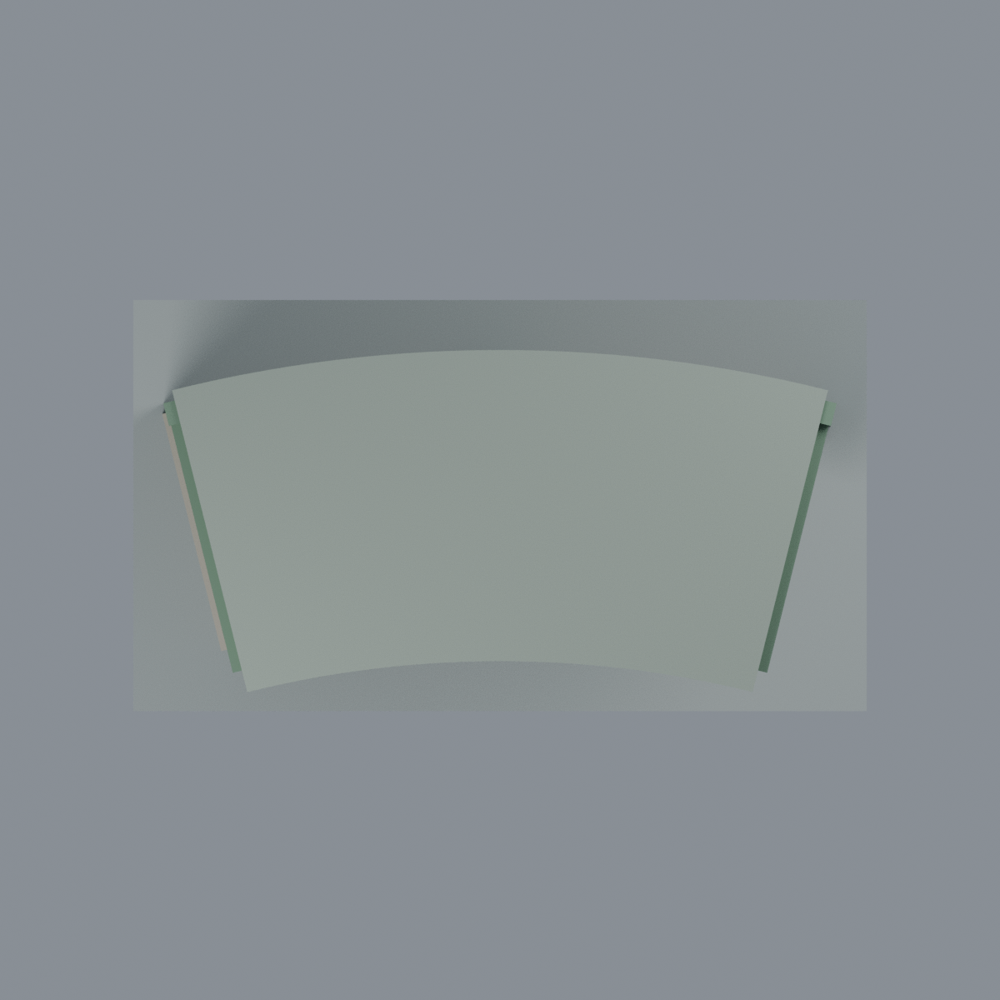
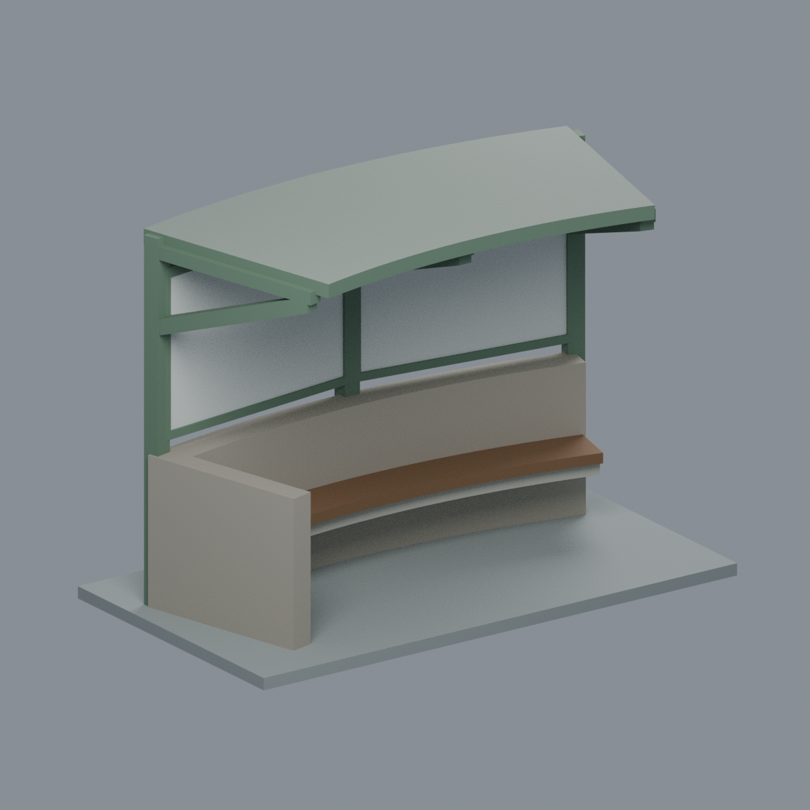

# 國立聯合大學八甲校區 1 弧形候車亭端部雙框外觀段

| 模型預覽 | 模型預覽 | 模型預覽 |
| :---: | :---: | :---: |
|  |  |  |

新增建築外觀段模型，不是「八甲校區 2」直線候車亭，也不是完整站體。選取八甲校區 1 左翼、白色設備櫃旁端柱至第二根內柱之間的兩個連續公告板格。設備櫃本身不建模。官方照片 2 背面視角的最右兩格，對應照片 1 的白色背板與相鄰淺藍內面公告格。延伸側在第二根內柱切斷。

## 檔案與實際視圖
- [可編輯彩色 Blender](scene.blend)
- [彩色 3MF](model.3mf)：8 種獨立命名展示材質，可單獨換色；不是多色列印機料槽指派。
- [單色幾何 STL](model.stl)
- [可重建生成器](build_model.py)、[渲染器](render_model.py)、[材質表](palette.json)
- [正面](previews/front.png) · [背面](previews/rear.png) · [正立面](previews/elevation.png) · [俯視](previews/top.png) · [左斜視](previews/left_oblique.png)
- [來源與推估邊界](SOURCES.md) · [驗證及列印限制](QA.md)

| 模型預覽 | 模型預覽 | 模型預覽 |
| :---: | :---: | :---: |
| 背面<br> | 正立面<br> | 俯視<br> |
| 左斜視<br> |  |  |

## 表達範圍
保留平面上的緩弧屋簷與灰色下牆、三根後立柱、向候車側伸出的開放三角懸臂、兩片素面框板、框板下 3 mm 窄開口、內側木座板及淡色壁托、短端部低返牆。未加入前側落地柱或側玻璃。

屋頂是平面弧形，**不是立面拱頂**。曲率半徑 240 mm、總轉角 28°、屋面出挑約 52 mm 均為照片導向估計，非量測比例。整體展示尺寸 **132 × 74 × 93.5 mm**，含另加的 3 mm 展示底板。未見的屋面頂部、深度、接頭、基礎及座椅底部採簡化；端返牆在展示深度內截斷，不延伸模擬周邊景觀牆。

不複製公告文字、圖像、花卉屋底藝術、站牌、監視器、燈具、太陽能板或設備櫃；公告與屋底均以素面處理。原始照片未隨包發行。官方照片拍攝於 2025-02-24，不能證明 2026 現場狀態。

## 重建
使用 Python 3.12 與 `requirements.txt` 套件：
```sh
python build_model.py
python qa_model.py
python check_features.py
python verify_exchange.py
blender -b -t 6 --python render_model.py
blender -b -t 6 --python verify_scene.py
blender -b -t 6 --python verify_render.py
python verify_package.py
```
若 `lib3mf` 與幾何套件位於不同 Python 環境，為 `verify_exchange.py` 設定 `BUILD_PYTHON` 指向可執行生成器的 Python；並按本機 SDK 安裝設定動態函式庫搜尋路徑。渲染使用 Blender 4.3.2 CPU Cycles、固定 seed 0、48 samples。跨 Blender 版本／平台不承諾圖像位元組相同。

**未經實際列印。** 拓撲與數值切片通過不等於免支撐：懸挑屋面、框板底梁、壁托座椅需自行檢視切片方向、支撐與材料。局部斜撐起點有薄截面警示，詳見 QA。
