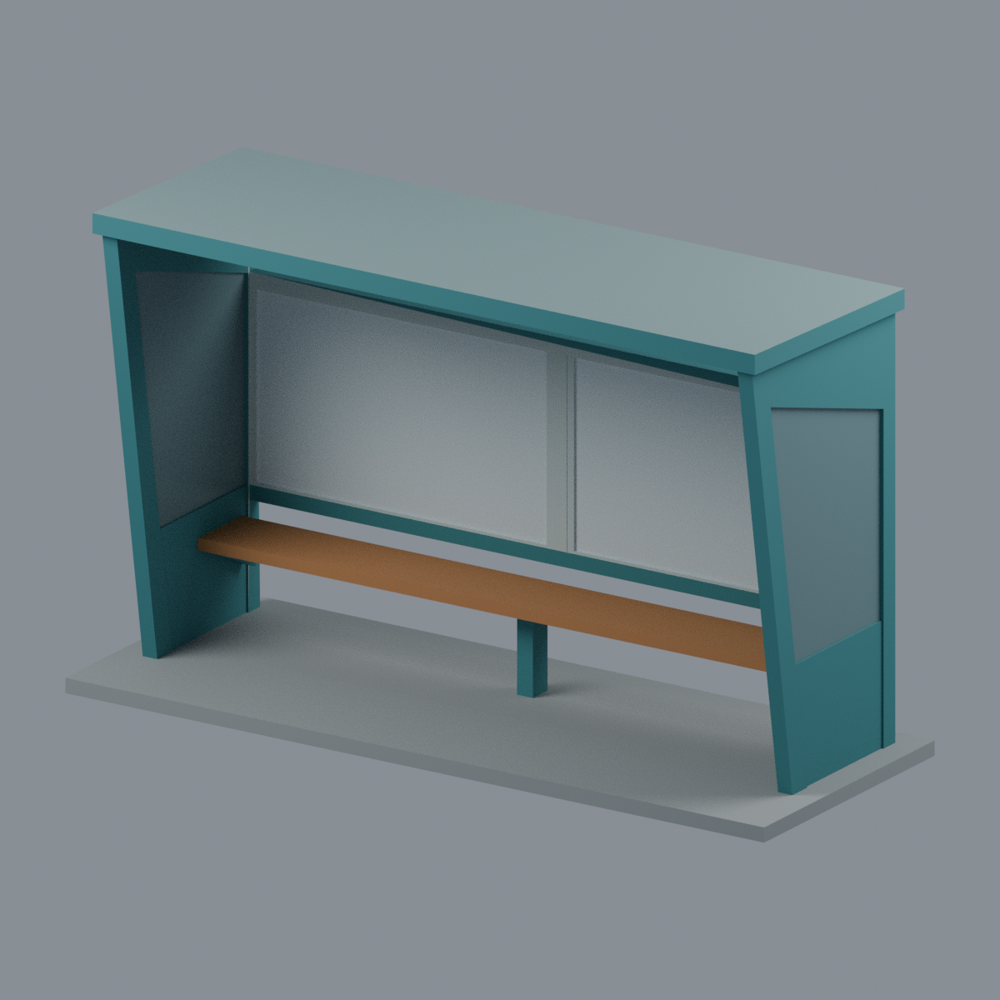
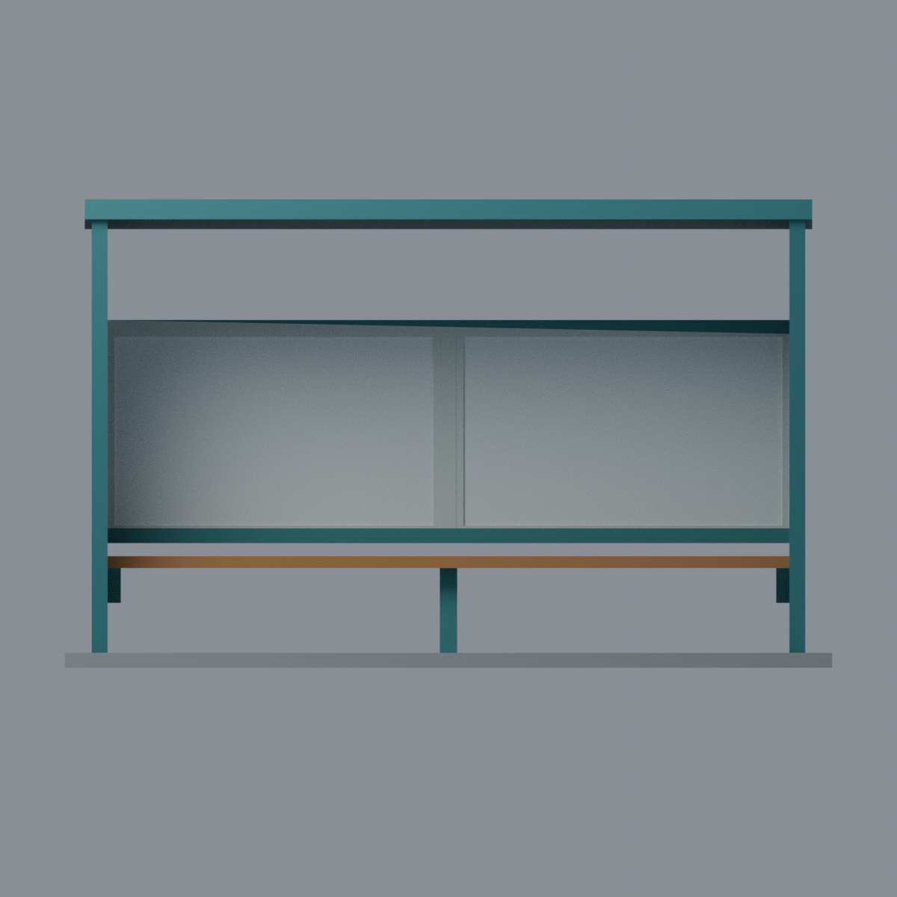
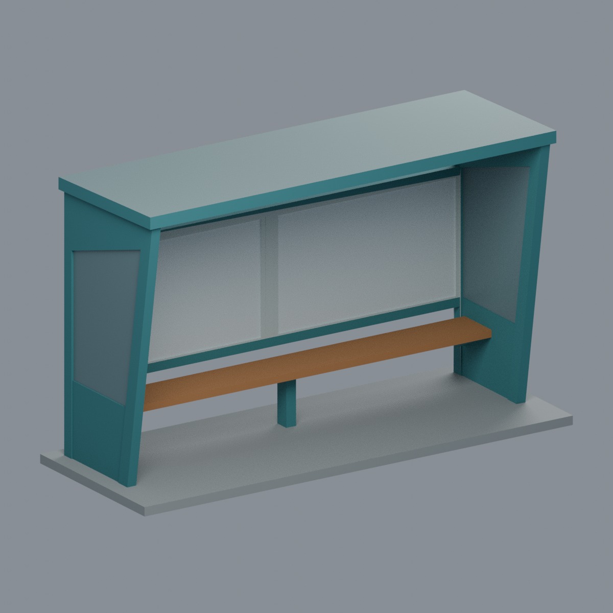
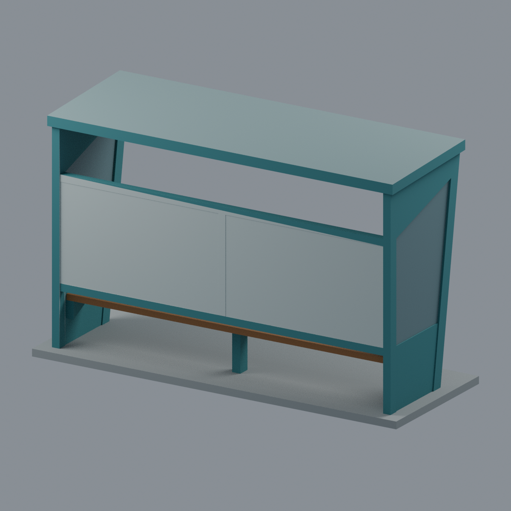

# 國立聯合大學八甲校區 2 公車候車亭左端單跨外觀段

| 模型預覽 | 模型預覽 | 模型預覽 |
| :---: | :---: | :---: |
|  |  |  |

原創近似外觀模型，以校方交通設施相簿照片 7 前景、照片 8 最左跨為同一目標；照片 6 僅佐證相同構造側剖輪廓，**不借用右端跨的告示內容**。不是完整三跨候車亭、建築施工圖或量測比例模型。

## 下載與編輯
- `model.stl`：單一連通封閉網格，毫米單位；不含色彩。
- `model.3mf`：同一三角網格，8 組可編輯顯示材質；不是多噴頭機器設定。
- `scene.blend`：同一實際網格、材質與相機；可編輯模型／材質。
- `build_model.py`：可重建原始幾何與 3MF；`render_model.py` 以 Blender 產生五張實際模型圖。

## 幾何範圍與證據界線
尺寸 **154 × 58 × 94 mm**（含 3 mm 展示底座）；屋面寬 146 mm。尺寸及深度為外觀估計，沒有現地測量。道路在 −Y。

保留藍綠色向道路側傾出的側框、下實板、上側玻璃區、上部斜楔、淺單坡平屋面、兩片後方告示板、窄中央框、棕色座椅和中央椅腳。告示板上方及椅下後方保持開口，**不是封閉實心盒子**。

右側是第一道共用支承的**人工範圍切界**，不是整座候車亭真正端頭；其餘兩跨不建模。側玻璃以 1.6 mm 不透明實體／低飽和玻璃色代理，並非透明列印保證。看不到的屋頂、背板背面、深度和接合採保守無裝飾形式，屋面微坡亦是估計。展示底座、加厚窗面與簡化椅架為模型結構處理，並非原物施工細節。

告示、地圖、照片、文字、花卉頂棚圖案、鏽蝕、站牌、燈具、螺栓與周邊景物皆省略，不以猜測補齊；空白板面不表示現場空白。原始照片僅私人研究，公開套件不含相片或擷取貼圖。

## 列印限制（重要）
**未實際列印；未認證可免支撐。** 拓樸通過不等於可直接列印。長屋面和座椅跨度、懸空板底、斜楔及三角椅架需在切片器規劃支撐／方向，或由使用者另行拆件。現有薄截面失敗如實記錄於 [QA.md](QA.md)，不以豁免或修補偷偷變成全通過。

## 來源與再現
[SOURCES.md](SOURCES.md) 記錄官方原始來源、日期與未見部位；[QA.md](QA.md) 解釋檢查範圍。五圖均由交付網格產生：
[正斜視](previews/front.png) · [正立面](previews/elevation.png) · [左斜視](previews/left_oblique.png) · [後斜視](previews/rear.png) · [頂視](previews/top.png)

| 模型預覽 | 模型預覽 | 模型預覽 |
| :---: | :---: | :---: |
| 正立面  | 左斜視  | 後斜視  |
| 頂視  |  |  |

使用 `requirements.txt` 安裝幾何依賴後執行 `python build_model.py`、`python qa_model.py`、`python check_features.py`。以 Blender 4.3.2 執行 `blender -b -P render_model.py`。lib3mf 交換驗證另需 `lib3mf`，詳見驗證腳本。原創幾何／程式依 LICENSE；不授予現地照片或告示作品的權利。
