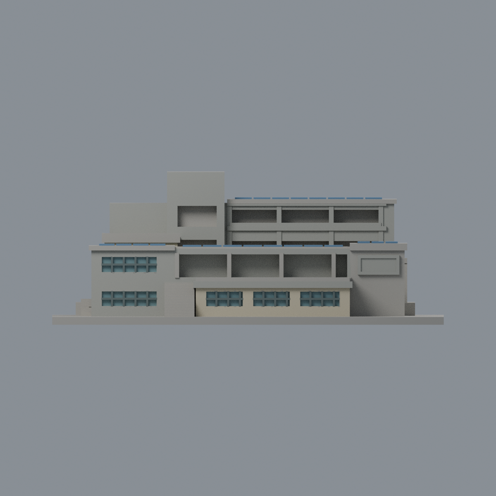
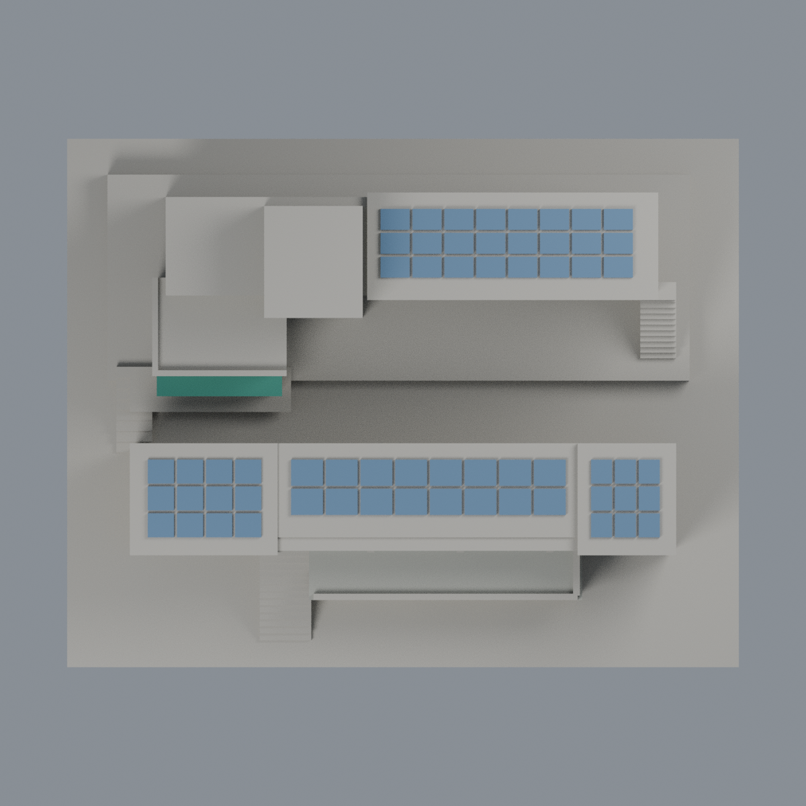

# 聯大八甲 D1／D2 客家研究學院：七材質外觀版

沿用原 **4,476 三角面／2,240 頂點**，不改原 STL 位元、座標、面序或幾何；這是既有模型外觀改版，不增加模型包數。

| 正面 | 背面保持中性 |
|---|---|
|  |  |
|  |  |

[表面色 3MF](nuud12-appearance.3mf) · [可編輯 Blender](scene.blend) · [材質色表](palette.json) · [逐面指派與依據](face-materials.json) · [原 STL](../model.stl)

## 來源與配色邊界

親自核對官方 [客家學院相簿](https://secretary.nuu.edu.tw/p/132-1003-1095.php?Lang=zh-tw) 的 [D1 照片 4](https://secretary.nuu.edu.tw/var/file/3/1003/gallery/95/1095/gallery_1095_5846559_25626.jpg)、[D2 照片 1](https://secretary.nuu.edu.tw/var/file/3/1003/gallery/95/1095/gallery_1095_9536606_25626.jpg)。EXIF DateTimeOriginal 分別為 **2025-03-02 14:52:18／15:09:50**，不以後續修改日當拍攝日；時區與日期未獨立核實，不聲稱 2026 現況。使用完整可解碼照片，早期傳輸不完整的 D2 副本不作最終 hash 證據；照片不隨包散布。

- D1 前棟與 D2 後棟已見正面結構灰色，前露台基座、左端及 D2 入口館牆奶油色；D2 原入口雨棚深綠色，原支柱淺色，不添字樣、招牌或室內設備。
- 只有原 D1 獨立窗槽與 D2 入口窗槽凹背配灰藍玻璃，原粗窗梃深灰。D1 上廊、D2 三層走廊與塔樓深凹包含門、牆和窗，不能當整片玻璃，保守中性／灰色。
- **D1 右端紅磚與奶油水平帶未完整配色**：原大面沒有足夠的實景色帶邊界，而且原看板面與照片方向為簡化對應。兩側寬大未分割面維持中性，不全染紅而省略色帶，也不切面假造色帶。照片確有紅磚，這是本版保守未還原區。原看板框灰色／內容留白，不複製廣告。
- 原四組實心黏合光伏小板配低彩度藍色，周邊屋頂中性；不增架高支架、管線或水塔。原厚實欄牆不是精確金屬欄杆；不畫細桿假造不存在的幾何。
- 原共底台與兩樓相對位置、坡度、窗數及外梯均是照片概略推估，不是測繪；不據此主張實際連通關係。照片後方 E3、其他前景館舍與植栽不包括。
- 未見後側、無法登錄的側面與其他屋頂中性。原 STL／面序／座標不變，不增加模型數，不宣稱物理列印成功。

[原幾何與來源限制](../README.zh-TW.md) · [來源覆核](qa/source-review.json)

## 重建與核驗

安裝 [依賴](source/requirements.txt)，Blender 使用 4.3.2。由本資料夾上層提供原 model.stl：

1. `python appearance/source/build_appearance.py`
2. `python appearance/source/verify_exchange.py`
3. `blender -b -t 3 --python-exit-code 1 -P appearance/source/render_appearance.py`
4. `blender -b -t 3 --python-exit-code 1 -P appearance/source/verify_scene.py`

[獨立重建 ZIP](rebuild-source.zip)含原 STL、四支程式及依賴，不含第三方照片；不取代原建模腳本。[逐檔 SHA256](SHA256SUMS)

[交換／拓撲 QA](qa/exchange-validation.json)核對原座標與面序、全部面材質、單連通、有向水密邊、頂點 link 單環、正體積與零退化／重複面；lib3mf 嚴格讀取零警告，實際編輯單材質再存讀，其他材質及面指派不變。SDK 六位小數量化誤差另列。

[Blender 存讀與編輯](qa/scene-validation.json) · [渲染記錄](qa/render-manifest.json) · [獨立重建](qa/rebuild-validation.json)

## 製造限制照舊

尺寸仍為 150 × 118 × 58 mm；原 STL、建模程式、場景及歷史 QA 保留。原層檢與薄特徵檢查本次未重跑，不能由材質 QA 代替。

3MF 是同一網格的表面色，不是各材質各自封閉的分色實體、切片專案、噴頭映射或 G-code。切片 GUI、多材料路徑與實體列印未測；柱頭、屋簷、窗框及薄邊仍須評估材料、支撐及拆除風險，沒有保證可印或免支撐。
