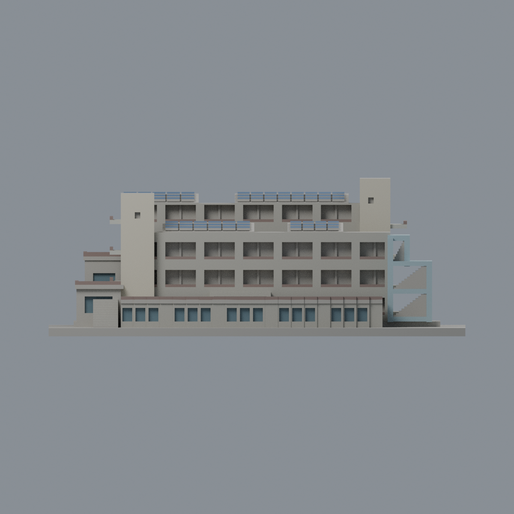
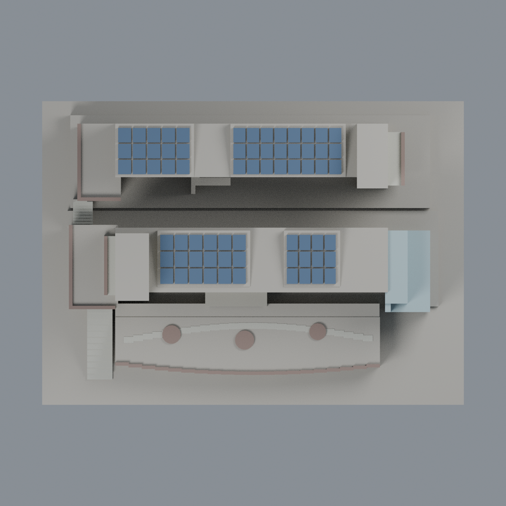

# 聯大八甲 G1／G2／G3 共同教育館舍：八材質外觀版

沿用原 **7,656 三角面／3,816 頂點**，不改原 STL 位元、座標、面序或幾何；這是既有模型外觀改版，不增加模型包數。

| 模型預覽 | 模型預覽 | 模型預覽 |
| :---: | :---: | :---: |
| 正面  | 背面保持中性  |  |
|  |  |  |

[表面色 3MF](nuug-appearance.3mf) · [可編輯 Blender](scene.blend) · [材質色表](palette.json) · [逐面指派與依據](face-materials.json) · [原 STL](../model.stl)

## 來源與配色邊界

親自核對官方 [共同教育館舍相簿](https://secretary.nuu.edu.tw/p/132-1003-1099.php?Lang=zh-tw) 的完整 [照片 11](https://secretary.nuu.edu.tw/var/file/3/1003/gallery/99/1099/gallery_1099_4997708_26562.jpg)、[照片 7](https://secretary.nuu.edu.tw/var/file/3/1003/gallery/99/1099/gallery_1099_6180336_26564.jpg)。EXIF DateTimeOriginal **2025-03-10 14:03:31／13:47:21**，日期與時區未獨立核實，不代表 2026 現況。來源照片不隨包散布。

- 原 G2／G3 正面結構暖灰、兩端塔樓淺奶油色；原 G2 右前錯位梯框採淡藍灰**混凝土色**，不是玻璃。其實牆／框寬等原簡化差異保留。
- G2／G3 大凹背是門、窗、實牆共存的外廊，保持中性，不因原有細柱就整片染玻璃。僅 G1 原前窗與兩處低亭已明確建出的獨立窗凹背灰藍，紅門、標字及實景設備未補畫。
- 原樓梯踏面與曲線低浮雕步道灰色；G1 屋頂平台的實際草坪、白鋪面及橙色活動區界線未由原網格精準分開，**整片平台保持中性，不臆造大片綠地**。原圓盤採褐灰作花台代理，不代表植物已建模。
- 既有實欄帶以褐灰色代理細金屬欄杆，並非透空欄杆復原；下亭的紅磚／灰牆分界沒有相應原面，跨界牆保持中性而非整片紅磚。
- 僅原楔形光電板的真正頂斜面藍灰，底托、屋頂縫及未見區域中性；不把整個屋頂染藍。不加入 E 棟、家具、車輛、樹木或室內。
- 原 STL／面序／座標不變，不增加模型數，不宣稱物理列印成功。

[原幾何與來源限制](../README.zh-TW.md) · [來源覆核](qa/source-review.json)

## 重建與核驗

安裝 [依賴](source/requirements.txt)，Blender 使用 4.3.2。由本資料夾上層提供原 model.stl：

1. `python appearance/source/build_appearance.py`
2. `python appearance/source/verify_exchange.py`
3. `blender -b -t 3 --python-exit-code 1 -P appearance/source/render_appearance.py`
4. `blender -b -t 3 --python-exit-code 1 -P appearance/source/verify_scene.py`

[獨立重建 ZIP](rebuild-source.zip)含原 STL、四支程式及依賴，不含第三方照片；不取代原建模腳本。[逐檔 SHA256](SHA256SUMS)

[交換／拓撲 QA](qa/exchange-validation.json)核對原座標與面序、全部面材質、單連通、有向水密邊、頂點 link 單環、正體積與零退化／重複面；lib3mf 嚴格讀取零警告，實際編輯單材質再存讀，其他材質及面指派不變。SDK 六位小數量化誤差另列。

[Blender 存讀與編輯](qa/scene-validation.json) · [渲染記錄](qa/render-manifest.json) · [獨立重建](qa/rebuild-validation.json)

## 製造限制照舊

尺寸仍為 150 × 108 × 56 mm；原 STL、建模程式、場景及歷史 QA 保留。原層檢與薄特徵檢查本次未重跑，不能由材質 QA 代替。

3MF 是同一網格的表面色，不是八個封閉分色實體、切片專案、噴頭映射或 G-code。切片 GUI、多材料路徑與實體列印未測；柱頭、屋簷、窗框及薄邊仍須評估材料、支撐及拆除風險，沒有保證可印或免支撐。
