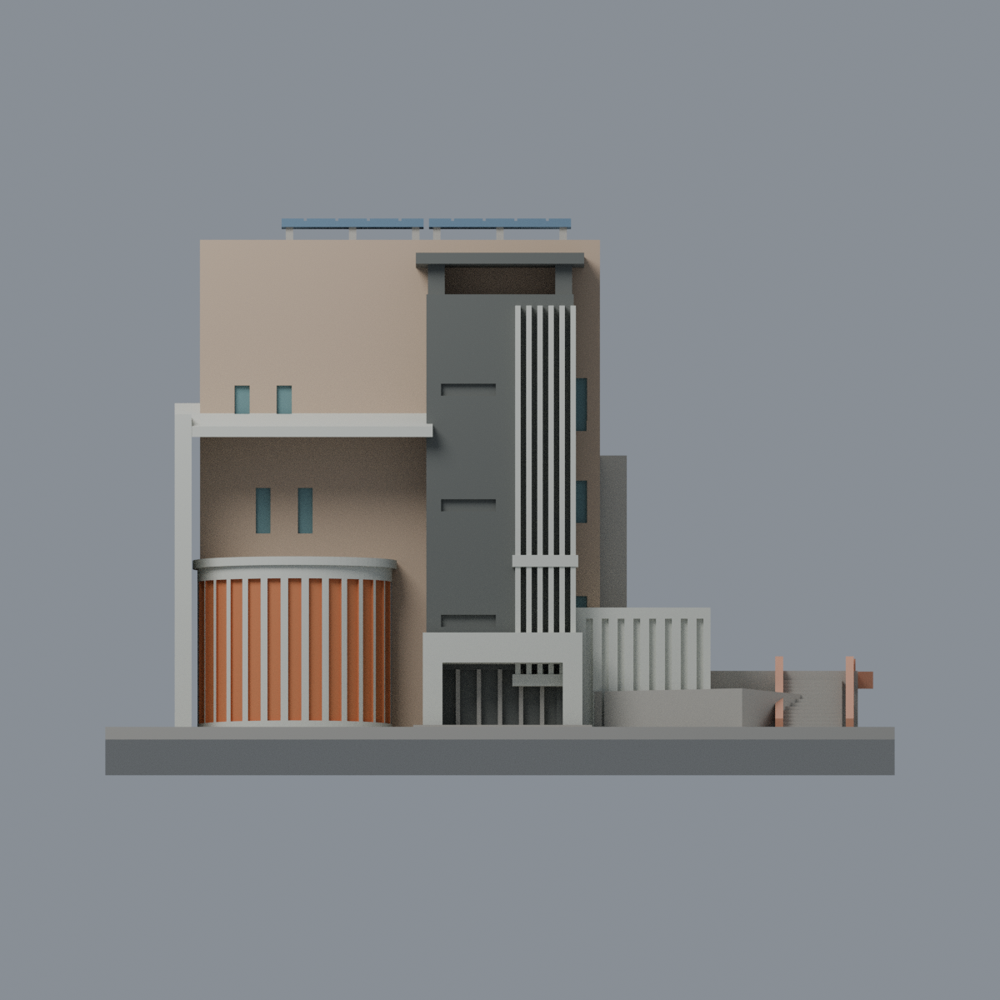
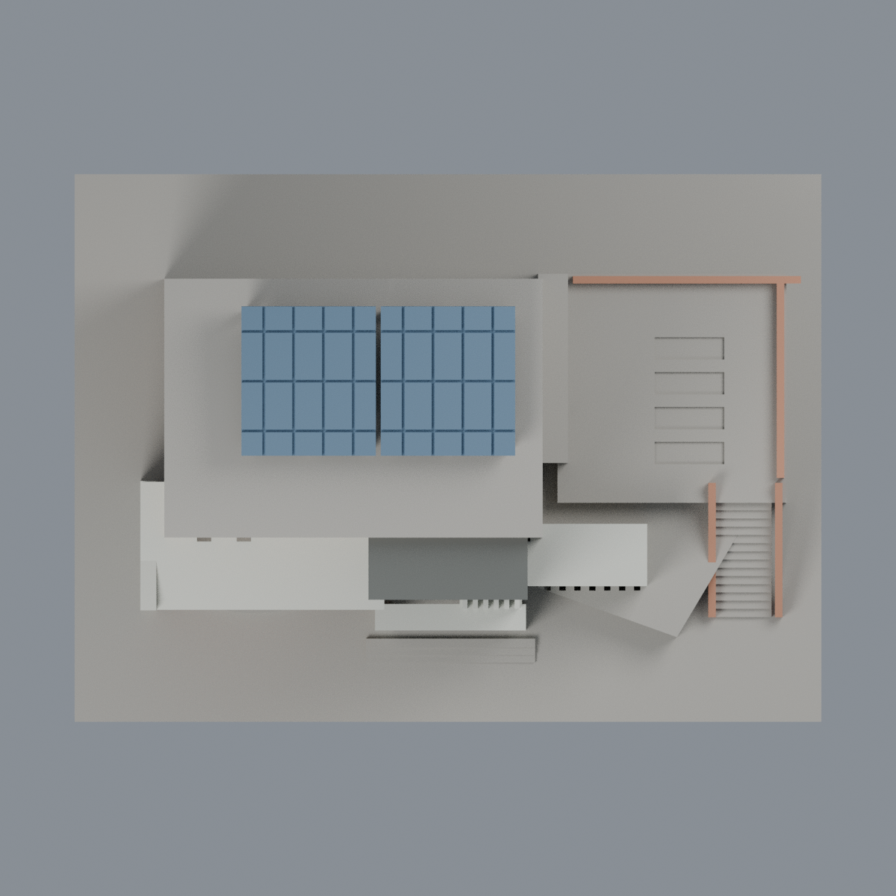

# 聯大八甲 I1 資訊大樓與 R1 會議中心段：八材質外觀版

沿用原 **4,066 三角面／1,979 頂點**，不改原 STL 位元、座標、面序或幾何；這是既有模型外觀改版，不增加模型包數。

| 模型預覽 | 模型預覽 | 模型預覽 |
| :---: | :---: | :---: |
| 正面  | 背面保持中性  |  |
|  |  |  |

[表面色 3MF](nuui1-appearance.3mf) · [可編輯 Blender](scene.blend) · [材質色表](palette.json) · [逐面指派與依據](face-materials.json) · [原 STL](../model.stl)

## 來源與配色邊界

親自核對官方 [相簿](https://secretary.nuu.edu.tw/p/132-1003-1094.php?Lang=zh-tw) 的 [照片 1](https://secretary.nuu.edu.tw/var/file/3/1003/gallery/94/1094/gallery_1094_2357708_25478.jpg)、[照片 3](https://secretary.nuu.edu.tw/var/file/3/1003/gallery/94/1094/gallery_1094_3208178_25479.jpg)。EXIF DateTimeOriginal 分別為 **2025-03-10 14:58:45／15:00:18**，時區與拍攝日期未獨立核實，不聲稱 2026 現況；照片不隨包散布。

- 已見前、左立面淡褐主牆，正面塔樓灰黑馬賽克以單一低彩度代理，不假造逐格拼貼。六條既有長鰭片、左側大框／斜簷、入口門框及右低層屏風採淺色。原空白招牌不加金字。
- 原左前弧形的細長槽遠高於實景小窗，**不染成整面落地玻璃**；保守以橙色背牆與淺色外肋呈現。這不能恢復照片中小窗與玻璃磚分布；實景有窗但本版未重建其精確邊界，不把差異說成還原。
- 只有可登錄的原主樓正面／左側窗槽凹背配低彩度灰青玻璃。上層開廊、塔樓水平孔、入口深凹與右屏風不是整片玻璃，仍是原封實簡化構造，不宣稱透明或室內模型。
- R1 既有外梯側牆與低屋頂欄牆淡磚橘；階梯、走道與原凹帶保持中性，不把所有凹槽當綠化。屋頂只對原兩片光伏棚板配藍色，其他屋頂與設備缺席區中性。
- 未見背面、右側和無法登錄的交界保持中性。L1 國鼎圖書館不在此原模型範圍；不把照片中的鄰棟、植栽、車輛、空調或金字加入模型。
- 原樓層、窗數、量體／階梯比例與 R1 範圍均為照片推估；原 STL／面序／座標不變，不增加模型數，不宣稱物理列印成功。

[原幾何與來源限制](../README.zh-TW.md) · [來源覆核](qa/source-review.json)

## 重建與核驗

安裝 [依賴](source/requirements.txt)，Blender 使用 4.3.2。由本資料夾上層提供原 model.stl：

1. `python appearance/source/build_appearance.py`
2. `python appearance/source/verify_exchange.py`
3. `blender -b -t 3 --python-exit-code 1 -P appearance/source/render_appearance.py`
4. `blender -b -t 3 --python-exit-code 1 -P appearance/source/verify_scene.py`

[獨立重建 ZIP](rebuild-source.zip)含原 STL、四支程式及依賴，不含第三方照片；不取代原建模腳本。[逐檔 SHA256](SHA256SUMS)

[交換／拓撲 QA](qa/exchange-validation.json)核對原座標與面序、全部面材質、單連通、有向水密邊、頂點 link 單環、正體積與零退化／重複面；lib3mf 嚴格讀取零警告，實際編輯單材質再存讀，其他材質及面指派不變。SDK 六位小數量化誤差另列。

[Blender 存讀與編輯](qa/scene-validation.json) · [渲染記錄](qa/render-manifest.json) · [獨立重建](qa/rebuild-validation.json)

## 製造限制照舊

尺寸仍為 150 × 110 × 103.9048 mm；原 STL、建模程式、場景及歷史 QA 保留。原層檢與薄特徵檢查本次未重跑，不能由材質 QA 代替。

3MF 是同一網格的表面色，不是八個封閉分色實體、切片專案、噴頭映射或 G-code。切片 GUI、多材料路徑與實體列印未測；柱頭、屋簷、窗框及薄邊仍須評估材料、支撐及拆除風險，沒有保證可印或免支撐。
