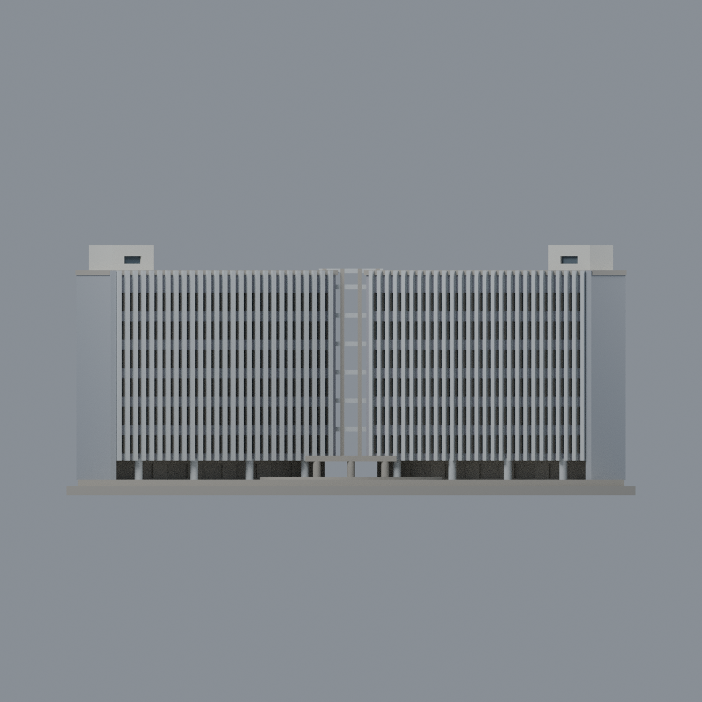
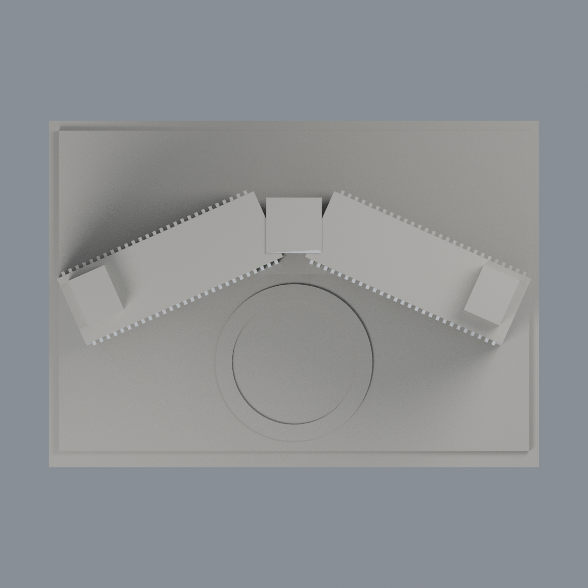

# 聯大八甲 M10／M11 宿舍群：六材質外觀版

沿用原 **28,008 三角面／13,884 頂點**，不改原 STL 位元、座標、面序或幾何；這是既有模型外觀改版，不增加模型包數。

| 正面 | 背牆與主屋頂中性 |
|---|---|
|  |  |
|  |  |

[表面色 3MF](nuum1011-appearance.3mf) · [可編輯 Blender](scene.blend) · [材質色表](palette.json) · [逐面指派與依據](face-materials.json) · [原 STL](../model.stl)

## 來源與配色邊界

親自核對官方 [第十／十一宿舍相簿](https://secretary.nuu.edu.tw/p/132-1003-1118.php?Lang=zh-tw) 的完整照片 10 與 11，精確網址與 SHA256 見 [來源覆核](qa/source-review.json)。EXIF 為 2025-03-10 15:39:37／15:39:44，日期與時區未獨立核實，不代表 2026 現況。兩張是接近角度的正面空拍，**不是獨立背面證據**；其他失敗請求未充作已看來源，照片不隨包散布。

- 僅兩翼正面既有長直肋淺灰白，肋間實牆灰紫；原離散窄窗凹背深灰藍，不把窗下實牆或整片立面染成玻璃。
- 兩外端實牆中灰，前側底層柱淺灰；深架空層仍中性，不把陰影當玻璃。中央原開放連接框架不填滿。
- 屋頂服務量體立面採同體米白的明示有界延伸，並非每一後面都有照片；僅原窗凹代理色，不增加熱水器、桶槽、管線或設備。
- 未見後牆、主屋面與未分割草地／道路／樹穴的底座中性；前庭圓環保留原中性，不把整個基座染綠或添加植栽。
- 原模型中央直線連廊、局部 V 形夾角及等距肋與實景曲線／不等距細節不同，此次不改幾何來配色。不是 M6 老宿舍或旁邊圓餐廳。
- 原 STL、座標、面序與歷史 QA 不變；不宣稱物理列印成功。

[原幾何與歷史來源限制](../README.zh-TW.md)

## 重建與核驗

安裝 [依賴](source/requirements.txt)，Blender 使用 4.3.2。由本資料夾上層提供原 model.stl：

1. `python appearance/source/build_appearance.py`
2. `python appearance/source/verify_exchange.py`
3. `blender -b -t 3 --python-exit-code 1 -P appearance/source/render_appearance.py`
4. `blender -b -t 3 --python-exit-code 1 -P appearance/source/verify_scene.py`

[獨立重建 ZIP](rebuild-source.zip)含原 STL、四支程式及依賴，不含第三方照片；不取代原建模腳本。[逐檔 SHA256](SHA256SUMS)

[交換／拓撲 QA](qa/exchange-validation.json)核對原座標與面序、全部面材質、單連通、有向水密邊、頂點 link 單環、正體積與零退化／重複面；lib3mf 嚴格讀取零警告，實際編輯單材質再存讀，其他材質及面指派不變。SDK 六位小數量化誤差另列。

[Blender 存讀與編輯](qa/scene-validation.json) · [渲染記錄](qa/render-manifest.json) · [獨立重建](qa/rebuild-validation.json)

## 製造限制照舊

尺寸仍為 150 × 106 × 65.9 mm；原 STL、建模程式、場景及歷史 QA 保留。原層檢與薄特徵檢查本次未重跑，不能由材質 QA 代替。

3MF 是同一網格的表面色，不是六個封閉分色實體、切片專案、噴頭映射或 G-code。切片 GUI、多材料路徑與實體列印未測；柱頭、屋簷、窗框及薄邊仍須評估材料、支撐及拆除風險，沒有保證可印或免支撐。
