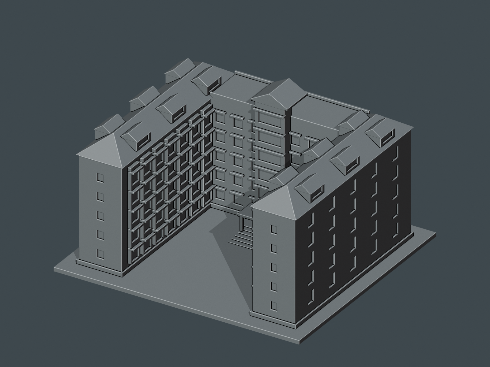

# 國立聯合大學｜八甲 M6 第六宿舍

## 5 材質外觀版（2026-10-21）

| 模型預覽 | 模型預覽 | 模型預覽 |
| :---: | :---: | :---: |
| 正面與來源支持區域  | 背牆中性／屋面同系統推估  |  |

[來源界線與四視角](appearance/README.md) · [表面色 3MF](appearance/nuum6-appearance.3mf) · [可編輯場景](appearance/scene.blend)

依官方照片限定粉褐磚牆、灰窗楣與藍灰瓦頂；未知外側及背牆中性，坡屋頂與屋窗僅同系統材料有界推估，不是光電板。 原 STL 與歷史 QA 不變；這是外觀改善，不是新增幾何。[原單色正面](previews/front.png)／[原單色背面](previews/rear.png)

| 模型預覽 | 模型預覽 | 模型預覽 |
| :---: | :---: | :---: |
| 原單色正面  | 原單色背面  |  |

這是依公開官方外觀照片製作的近似建築微縮模型，供觀賞及 FDM 列印。不是校方工程圖、實測復原或統一校園比例。只含外殼造型，不含房間、住戶、門禁、設備配置或第三方照片。

## 身分與範圍
現行八甲地圖為 M6 第六宿舍，官方相簿可見紅磚 U 形宿舍；校史舊表列 M5 第五男生宿舍。新建工程曾使用「第六宿舍」名稱的 M10/M11 不屬本模型。

## 尺寸與造型
- 最長邊 150 mm，實際 XYZ 尺寸：150.00 × 136.00 × 84.00 mm（含底座）。
- 單一連通、水密外邊界；實體建築量體與底座相連，不是需要拼合的散件。
- 正面朝 -Y、底座 Z=0；STL 本身沒有單位欄位，匯入時選毫米。
- 開放 U 形院落、三段主體
- 兩側斜屋頂與每翼三組老虎窗
- 中軸高出屋面的山牆塔與逐層凸窗

## 估計與簡化
- 後牆及部分外側窗列被樹木遮擋，使用低細節近似，未把照片之外的細部當作實測。
- 屋瓦未逐片建模；老虎窗與窗楣加粗以利列印。
- 同相簿的圓廳是另外一棟，完全不包含於此模型。

所有模型的尺寸、深度、窗距與屋頂高差皆依外觀比例估計，並無量測尺度。簡化背面以 rear.png 可直接檢視。預覽色彩只屬材質；STL 不含色彩或貼圖。

## 列印建議
- 底座平放；建議 0.4 mm 噴嘴、0.16–0.20 mm 層高、3 道外牆、10–18% 填充。
- 最小特徵：主底板 2.4 mm；窗楣 1.0–1.1 mm；門廊柱 1.5 mm；山牆與斜屋面採實心。
- 支撐：屋頂為實體斜屋面，無封閉內腔；小窗楣懸出約 1.5 mm。入口 14 mm 深小雨棚建議局部支撐，院落保持開放。
- 此為 150 mm 獨立微縮件，不建議等比縮小至 100 mm 以下；細節會低於常見噴嘴的可靠表現。
- 實心在此指封閉可切片的量體，不要求 100% 填充。未進行實體試印或切片器驗證；請自行檢查支撐、首層與機台公差。

## 隨附檔案與重建
- model.stl：毫米列印網格
- scene.blend：可編輯 Blender 網格、材質、相機；模型為實際 STL 匯入，非額外裝飾版
- build_model.py：原始參數化造型程式；所有可列印幾何可由此重建
- render_preview.py：由 STL 直接渲染 front.png / rear.png，並儲存 Blender 場景
- requirements.txt：Python 依賴版本
- validate_model.py、validation.json：原始 STL 法向、邊、頂點連結、水密性、連通數、內腔殼等檢查
- rebuild-check.json：再次重建後的 SHA-256 一致性
- blender-geometry-check.json：STL 與 Blender 全部三角面座標一致性
- evidence.json：完整外觀圖說、網址、身份和估計說明
- SHA256SUMS：所有公開檔案雜湊

在獨立 Python 環境執行：

    pip install -r requirements.txt
    python build_model.py
    python validate_model.py model.stl --output validation.json
    blender -b -t 4 -P render_preview.py

建議 Blender 4.x。Python 使用 numpy、trimesh、manifold3d、scipy。重建不依賴原作者資料夾或網路照片。數位檢查通過並不等於實體試印成功。

## 公開來源
查核日：2026-10-11。照片版權歸原權利人；本包不重製參考照片。
- 現行校園地圖與代碼：https://www.nuu.edu.tw/p/426-1000-9.php?Lang=zh-tw
- 官方外觀相簿：https://secretary.nuu.edu.tw/p/132-1003-1116.php?Lang=zh-tw
- 歷史名稱／建物清冊（歷史資料）：https://nuuarchives.nuu.edu.tw/p/16-1097-27990.php?Lang=zh-tw
