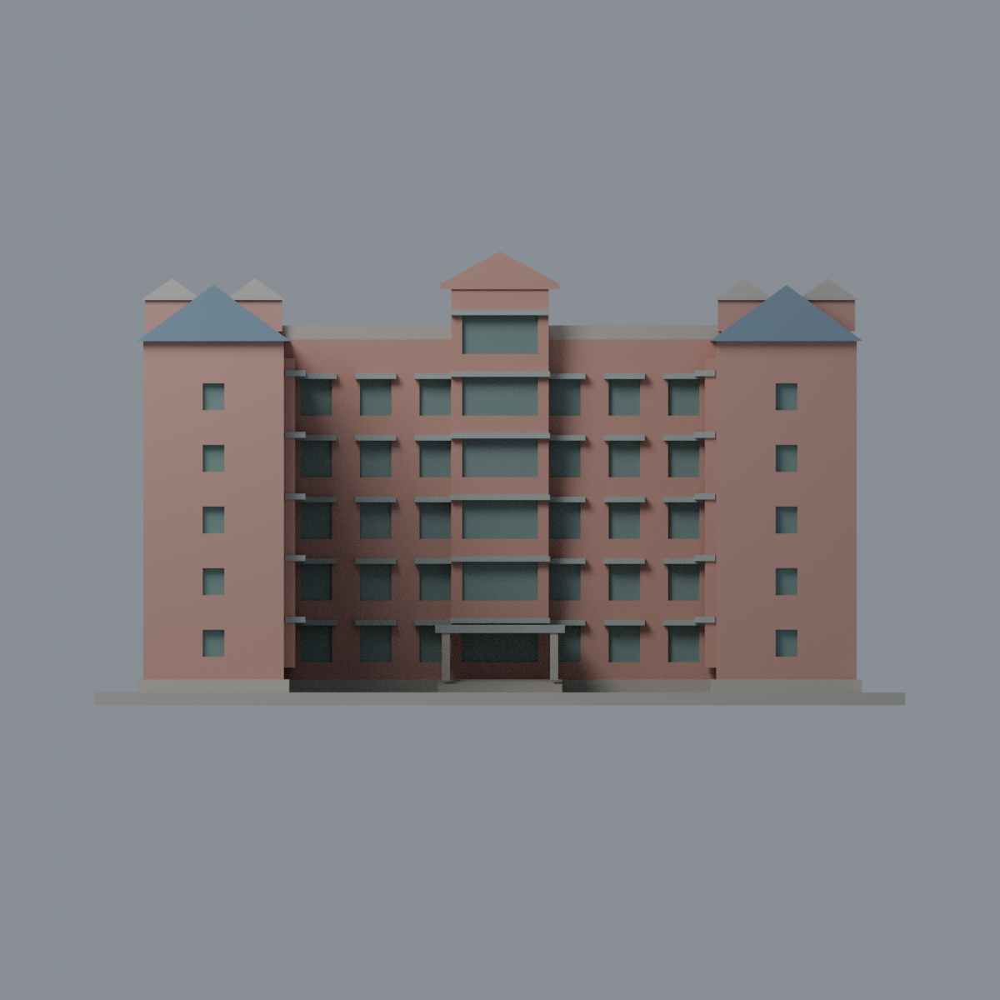
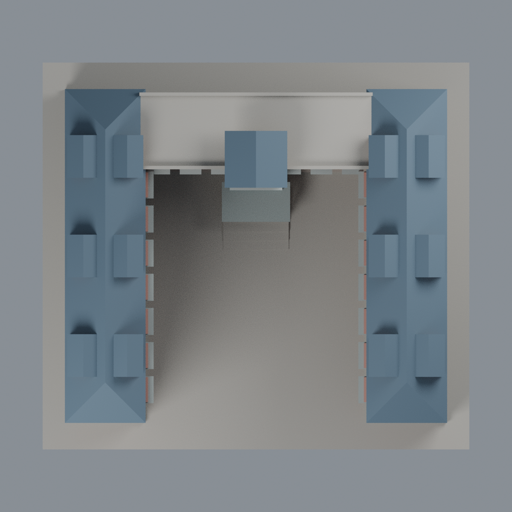

# 聯大八甲 M6 第六宿舍：五材質外觀版

沿用原 **7,000 三角面／3,476 頂點**，不改原 STL 位元、座標、面序或幾何；這是既有模型外觀改版，不增加模型包數。

| 正面 | 背牆中性／瓦頂同系統推估 |
|---|---|
|  |  |
|  |  |

[表面色 3MF](nuum6-appearance.3mf) · [可編輯 Blender](scene.blend) · [材質色表](palette.json) · [逐面指派與依據](face-materials.json) · [原 STL](../model.stl)

## 來源與配色邊界

親自核對官方 [第六宿舍相簿](https://secretary.nuu.edu.tw/p/132-1003-1116.php?Lang=zh-tw) 的[照片 1](https://secretary.nuu.edu.tw/var/file/3/1003/gallery/16/1116/gallery_1116_293635_95851.jpg)與[照片 3](https://secretary.nuu.edu.tw/var/file/3/1003/gallery/16/1116/gallery_1116_1013628_95852.jpg)完整影像。EXIF 分別為 2025-03-10 15:37:24／15:37:09；日期與時區未獨立核實，非 2026 現況證明。照片 2 請求失敗未列為已覆核來源。這是原資料所識別的 M6 U 形第六宿舍，不是 M10/M11 新宿舍，也不含獨立圓廳。來源照片不隨包散布。

- U 形內院牆、兩端正面及中央凸塔的可確認部分淡磚紅；原內側凸窗量體的實牆仍磚紅，不把整個凸塊都染玻璃。
- 既有窗楣／逐層厚凸帶灰色，只有原離散窗凹背灰綠；原模型未做完整鋁窗格、空調或磚紋，本次不補幾何／貼圖。
- 兩翼、老虎窗及中央山牆的斜屋面藍灰瓦色，**不是 PV**。同一屋頂系統未直接可見的部分與老虎窗小側面，材質延伸屬明示有界推估，不代表每一片面都有單獨照片證據。
- 中央後方平屋頂與未充分配準的外長側／背牆中性／瓦頂同系統推估，沒有把外窗全部對稱還原。原內院底座未分草地、步道及樹穴，不把整個底座染綠。
- 不添加天線、住戶資訊、樹木、車輛或圓廳。原 STL／面序／座標不變，不增加模型數，不宣稱物理列印成功。

[原幾何與歷史來源限制](../README.zh-TW.md) · [來源覆核](qa/source-review.json)

## 重建與核驗

安裝 [依賴](source/requirements.txt)，Blender 使用 4.3.2。由本資料夾上層提供原 model.stl：

1. `python appearance/source/build_appearance.py`
2. `python appearance/source/verify_exchange.py`
3. `blender -b -t 3 --python-exit-code 1 -P appearance/source/render_appearance.py`
4. `blender -b -t 3 --python-exit-code 1 -P appearance/source/verify_scene.py`

[獨立重建 ZIP](rebuild-source.zip)含原 STL、四支程式及依賴，不含第三方照片；不取代原建模腳本。[逐檔 SHA256](SHA256SUMS)

[交換／拓撲 QA](qa/exchange-validation.json)核對原座標與面序、全部面材質、單連通、有向水密邊、頂點 link 單環、正體積與零退化／重複面；lib3mf 嚴格讀取零警告，實際編輯單材質再存讀，其他材質及面指派不變。SDK 六位小數量化誤差另列。

[Blender 存讀與編輯](qa/scene-validation.json) · [渲染記錄](qa/render-manifest.json) · [獨立重建](qa/rebuild-validation.json)

## 製造限制照舊

尺寸仍為 150 × 136 × 84 mm；原 STL、建模程式、場景及歷史 QA 保留。原層檢與薄特徵檢查本次未重跑，不能由材質 QA 代替。

3MF 是同一網格的表面色，不是五個封閉分色實體、切片專案、噴頭映射或 G-code。切片 GUI、多材料路徑與實體列印未測；柱頭、屋簷、窗框及薄邊仍須評估材料、支撐及拆除風險，沒有保證可印或免支撐。
