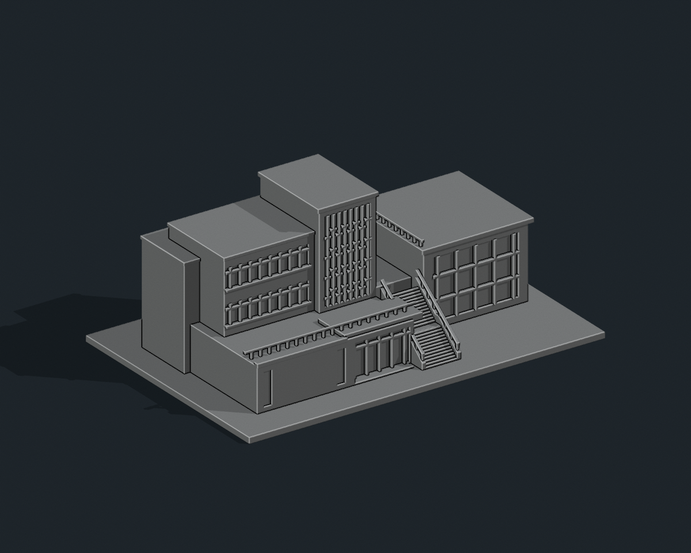

# 國立聯合大學 Q1 藝文教學中心（藝術中心）

## 模型預覽

| 模型預覽 | 模型預覽 | 模型預覽 |
| :---: | :---: | :---: |
| 正面與來源支持區域<br> | 未見外側背面中性<br> |  |

## 八材質外觀版（2026-10-20）


[來源界線與四視角](appearance/README.md) · [表面色 3MF](appearance/nuuq1-appearance.3mf) · [可編輯場景](appearance/scene.blend)

已見正面淡赭牆、冷灰塔框、原凹窗灰藍玻璃、深灰窗梃與灰紅褐欄杆。右廳僅據未定年歷史航照作有限代理，不冒稱現況；後側與屋頂中性，不添文字或壁畫。 原 STL 與歷史 QA 不變；這是外觀改善，不是新增幾何。[原單色正面](previews/front.png)／[原單色背面](previews/rear.png)


依官方外觀照片製作的獨立建築縮印模型，含底座 **150 × 100 × 61 mm**。照片比例詮釋，未實測，不是與其他館舍共同比例的校園模型。STL 單位為毫米且無顏色；預覽單色只是材質。

## 建物範圍與照片判讀

現行八甲校園圖將這一組藝文建築標為 Q1。官方入口相簿與校史完工空拍互核，模型包含左側教學量體、中央高玻璃塔、低層連接段、右側平頂展演廳及入口外梯，合為一個連通列印單元。不把藝術中心、蓮荷藝文空間、內部文物展示或研究中心名稱另算建物；不含後方 D1／D2 客家學院。

完整核對相簿 (1)–(5)，其中 (1)、(2) 是入口正斜面，(3)、(4)、(5) 是招牌／階梯細節，不能單憑它們推測完整全棟。另檢視官方校史的 06image051.jpg 完工空拍，才確立左高右低的全棟輪廓與低層連接。保留中央高玻璃框及錯列橫框、左長窗帶、低層玻璃入口、露台前帶、兩段外梯和右側平頂玻璃展演廳。

總尺寸、進深、樓層標高、被遮住的門窗、階梯踏步數及展演廳窗格為照片估計。空拍解析度有限，未見背面採無窗簡化牆與平屋頂，不鏡射入口。照片牆面的陶藝裝飾、字牌、植栽和室內展品省略；屋頂與外梯欄杆已加粗。

所有玻璃窗皆以有實心背襯的淺凹窗表示，不含室內格局、設備與安防配置。未附第三方參考照片。

## 預覽與交付

| 模型預覽 | 模型預覽 | 模型預覽 |
| :---: | :---: | :---: |
|  |  |  |

- `model.stl`：單一連通封閉實體
- `build_model.py`：可攜式完整幾何原始碼
- `scene.blend`：可編輯 STL 網格、攝影機、燈光與嵌入原始碼
- `previews/front.png`、`rear.png`、`elevation.png`：最終實際 STL 的完整取景
- `validation.json`：原 STL 法向、邊／頂點連結、封閉性、連通體、無獨立內腔殼、尺寸與平底檢查
- `rebuild_check.json`：乾淨資料夾重建後的相同 STL SHA-256
- `scene_check.json`：Blender/STL 逐三角形座標至 0.00001 mm 比對與嵌入原始碼比對
- `evidence.json`、`manifest.json`、`SHA256SUMS`：來源、範圍及交付雜湊

## 列印建議

底座平放，匯入選毫米。可從 0.4 mm 噴嘴、0.16–0.20 mm 層高、3 圈外牆與 10–15% 填充開始調整。

底座厚 2.4 mm；高玻璃窗格 0.75 mm、其他窗格 0.85–0.95 mm；露台欄杆約 0.95–1 mm、樓梯扶手寬 1.2 mm、扶手柱約 0.9 mm、實心階梯側牆厚 1.5 mm、屋簷厚約 1.6–2 mm。扶手與露台細欄脆弱；入口門額、扶手局部跨距、右廳屋簷需切片檢查支撐。外梯底部採實心加固，不宣稱為完整結構複製。

已完成數位網格、原始碼重建與 Blender 幾何一致性檢查，未做實體試印或切片器驗證。局部細節依材料、機器與切片策略調整；不建議直接大幅縮小。

## 重新生成

```sh
python -m pip install -r requirements.txt
python build_model.py
python validate_model.py model.stl --longest-edge 150 --output validation.json
python verify_rebuild.py
blender -b -t 4 -P render_preview.py
blender -b -t 2 -P verify_scene.py
```

Python 從自身資料夾讀寫，不依賴原製作環境路徑或照片。Blender 4.3 或較新版可用。重建會覆寫同名檔案；修改前先備份。

模型三角面數：4,300。STL SHA-256：`4728cfad77601086a6b032a7d6da06535ba29e2134a37e0c9f3d322f3d0bac46`。

## 公開來源

查核日期：2026-10-11。

- [現行八甲校園圖：Q1 藝文中心位置](https://www.nuu.edu.tw/p/426-1000-9.php?Lang=zh-tw)
- [官方藝術中心外觀相簿，照片 (1)–(5)](https://secretary.nuu.edu.tw/p/132-1003-1123.php?Lang=zh-tw)
- [官方校史：藝文教學中心完工說明及空拍](https://nuuarchives.nuu.edu.tw/p/16-1097-27990.php?Lang=zh-tw)
- [官方完工空拍原圖：近景 Q1 全棟](https://nuuarchives.nuu.edu.tw/var/file/97/1097/img/828/06image051.jpg)
- [官方藝術中心首頁](https://art.nuu.edu.tw/index.php)
