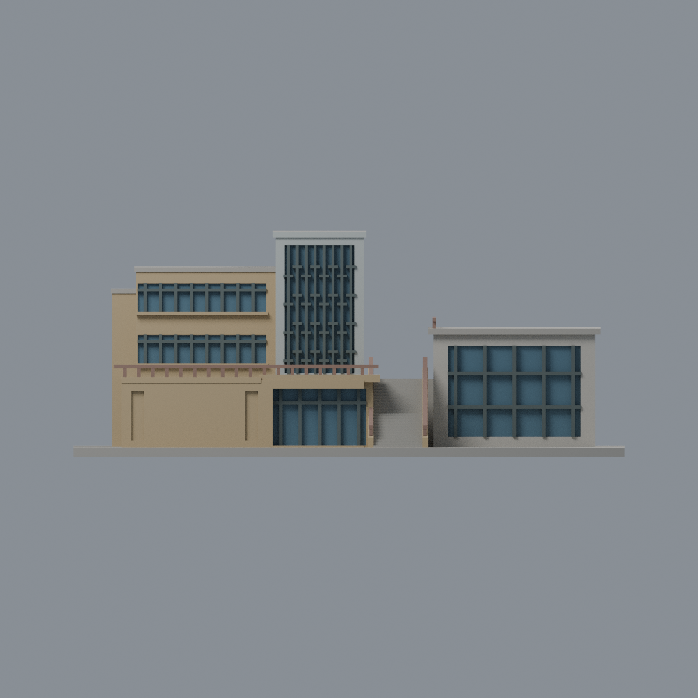
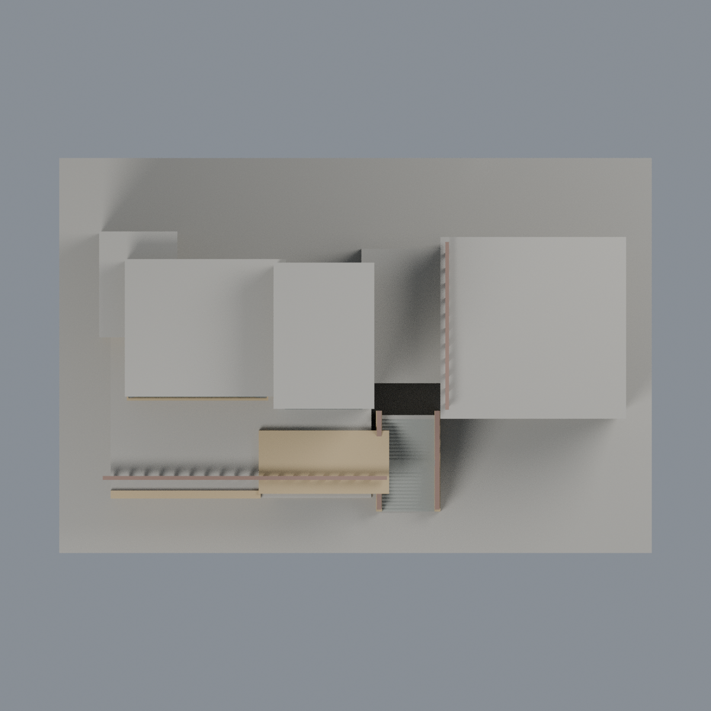

# 聯大八甲 Q1 藝文教學中心：八材質外觀版

沿用原 **4,300 三角面／2,100 頂點**，不改原 STL 位元、座標、面序或幾何；這是既有模型外觀改版，不增加模型包數。

| 模型預覽 | 模型預覽 | 模型預覽 |
| :---: | :---: | :---: |
| 正面  | 背面保持中性  |  |
|  |  |  |

[表面色 3MF](nuuq1-appearance.3mf) · [可編輯 Blender](scene.blend) · [材質色表](palette.json) · [逐面指派與依據](face-materials.json) · [原 STL](../model.stl)

## 來源與配色邊界

親自核對官方 [藝文教學中心相簿](https://secretary.nuu.edu.tw/p/132-1003-1123.php?Lang=zh-tw) 的 [照片 1](https://secretary.nuu.edu.tw/var/file/3/1003/gallery/23/1123/gallery_1123_337665_71876.jpg)、[照片 2](https://secretary.nuu.edu.tw/var/file/3/1003/gallery/23/1123/gallery_1123_5642611_71877.jpg)，以及 [官方校史航照](https://nuuarchives.nuu.edu.tw/var/file/97/1097/img/828/06image051.jpg)。近照 EXIF DateTimeOriginal **2025-02-25 12:17:55／12:18:20**；航照無可確認拍攝日，是歷史環境佐證，不是 2026 現況。EXIF 日期與時區未獨立核實；照片不隨包散布。

- 已見正面主牆、露台腰帶與入口門楣淡赭色；高玻璃塔的正面框與上緣冷淺灰。樓層間實牆不是玻璃，不添加原模型沒有的馬賽克壁畫、金屬字、裝飾、雨痕或設備。
- 只對原塔窗、左翼橫窗、下入口的凹背配低彩度灰藍玻璃，既有錯列窗梃深灰。原樓層與窗梃間距為近似，不能靠配色補正；凹背仍封實，不宣稱透明室內。
- 右側廳舍的淺色正面與深窗基於**未定年歷史航照**的有限配色代理，非以近照看不到的部分冒稱當下實景。原估計窗格數保留，未見屋頂／背面中性。
- 原露台、外梯及右廳側邊的加厚欄杆採灰紅褐色；踏面灰色、實梯側牆淡赭色。欄杆與實景不完全等比例，這不是無障礙尺寸或列印安全承諾。
- 未見外側背面、屋頂及不能登錄的交界中性；不加入後方 D1／D2 等鄰棟。原 STL／面序／座標不變，不增加模型數，不宣稱物理列印成功。

[原幾何與來源限制](../README.zh-TW.md) · [來源覆核](qa/source-review.json)

## 重建與核驗

安裝 [依賴](source/requirements.txt)，Blender 使用 4.3.2。由本資料夾上層提供原 model.stl：

1. `python appearance/source/build_appearance.py`
2. `python appearance/source/verify_exchange.py`
3. `blender -b -t 3 --python-exit-code 1 -P appearance/source/render_appearance.py`
4. `blender -b -t 3 --python-exit-code 1 -P appearance/source/verify_scene.py`

[獨立重建 ZIP](rebuild-source.zip)含原 STL、四支程式及依賴，不含第三方照片；不取代原建模腳本。[逐檔 SHA256](SHA256SUMS)

[交換／拓撲 QA](qa/exchange-validation.json)核對原座標與面序、全部面材質、單連通、有向水密邊、頂點 link 單環、正體積與零退化／重複面；lib3mf 嚴格讀取零警告，實際編輯單材質再存讀，其他材質及面指派不變。SDK 六位小數量化誤差另列。

[Blender 存讀與編輯](qa/scene-validation.json) · [渲染記錄](qa/render-manifest.json) · [獨立重建](qa/rebuild-validation.json)

## 製造限制照舊

尺寸仍為 150 × 100 × 61 mm；原 STL、建模程式、場景及歷史 QA 保留。原層檢與薄特徵檢查本次未重跑，不能由材質 QA 代替。

3MF 是同一網格的表面色，不是八個封閉分色實體、切片專案、噴頭映射或 G-code。切片 GUI、多材料路徑與實體列印未測；柱頭、屋簷、窗框及薄邊仍須評估材料、支撐及拆除風險，沒有保證可印或免支撐。
