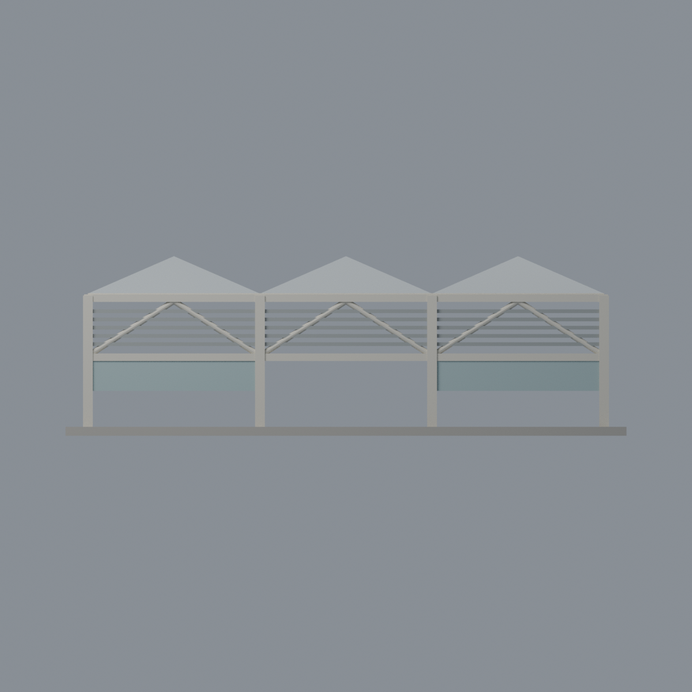
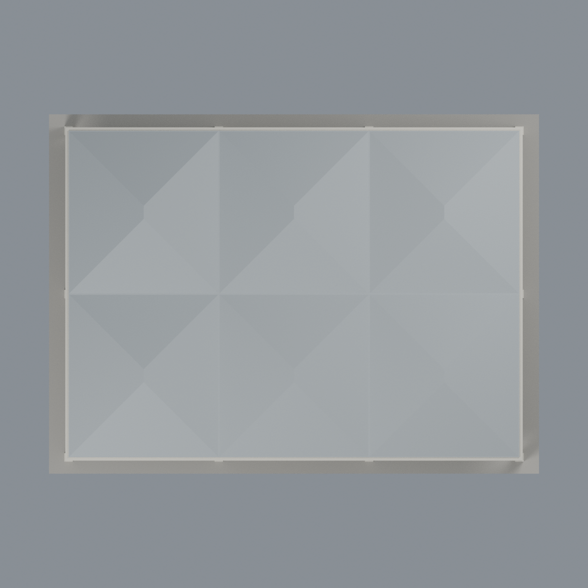

# 聯大八甲 S2 風雨球場：五材質外觀版

沿用原 **9,094 三角面／4,167 頂點**，不改原 STL 位元、座標、面序或幾何；這是既有模型外觀改版，不增加模型包數。

| 模型預覽 | 模型預覽 | 模型預覽 |
| :---: | :---: | :---: |
| 正面  | 同構背側材質有界推估  |  |
|  |  |  |

[表面色 3MF](nuus2-appearance.3mf) · [可編輯 Blender](scene.blend) · [材質色表](palette.json) · [逐面指派與依據](face-materials.json) · [原 STL](../model.stl)

## 來源與配色邊界

親自核對官方 [S2 風雨球場相簿](https://secretary.nuu.edu.tw/p/132-1003-1093.php?Lang=zh-tw) 的四張完整照片：內部 [1](https://secretary.nuu.edu.tw/var/file/3/1003/gallery/93/1093/gallery_1093_334880_25344.jpg)、[2](https://secretary.nuu.edu.tw/var/file/3/1003/gallery/93/1093/gallery_1093_112920_25344.jpg)，高空外觀 [3](https://secretary.nuu.edu.tw/var/file/3/1003/gallery/93/1093/gallery_1093_8955361_25344.jpg)、[4](https://secretary.nuu.edu.tw/var/file/3/1003/gallery/93/1093/gallery_1093_5016727_25344.jpg)。EXIF 分別為 2025-03-10 15:54:08、2025-02-25 15:18:59、2025-03-10 15:30:47、2025-03-10 15:50:15；時區和拍攝日期未獨立核實，不代表 2026 現況。來源照片不隨包散布。

- 六個原始簡化四坡模組採銀灰金屬色，**不是太陽能板**。實景有淺色透光片，但原三角面沒有相應邊界，故不硬染白斑、不增加切面。原屋脊比例與實景不同，這不是重新建模修正。
- 原柱、橫梁與斜撐象牙白，原百葉灰色，低處既有屏板淡藍灰。材料延伸至同構的其他側面屬**同系統材質的有界推估**，不聲稱每個背面部件都有直接照片證據。
- 原柱沒有分出藍色護套的高度邊界，整柱維持象牙白；不將整根柱染藍。底座沒有分出多色球場線／球場面域，保持中性，不增添球具、標字或圖形。
- 原屋下有實心薄板，保留原幾何，不假稱看穿屋板或逐根真實鋼桁架。屏板使用不透明代理色，不宣稱玻璃或透明物理性質。
- 原 STL／面序／座標不變，不增加模型數，不宣稱物理列印成功。

[原幾何與來源限制](../README.zh-TW.md) · [來源覆核](qa/source-review.json)

## 重建與核驗

安裝 [依賴](source/requirements.txt)，Blender 使用 4.3.2。由本資料夾上層提供原 model.stl：

1. `python appearance/source/build_appearance.py`
2. `python appearance/source/verify_exchange.py`
3. `blender -b -t 3 --python-exit-code 1 -P appearance/source/render_appearance.py`
4. `blender -b -t 3 --python-exit-code 1 -P appearance/source/verify_scene.py`

[獨立重建 ZIP](rebuild-source.zip)含原 STL、四支程式及依賴，不含第三方照片；不取代原建模腳本。[逐檔 SHA256](SHA256SUMS)

[交換／拓撲 QA](qa/exchange-validation.json)核對原座標與面序、全部面材質、單連通、有向水密邊、頂點 link 單環、正體積與零退化／重複面；lib3mf 嚴格讀取零警告，實際編輯單材質再存讀，其他材質及面指派不變。SDK 六位小數量化誤差另列。

[Blender 存讀與編輯](qa/scene-validation.json) · [渲染記錄](qa/render-manifest.json) · [獨立重建](qa/rebuild-validation.json)

## 製造限制照舊

尺寸仍為 150 × 110 × 48 mm；原 STL、建模程式、場景及歷史 QA 保留。原層檢與薄特徵檢查本次未重跑，不能由材質 QA 代替。

3MF 是同一網格的表面色，不是五個封閉分色實體、切片專案、噴頭映射或 G-code。切片 GUI、多材料路徑與實體列印未測；柱頭、屋簷、窗框及薄邊仍須評估材料、支撐及拆除風險，沒有保證可印或免支撐。
