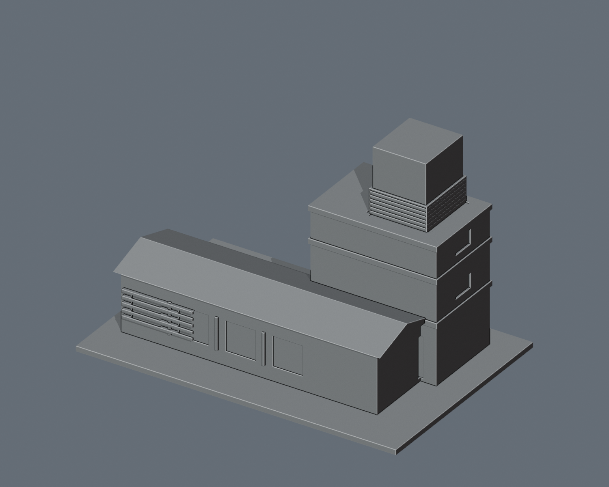
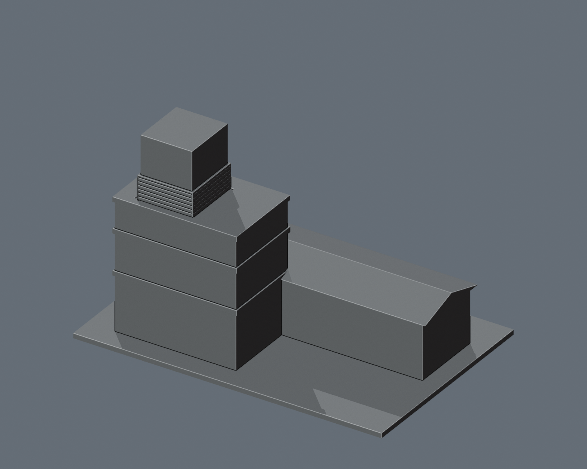

# 國立聯合大學 八甲機電中心

## 模型預覽

| 模型預覽 | 模型預覽 | 模型預覽 |
| :---: | :---: | :---: |
| 正面與來源支持區域  | 未見外側背面中性  |  |

## 6 材質外觀版（2026-10-21）

[來源界線與四視角](appearance/README.md) · [表面色 3MF](appearance/nuut2-appearance.3mf) · [可編輯場景](appearance/scene.blend)

依官方照片限定低棟前坡瓦紅、塔樓紫灰牆與奶油橫帶、灰百葉及橘色上部；未分面的低棟牆與未知背面維持中性，不把四個簡化凹口都當玻璃。 原 STL 與歷史 QA 不變；這是外觀改善，不是新增幾何。[原單色正面](previews/front.png)／[原單色背面](previews/rear.png)

| 模型預覽 | 模型預覽 | 模型預覽 |
| :---: | :---: | :---: |
| 原單色正面  | 原單色背面  |  |

依官方外觀照片製作的近似列印模型。最長邊獨立設定150 mm，並非全校統一縮尺或實測模型。正面朝-Y。只建外觀，不建內部配置。

## 外形與來源
低層紅瓦坡頂長翼、後方不對稱高塔、淺色水平帶、頂端立方體與百葉環帶。

官方相簿：https://secretary.nuu.edu.tw/p/132-1003-1120.php?Lang=zh-tw

完整照片標題與原圖來源見evidence.json。照片只用於研究，未收入交付檔。預覽直接渲染實際STL；顏色為材質，STL無顏色。

## 證據限制
只建相簿明確標示的機電中心外觀。不加入V2餐廳；24.13平方公尺機械房的位置與歸屬仍無證據，不新增獨立模型。背側未見立面簡化。
所有長寬高、深度與樓層比例均為照片估計，未見部分不視為可靠復原；相簿發布／拍攝年代不等於2026現況。

## 列印
實體低坡屋頂可無大面積支撐；屋簷約2 mm。百葉凹槽0.8 mm，浮雕橫條1.2 mm。
建議0.4 mm噴嘴、0.16–0.20 mm層高、底座平放、先在切片器檢查支撐與橋接。布林合併為單一封閉連通實體，保留外露孔洞／廊道。不含封閉內腔殼。未做實際列印或切片驗證。

## 內容與重建
- build_model.py：原創參數化外觀來源，Python 3.11+
- model.stl：毫米單位可列印網格
- scene.blend：與STL一致的可編輯網格場景（另含攝影棚地面）
- previews/front.png、rear.png：實際STL全幅前後視圖
- validate_model.py、validation.json：原始法線、邊、頂點連結、連通與尺寸檢查
- rebuild-check.json、blender-stl-agreement.json、SHA256SUMS：重建與交付核對

安裝requirements.txt後執行python build_model.py；再執行python validate_model.py model.stl --longest-edge 150 --output validation.json。Blender 4.3.2執行blender -b -t 2 -P render_preview.py可重建預覽與場景。

## 實際模型尺寸
150.0 × 100.0 × 96.8 mm（X × Y × Z，含底座）。
