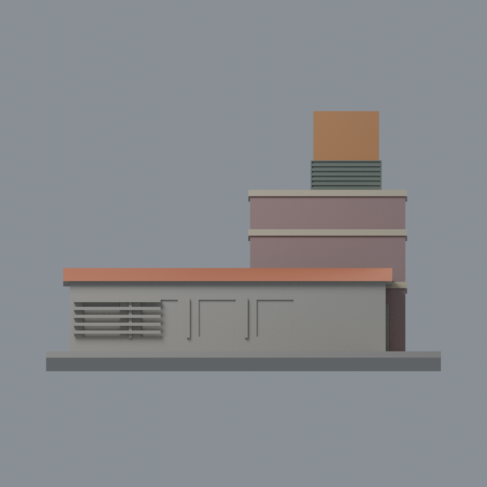
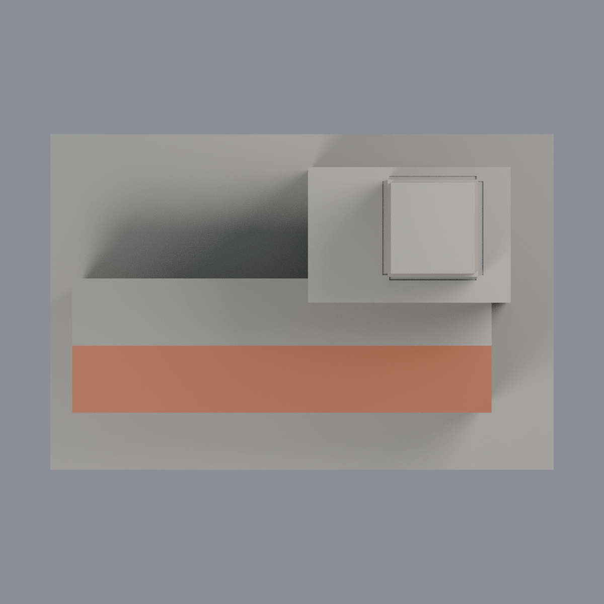

# 聯大八甲 T2 機電中心：六材質外觀版

沿用原 **1,116 三角面／560 頂點**，不改原 STL 位元、座標、面序或幾何；這是既有模型外觀改版，不增加模型包數。

| 模型預覽 | 模型預覽 | 模型預覽 |
| :---: | :---: | :---: |
| 正面  | 背面保持中性  |  |
|  |  |  |

[表面色 3MF](nuut2-appearance.3mf) · [可編輯 Blender](scene.blend) · [材質色表](palette.json) · [逐面指派與依據](face-materials.json) · [原 STL](../model.stl)

## 來源與配色邊界

親自核對官方 [V2／機電中心相簿](https://secretary.nuu.edu.tw/p/132-1003-1120.php?Lang=zh-tw) 中完整 [機電中心照片](https://secretary.nuu.edu.tw/var/file/3/1003/gallery/20/1120/gallery_1120_9652008_97550.jpg)，不是將左側 V2 餐廳混作 T2。EXIF DateTimeOriginal **2025-03-10 15:44:19**，日期與時區未獨立核實，不代表 2026 現況。來源照片不隨包散布。

- 原塔樓前／右面紫灰磚色，已有三條凸橫帶奶油色；百葉圈前／右面灰綠，頂部方塊前／右面橘褐。不補校徽、文字或新百葉細節。
- 只對**直接可見的長屋前坡**採瓦紅，屋頂背坡及未見上表面中性；不推估背面同色，不加瓦片幾何。
- 長低棟實景上沿有奶油帶，但原前牆未分這條材質邊界，整面保守中性，不讓原三角面出現虛構斜切色塊。這不是整棟配色完整還原。
- 原四個正面凹口不能對應為四片玻璃；照片左段是實牆／外架，故這些凹背及不確定窗洞保持中性，不臆造玻璃或門。原左外架加厚浮雕也不假造實景綠褐條紋。
- 未見背面、左端與屋頂上面保持中性；不加前景樹、車輛、空調或鄰棟。原 STL／面序／座標不變，不增加模型數，不宣稱物理列印成功。

[原幾何與來源限制](../README.zh-TW.md) · [來源覆核](qa/source-review.json)

## 重建與核驗

安裝 [依賴](source/requirements.txt)，Blender 使用 4.3.2。由本資料夾上層提供原 model.stl：

1. `python appearance/source/build_appearance.py`
2. `python appearance/source/verify_exchange.py`
3. `blender -b -t 3 --python-exit-code 1 -P appearance/source/render_appearance.py`
4. `blender -b -t 3 --python-exit-code 1 -P appearance/source/verify_scene.py`

[獨立重建 ZIP](rebuild-source.zip)含原 STL、四支程式及依賴，不含第三方照片；不取代原建模腳本。[逐檔 SHA256](SHA256SUMS)

[交換／拓撲 QA](qa/exchange-validation.json)核對原座標與面序、全部面材質、單連通、有向水密邊、頂點 link 單環、正體積與零退化／重複面；lib3mf 嚴格讀取零警告，實際編輯單材質再存讀，其他材質及面指派不變。SDK 六位小數量化誤差另列。

[Blender 存讀與編輯](qa/scene-validation.json) · [渲染記錄](qa/render-manifest.json) · [獨立重建](qa/rebuild-validation.json)

## 製造限制照舊

尺寸仍為 150 × 100 × 96.8 mm；原 STL、建模程式、場景及歷史 QA 保留。原層檢與薄特徵檢查本次未重跑，不能由材質 QA 代替。

3MF 是同一網格的表面色，不是六個封閉分色實體、切片專案、噴頭映射或 G-code。切片 GUI、多材料路徑與實體列印未測；柱頭、屋簷、窗框及薄邊仍須評估材料、支撐及拆除風險，沒有保證可印或免支撐。
