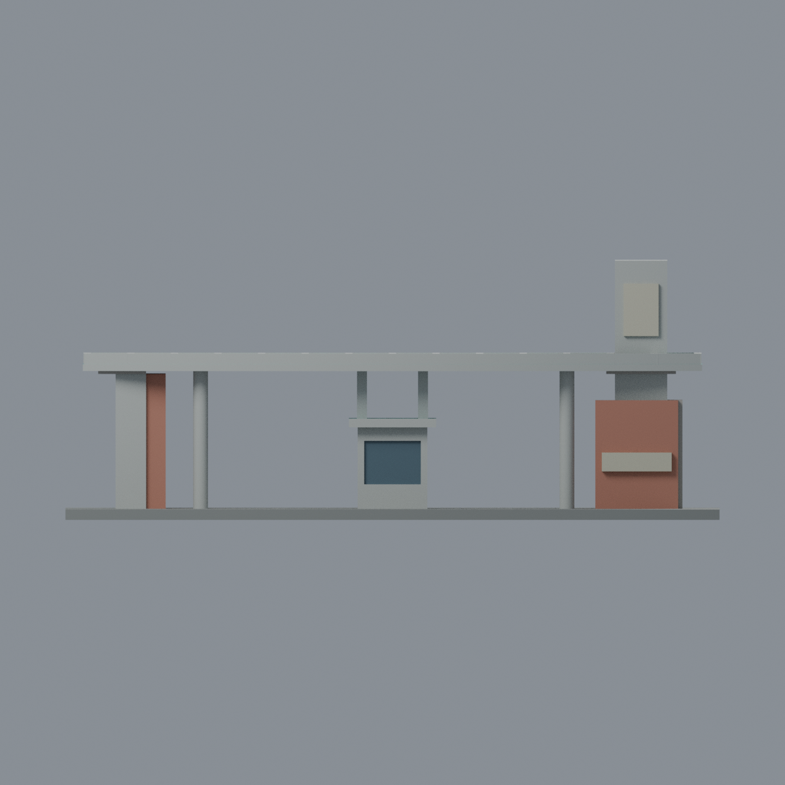
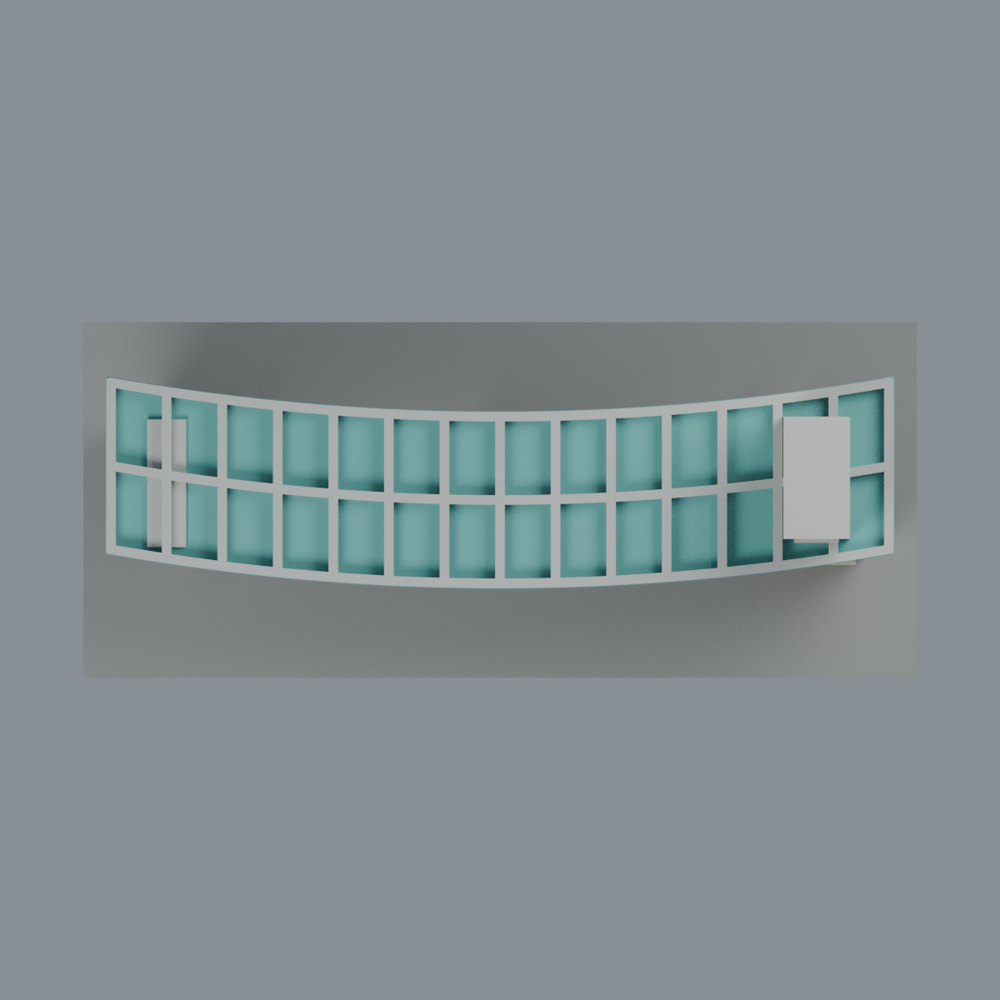

# 聯大八甲北門與中央警衛室：七材質外觀版

沿用原 **3,832 三角面／1,900 頂點**，不改原 STL 位元、座標、面序或幾何；這是既有模型外觀改版，不增加模型包數。

| 模型預覽 | 模型預覽 | 模型預覽 |
| :---: | :---: | :---: |
| 正面  | 背牆窗面中性／支撐構件材質有界延伸  |  |
|  |  |  |

[表面色 3MF](nuugate-appearance.3mf) · [可編輯 Blender](scene.blend) · [材質色表](palette.json) · [逐面指派與依據](face-materials.json) · [原 STL](../model.stl)

## 來源與配色邊界

親自查看聯大官方 [北大門相簿](https://secretary.nuu.edu.tw/p/132-1003-1091.php?Lang=zh-tw) 的 [第 6 張斜俯視](https://secretary.nuu.edu.tw/var/file/3/1003/gallery/91/1091/gallery_1091_5510997_24417.jpg)。內嵌 EXIF DateTimeOriginal **2025-03-02 15:01:54**，並非修改日 2025-03-10；拍攝時區／日期未獨立核實，不宣稱 2026 現況。照片不隨包散布。

- 沿用「北門＋中央亭」一個原組合，不將 T3 警衛室和北門重複計數。高塔、外側牆、圓柱及頂蓋肋側為灰石色代理，右前低牆和左內窄牆的已見平面為鮭紅磚色；**不把高塔整座染磚色**。
- 只在原水平凹格底與中央亭帽頂部使用青綠防水面代理，格梁、帽側仍灰色，不把青綠烘焙到梁肋或立柱。原凹格薄底保持不變，不宣稱精確防水材料規格。
- 中央亭僅原前窗凹背使用低彩度灰藍玻璃；原窗沒有來源照片的全部細窗梃，本版不添加。未登錄的背窗與其他窗背保持中性。
- 已見柱／支撐與肋的同一構件使用灰色連續代理，**其圓周隱蔽面是有限材質延伸，不是逐面看見**。後牆與頂蓋未見底面中性；不把一張俯視當成完整後面證據。
- 原兩塊浮凸牌保持空白淡色，不補校名、英文字、標誌；照片牌面與高塔刻字和原簡化浮牌並不完全一致，本版不宣稱文字還原。
- 原道路、底板只作展示；不增添車、柵欄、號誌、攝影機、管線或人物。所有色值未校準，原彎曲頂蓋、牆厚、亭比例仍為原近似幾何。

[原幾何與來源界線](../README.zh-TW.md) · [本次來源覆核](qa/source-review.json)

## 重建與核驗

安裝 [依賴](source/requirements.txt)，Blender 使用 4.3.2。由本資料夾上層提供原 model.stl：

1. `python appearance/source/build_appearance.py`
2. `python appearance/source/verify_exchange.py`
3. `blender -b -t 3 --python-exit-code 1 -P appearance/source/render_appearance.py`
4. `blender -b -t 3 --python-exit-code 1 -P appearance/source/verify_scene.py`

[獨立重建 ZIP](rebuild-source.zip)含原 STL、四支程式及依賴，不含第三方照片；不取代原建模腳本。[逐檔 SHA256](SHA256SUMS)

[交換／拓撲 QA](qa/exchange-validation.json)核對原座標與面序、全部面材質、單連通、有向水密邊、頂點 link 單環、正體積與零退化／重複面；lib3mf 嚴格讀取零警告，實際編輯單材質再存讀，其他材質及面指派不變。SDK 六位小數量化誤差另列。

[Blender 存讀與編輯](qa/scene-validation.json) · [渲染記錄](qa/render-manifest.json) · [獨立重建](qa/rebuild-validation.json)

## 製造限制照舊

尺寸仍為 150 × 64 × 59.3 mm；原 STL、建模程式、場景及歷史 QA 保留。原層檢與薄特徵檢查本次未重跑，不能由材質 QA 代替。

3MF 是同一網格的表面色，不是七個封閉分色實體、切片專案、噴頭映射或 G-code。切片 GUI、多材料路徑與實體列印未測；柱頭、屋簷、窗框及薄邊仍須評估材料、支撐及拆除風險，沒有保證可印或免支撐。
