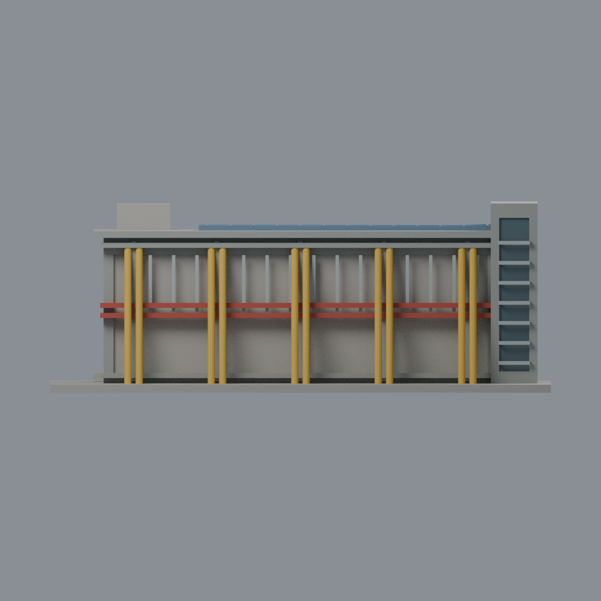
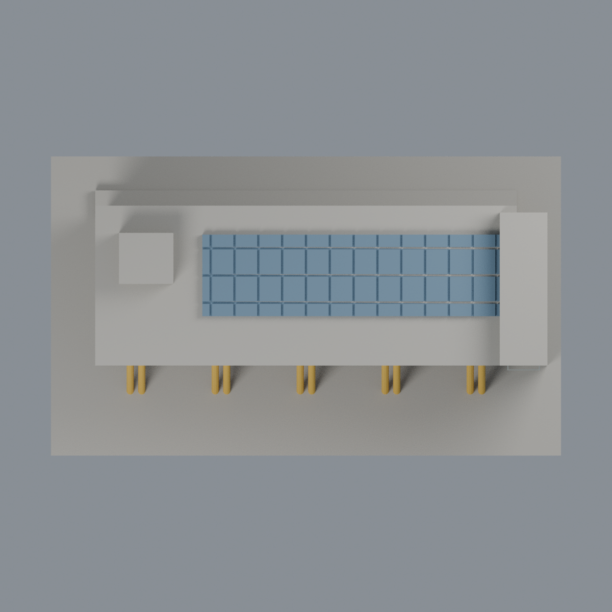

# 聯大八甲 V2 景觀餐廳：七材質外觀版

沿用原 **3,594 三角面／1,723 頂點**，不改原 STL 位元、座標、面序或幾何；這是既有模型外觀改版，不增加模型包數。

| 正面 | 背面保持中性 |
|---|---|
|  |  |
|  |  |

[表面色 3MF](nuuv2-appearance.3mf) · [可編輯 Blender](scene.blend) · [材質色表](palette.json) · [逐面指派與依據](face-materials.json) · [原 STL](../model.stl)

## 來源與配色邊界

親自核對官方 [景觀餐廳與能源中心相簿](https://secretary.nuu.edu.tw/p/132-1003-1120.php?Lang=zh-tw) 的 [照片 2](https://secretary.nuu.edu.tw/var/file/3/1003/gallery/20/1120/gallery_1120_1276700_97548.jpg)。EXIF DateTimeOriginal **2025-03-10 14:52:14**，時區與拍攝日期未獨立核實，不聲稱 2026 現況；照片不隨包散布。

- 五組成對既有斜柱採低彩度黃色，依每根原柱軸距與兩端範圍配色，不用寬 X 條紋誤染整片牆。原斜柱是十二邊近似圓柱，非實景精密結構剖面。
- 兩道原中層橫帶紅色；上下橫梁與正面結構灰色，細窗梃銀灰。原幾何的橫帶數與位置簡化，沒有新增實景小遮陽架或桿件。
- **正面大凹背保持中性，不配藍玻璃**：原三角面跨上下兩層，不能在不切面情況下只改上層；照片上層確有藍玻璃，下層卻含入口／深凹／開放區。本版不把整片凹背染成玻璃，也不假稱中性色是實景還原。保留此明確未還原區，比任意割面或假造全高玻璃更保守。
- 右側原梯塔有獨立完整凹背，可配深灰玻璃，橫條保持銀灰、外框灰色。塔體屬 V2，不包含照片右側 T2 能源中心；前景機車棚也未加入。
- 只對原屋頂光伏板配藍色，粗網格保留。未見後牆、側面、其他屋頂與設備方塊中性，沒有補畫黃色設備格柵、招牌、樹影或景觀。
- 原尺寸、比例、窗數及深凹均為照片推估／封實簡化；原 STL／面序／座標不變，不增加模型數，不宣稱物理列印成功。

[原幾何與來源限制](../README.zh-TW.md) · [來源覆核](qa/source-review.json)

## 重建與核驗

安裝 [依賴](source/requirements.txt)，Blender 使用 4.3.2。由本資料夾上層提供原 model.stl：

1. `python appearance/source/build_appearance.py`
2. `python appearance/source/verify_exchange.py`
3. `blender -b -t 3 --python-exit-code 1 -P appearance/source/render_appearance.py`
4. `blender -b -t 3 --python-exit-code 1 -P appearance/source/verify_scene.py`

[獨立重建 ZIP](rebuild-source.zip)含原 STL、四支程式及依賴，不含第三方照片；不取代原建模腳本。[逐檔 SHA256](SHA256SUMS)

[交換／拓撲 QA](qa/exchange-validation.json)核對原座標與面序、全部面材質、單連通、有向水密邊、頂點 link 單環、正體積與零退化／重複面；lib3mf 嚴格讀取零警告，實際編輯單材質再存讀，其他材質及面指派不變。SDK 六位小數量化誤差另列。

[Blender 存讀與編輯](qa/scene-validation.json) · [渲染記錄](qa/render-manifest.json) · [獨立重建](qa/rebuild-validation.json)

## 製造限制照舊

尺寸仍為 150 × 88 × 56.3 mm；原 STL、建模程式、場景及歷史 QA 保留。原層檢與薄特徵檢查本次未重跑，不能由材質 QA 代替。

3MF 是同一網格的表面色，不是八個封閉分色實體、切片專案、噴頭映射或 G-code。切片 GUI、多材料路徑與實體列印未測；柱頭、屋簷、窗框及薄邊仍須評估材料、支撐及拆除風險，沒有保證可印或免支撐。
