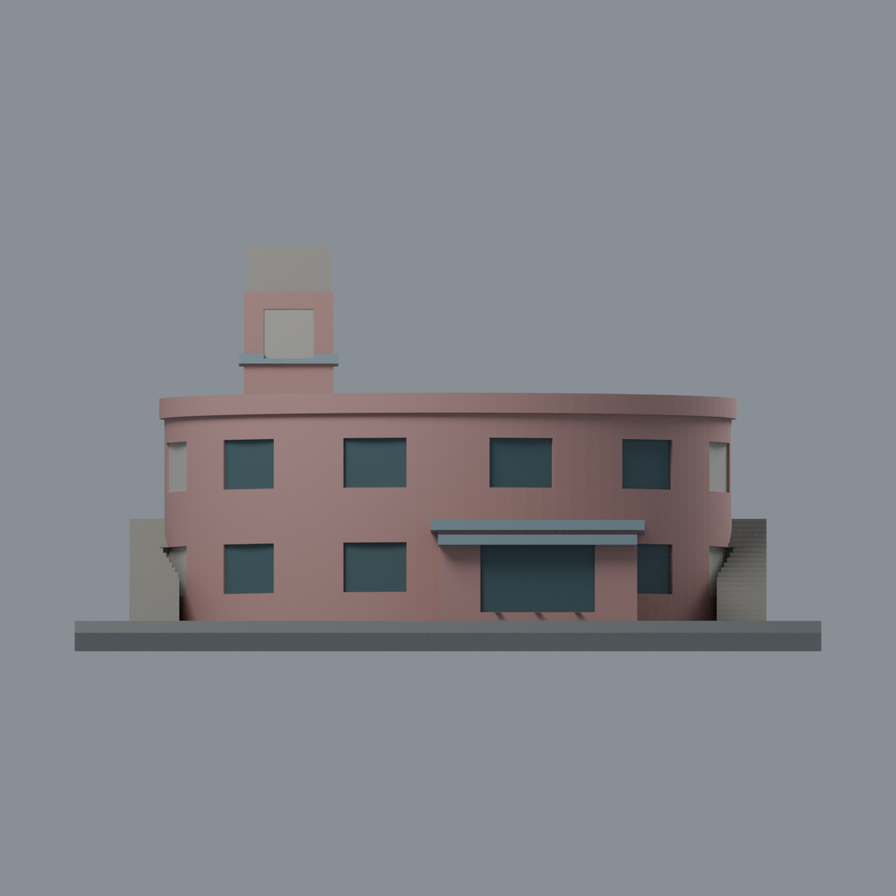
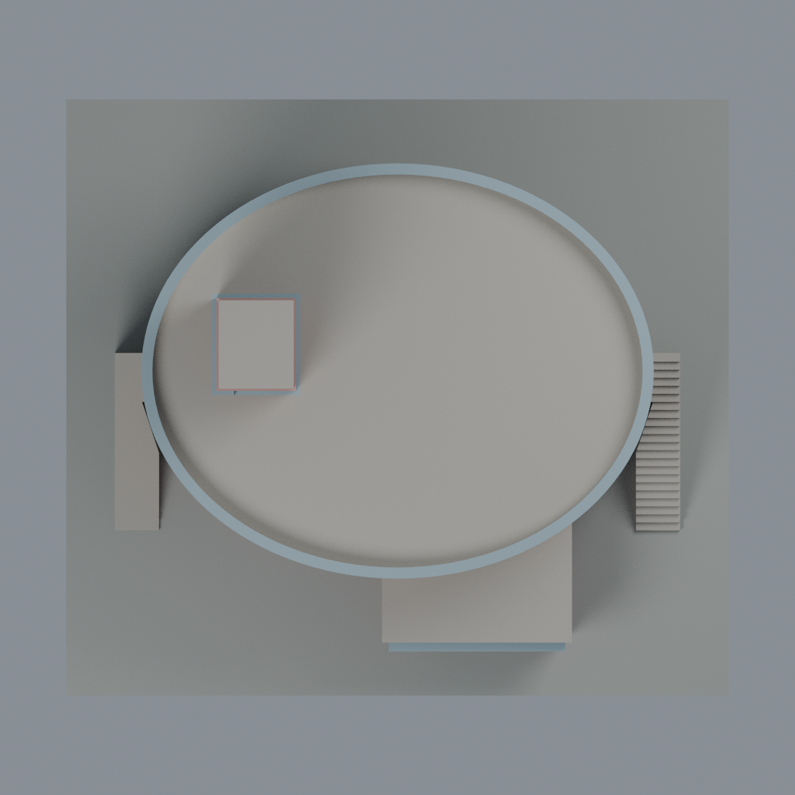

# 聯大八甲圓廳：八材質外觀版

沿用原 **3,008 三角面／1,506 頂點**，不改原 STL 位元、座標、面序或幾何；這是既有模型外觀改版，不增加模型包數。

| 正面 | 外側背牆中性／來源支持內環與露臺 |
|---|---|
|  |  |
|  |  |

[表面色 3MF](nuuround-appearance.3mf) · [可編輯 Blender](scene.blend) · [材質色表](palette.json) · [逐面指派與依據](face-materials.json) · [原 STL](../model.stl)

## 來源與配色邊界

親自查看聯大官方 [圓廳相簿](https://secretary.nuu.edu.tw/p/132-1003-1116.php?Lang=zh-tw) 的 [第 6 張](https://secretary.nuu.edu.tw/var/file/3/1003/gallery/16/1116/gallery_1116_1424643_95855.jpg) 與 [第 7 張高視角](https://secretary.nuu.edu.tw/var/file/3/1003/gallery/16/1116/gallery_1116_7832675_95855.jpg)。兩張內嵌拍攝日期為 **2025-03-10**，時區與日期未另行核實，不聲稱 2026 現況。參考照片不隨包散布。

- 登錄前半橢圓外牆、左塔已見面及原方形入口附量體的鮭粉陶磚色；不添加磚紋。原幾何把實景複雜入口／露台簡化為方盒與薄板，**色彩不能補正輪廓差異**。
- 原頂層內女兒牆以奶白色、頂沿以藍灰馬賽克代理；俯視照片可見整個內環及露台，露台灰褐色。外環後側、主體後牆與未登錄面中性。
- 來源窗楣／窗台、樓層帶有細馬賽克裝飾，但原網格沒有對應獨立邊界；**不分割三角面，不用寬斜色塊假造細帶**。既有塔帶與附量體頂緣僅為簡化位置代理。
- 只將前半中央四組原切槽的凹背配低彩度暗灰綠玻璃，最靠近兩側樓梯的端部槽保持中性，避免把可能的開放通道塗成玻璃，回口仍為牆色；入口原窗梃灰綠。原切槽與照片中的門、窗、開放通道不逐一等同，沒有增加細框、玻璃厚度或內室。塔上不明凹口保持中性。
- 兩側原階梯為灰色，不增添扶手、設備、冷氣、排風管、招牌、字母或人物。背景 M6 教學樓不在此模型；未將它誤當圓廳背牆。
- 所有顏色是未校準視覺代理；原橢圓、塔與階梯比例未改，並非測繪或修復成果，也不代表可直接列印。

[原幾何與來源界線](../README.zh-TW.md) · [本次來源覆核](qa/source-review.json)

## 重建與核驗

安裝 [依賴](source/requirements.txt)，Blender 使用 4.3.2。由本資料夾上層提供原 model.stl：

1. `python appearance/source/build_appearance.py`
2. `python appearance/source/verify_exchange.py`
3. `blender -b -t 3 --python-exit-code 1 -P appearance/source/render_appearance.py`
4. `blender -b -t 3 --python-exit-code 1 -P appearance/source/verify_scene.py`

[獨立重建 ZIP](rebuild-source.zip)含原 STL、四支程式及依賴，不含第三方照片；不取代原建模腳本。[逐檔 SHA256](SHA256SUMS)

[交換／拓撲 QA](qa/exchange-validation.json)核對原座標與面序、全部面材質、單連通、有向水密邊、頂點 link 單環、正體積與零退化／重複面；lib3mf 嚴格讀取零警告，實際編輯單材質再存讀，其他材質及面指派不變。SDK 六位小數量化誤差另列。

[Blender 存讀與編輯](qa/scene-validation.json) · [渲染記錄](qa/render-manifest.json) · [獨立重建](qa/rebuild-validation.json)

## 製造限制照舊

尺寸仍為 150 × 135 × 79.8 mm；原 STL、建模程式、場景及歷史 QA 保留。原層檢與薄特徵檢查本次未重跑，不能由材質 QA 代替。

3MF 是同一網格的表面色，不是八個封閉分色實體、切片專案、噴頭映射或 G-code。切片 GUI、多材料路徑與實體列印未測；柱頭、屋簷、窗框及薄邊仍須評估材料、支撐及拆除風險，沒有保證可印或免支撐。
