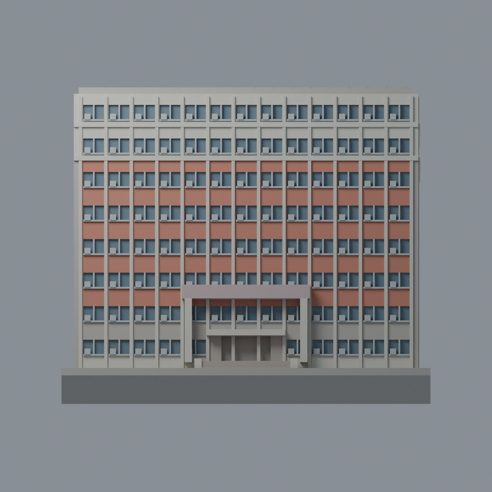
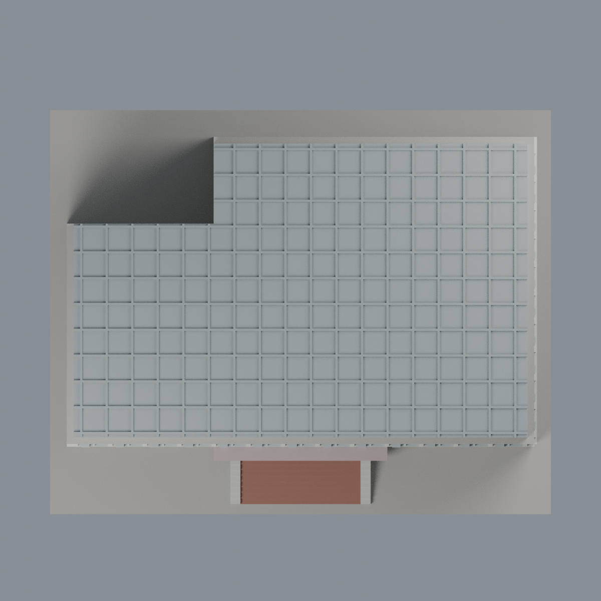

# 聯大二坪 C1 立德樓：八材質外觀版

沿用原 **21,246 三角面／10,419 頂點**，不改原 STL 位元、座標、面序或幾何；這是既有模型外觀改版，不增加模型包數。

| 正面 | 背面保持中性 |
|---|---|
|  |  |
|  |  |

[表面色 3MF](nuuc1-appearance.3mf) · [可編輯 Blender](scene.blend) · [材質色表](palette.json) · [逐面指派與依據](face-materials.json) · [原 STL](../model.stl)

## 來源與配色邊界

親自核對官方 [立德樓相簿](https://secretary.nuu.edu.tw/p/132-1003-1101.php?Lang=zh-tw) 的 [照片 1](https://secretary.nuu.edu.tw/var/file/3/1003/gallery/1/1101/gallery_1101_637737_26854.jpg)、[照片 4](https://secretary.nuu.edu.tw/var/file/3/1003/gallery/1/1101/gallery_1101_5926483_26855.jpg)，及 [校史照片](https://nuuarchives.nuu.edu.tw/var/file/97/1097/img/828/06image012.jpg)。近照 EXIF DateTimeOriginal **2025-02-28 10:19:35／11:26:26**；校史照未定年，用於上部兩層與屋頂金屬棚登錄，不冒稱 2026 現況。EXIF 日期與時區未獨立核實；照片不隨包散布。

- 只對原正面與右側中段可完整區分的面採陶紅色，原連續立柱及上部兩層淡象牙色。原幾何沒有精準分開所有紅／白邊界，下部過渡帶與跨界長面保守中性；不藉三角面斜切色塊或新增幾何補足。
- 每一原窗凹背採低彩度灰藍，既有窗梃、窗台及空調簡化方塊銀灰，不把空調染作玻璃。原設備位置／數目與窗格節奏都是近似，不宣稱逐台辨認，不增加照片的管線與機器細節。
- 既有入口大門楣淡灰粉色、小門楣與支柱象牙色、梯踏面紅褐磁磚色；原空白招牌面不加文字。實景圓柱等差異仍是原模型簡化，不靠配色掩飾。
- 原實底網格屋頂採灰金屬色：來源只能支持金屬遮棚，**沒有把它認定或染成光電板**。網格仍是原加厚模型，並非薄金屬施工圖。
- 未見左側、後牆及推估後凹口保持中性；不新增任何室內、植栽或街景。原 STL／面序／座標不變，不增加模型數，不宣稱物理列印成功。

[原幾何與來源限制](../README.zh-TW.md) · [來源覆核](qa/source-review.json)

## 重建與核驗

安裝 [依賴](source/requirements.txt)，Blender 使用 4.3.2。由本資料夾上層提供原 model.stl：

1. `python appearance/source/build_appearance.py`
2. `python appearance/source/verify_exchange.py`
3. `blender -b -t 3 --python-exit-code 1 -P appearance/source/render_appearance.py`
4. `blender -b -t 3 --python-exit-code 1 -P appearance/source/verify_scene.py`

[獨立重建 ZIP](rebuild-source.zip)含原 STL、四支程式及依賴，不含第三方照片；不取代原建模腳本。[逐檔 SHA256](SHA256SUMS)

[交換／拓撲 QA](qa/exchange-validation.json)核對原座標與面序、全部面材質、單連通、有向水密邊、頂點 link 單環、正體積與零退化／重複面；lib3mf 嚴格讀取零警告，實際編輯單材質再存讀，其他材質及面指派不變。SDK 六位小數量化誤差另列。

[Blender 存讀與編輯](qa/scene-validation.json) · [渲染記錄](qa/render-manifest.json) · [獨立重建](qa/rebuild-validation.json)

## 製造限制照舊

尺寸仍為 150 × 121 × 119.9 mm；原 STL、建模程式、場景及歷史 QA 保留。原層檢與薄特徵檢查本次未重跑，不能由材質 QA 代替。

3MF 是同一網格的表面色，不是八個封閉分色實體、切片專案、噴頭映射或 G-code。切片 GUI、多材料路徑與實體列印未測；柱頭、屋簷、窗框及薄邊仍須評估材料、支撐及拆除風險，沒有保證可印或免支撐。
