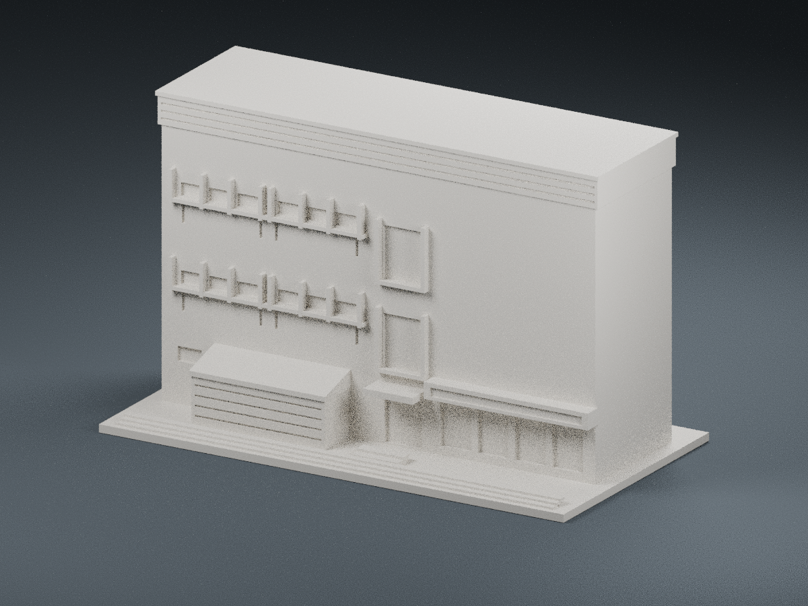

# F1 建築一館｜可列印外觀近似模型

## 7 材質外觀版（2026-10-21）

| 正面與來源支持區域 | 未見外側背面中性 |
|---|---|
|  |  |

[來源界線與四視角](appearance/README.md) · [表面色 3MF](appearance/nuuf1-appearance.3mf) · [可編輯場景](appearance/scene.blend)

依官方正面與斜面照片限定灰混凝土、淡窗凸框、青綠窗凹背與附屋斜頂；中央高窗是玻璃和不透明板混合的代理色，招牌留白、未知側背與平屋頂中性。 原 STL 與歷史 QA 不變；這是外觀改善，不是新增幾何。[原單色正面](previews/front.png)／[原單色背面](previews/rear.png)

二坪山校區，官方相簿照片比對版。這是照片辨識後獨立建模的外觀小模型，並非建築測量、竣工圖或精確復原。

## 檔案

- `model.stl`：毫米單位的可列印網格，底座一體成形。
- `scene.blend`：由該 STL 匯入的預覽場景；棚架、窗格及階梯都存在於 STL，非渲染貼圖。
- `build_model.py`：幾何原始碼；`requirements.txt`：Python 套件。
- `render_preview.py`：Blender 預覽程式；`previews/front.png`、`previews/rear.png`：實際 STL 正／背面圖。
- `validate_model.py`、`validation.json`：網格檢查程式及結果。
- `evidence.json`：參考照片標題、官方來源網址與證據限制。

## 辨識特徵

不對稱立面、左側六段水平窄窗及短豎肋、中央兩層直立窗框、右側底層店面及橫長招牌帶、左前低矮斜頂附屋。未製作便利商店商標文字；未納入右後方 H1 高樓或左側 F2。

## 比例與不確定處

含底座外尺寸約 150 × 80 × 93.8 mm，最長邊 150 mm。每棟各自縮放方便列印，與其他校舍並非共同縮尺。

平頂與背面、館體深度為推估；照片未確認的背面及狹側不增造窗戶。

照片被樹木或其他建築遮蔽的細部沒有足夠資訊，未以虛構設備、窗洞或新附樓補齊。基地高程、階梯級數與實際長寬高皆為近似。屋頂及側後仍需要現況補照才能提高精度。

## FDM 列印建議

- 以平底朝下；建議 0.4 mm 噴嘴、0.16–0.20 mm 層高、3 道外壁。
- 窗框立肋最小約 1.2 mm；淺溝約 0.65–0.7 mm。
- 門廊、屋簷及太陽能棚下方有懸空和跨距，請於切片軟體檢視支撐與橋接；建議手動支撐並檢查拆除空間。
- 不建議直接縮小，細格柵與凹刻可能消失。
- 尚未實體試印。封閉網格及單一連通檢查不代表所有列印機都可免支撐成功。

## 重建

安裝 `requirements.txt` 後執行 `python build_model.py`。檢查方式為 `python validate_model.py model.stl --longest-edge 150 --output validation.json`。Blender 4.x 執行 `blender -b -P render_preview.py` 可重建預覽與場景。

## 官方參考

- [設計學院館舍相簿](https://secretary.nuu.edu.tw/p/132-1003-1100.php?Lang=zh-tw)
- [建築一館外觀 (1)](https://secretary.nuu.edu.tw/var/file/3/1003/gallery/0/1100/gallery_1100_885303_26747.jpg)
- [建築一館外觀 (3)](https://secretary.nuu.edu.tw/var/file/3/1003/gallery/0/1100/gallery_1100_604034_26747.jpg)

公開照片僅作研究引用，權利歸原權利人；套件不附原始照片，也不替任何來源授予授權。
