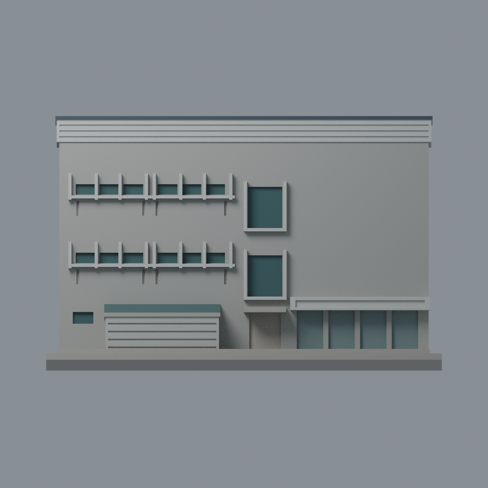
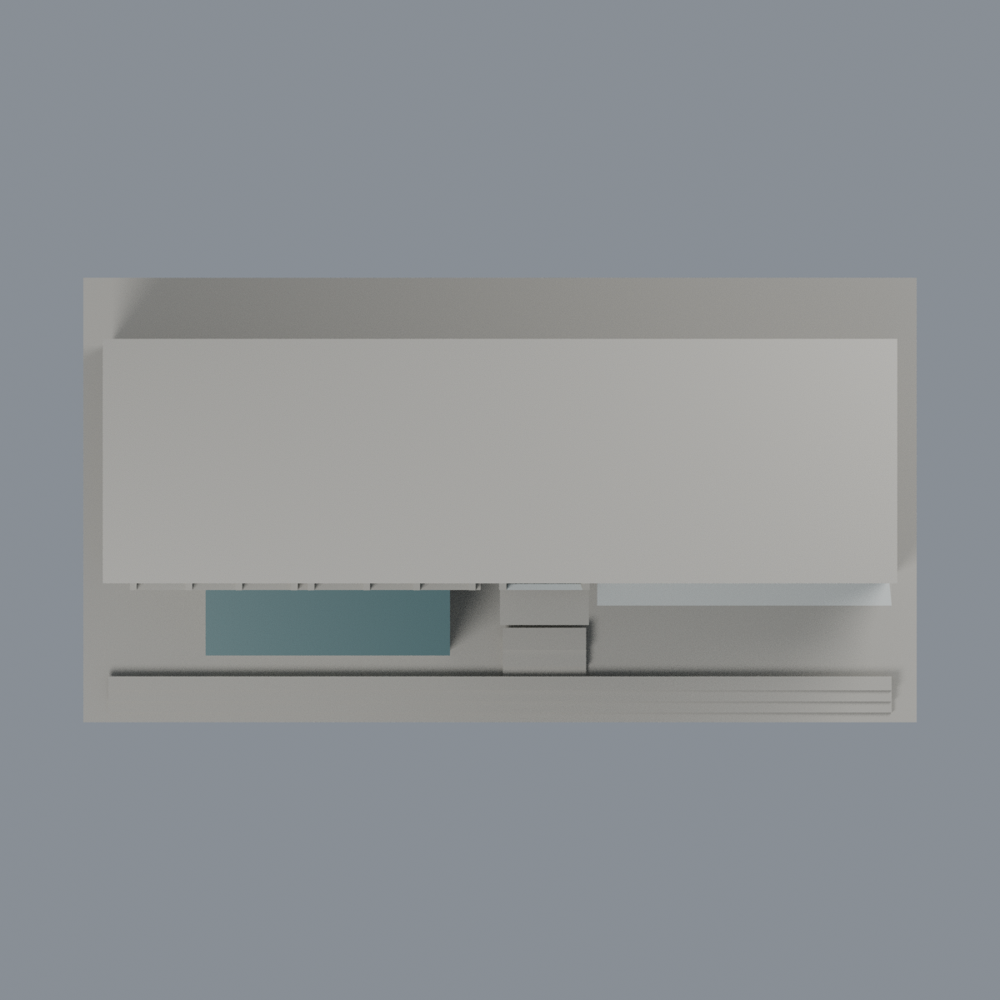

# 聯大二坪 F1 建築一館：七材質外觀版

沿用原 **1,524 三角面／764 頂點**，不改原 STL 位元、座標、面序或幾何；這是既有模型外觀改版，不增加模型包數。

| 模型預覽 | 模型預覽 | 模型預覽 |
| :---: | :---: | :---: |
| 正面  | 背面保持中性  |  |
|  |  |  |

[表面色 3MF](nuuf1-appearance.3mf) · [可編輯 Blender](scene.blend) · [材質色表](palette.json) · [逐面指派與依據](face-materials.json) · [原 STL](../model.stl)

## 來源與配色邊界

親自核對官方 [F1／F2 建築館相簿](https://secretary.nuu.edu.tw/p/132-1003-1100.php?Lang=zh-tw) 的 F1 [正面](https://secretary.nuu.edu.tw/var/file/3/1003/gallery/0/1100/gallery_1100_885303_26747.jpg)與[斜面](https://secretary.nuu.edu.tw/var/file/3/1003/gallery/0/1100/gallery_1100_604034_26747.jpg)完整照片。EXIF 分別為 2025-02-28 10:26:40／10:25:39；時區與拍攝日期未獨立核實，不代表 2026 現況。來源照片不隨包散布。

- 正面灰色混凝土、上沿淡銀灰既有凹槽飾帶、深灰前屋緣；照片旁邊粉色 H1 及紅磚 F2 不在模型內，不混入其材質。
- 既有小橫窗凹背深青綠，凸窗柱／帶淡灰。中央高窗實景有玻璃及不透明綠板混合，原模型未分隔，整凹背只作均勻青綠代理，**不聲稱整片透明玻璃**。
- 原左下附屋採灰色磁磚量體，既有水平凹槽不是玻璃；只有斜頂上表面採來源青綠，厚側邊不延伸綠色。
- 右下既有商店窗凹背灰藍，投射招牌留淡色空白，不加品牌、商標、文字或海報。中央混合材質門洞未能逐格配準，保守中性，不加門片。
- 未見側／背面與大面平屋頂保持中性；不加空調、管線、球場、人物、鄰棟。原 STL／面序／座標不變，不增加模型數，不宣稱物理列印成功。

[原幾何與來源限制](../README.zh-TW.md) · [來源覆核](qa/source-review.json)

## 重建與核驗

安裝 [依賴](source/requirements.txt)，Blender 使用 4.3.2。由本資料夾上層提供原 model.stl：

1. `python appearance/source/build_appearance.py`
2. `python appearance/source/verify_exchange.py`
3. `blender -b -t 3 --python-exit-code 1 -P appearance/source/render_appearance.py`
4. `blender -b -t 3 --python-exit-code 1 -P appearance/source/verify_scene.py`

[獨立重建 ZIP](rebuild-source.zip)含原 STL、四支程式及依賴，不含第三方照片；不取代原建模腳本。[逐檔 SHA256](SHA256SUMS)

[交換／拓撲 QA](qa/exchange-validation.json)核對原座標與面序、全部面材質、單連通、有向水密邊、頂點 link 單環、正體積與零退化／重複面；lib3mf 嚴格讀取零警告，實際編輯單材質再存讀，其他材質及面指派不變。SDK 六位小數量化誤差另列。

[Blender 存讀與編輯](qa/scene-validation.json) · [渲染記錄](qa/render-manifest.json) · [獨立重建](qa/rebuild-validation.json)

## 製造限制照舊

尺寸仍為 150 × 80 × 93.8 mm；原 STL、建模程式、場景及歷史 QA 保留。原層檢與薄特徵檢查本次未重跑，不能由材質 QA 代替。

3MF 是同一網格的表面色，不是七個封閉分色實體、切片專案、噴頭映射或 G-code。切片 GUI、多材料路徑與實體列印未測；柱頭、屋簷、窗框及薄邊仍須評估材料、支撐及拆除風險，沒有保證可印或免支撐。
