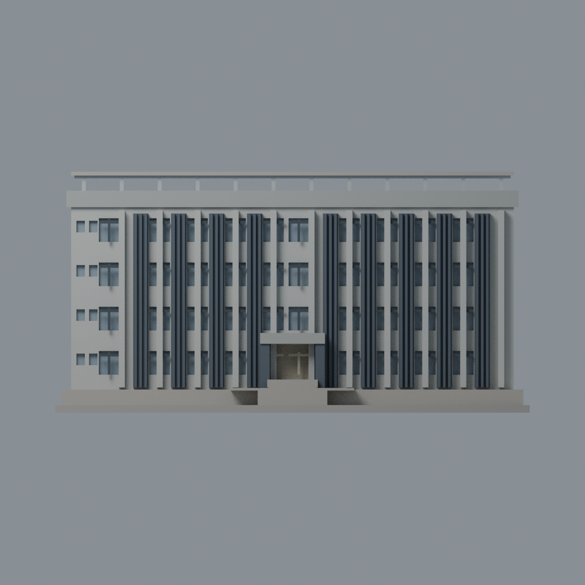
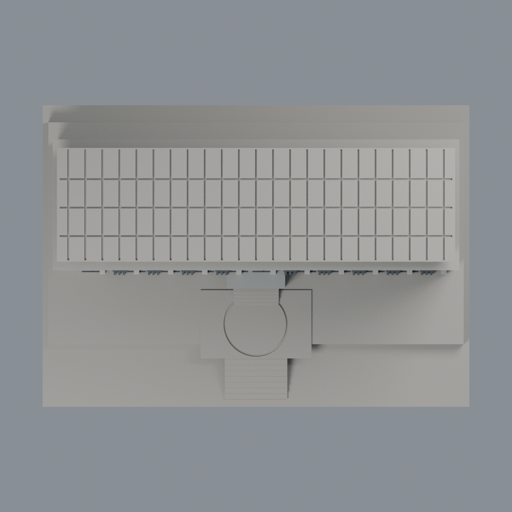

# 聯大二坪 F3 公弢樓：八材質外觀版

沿用原 **7,840 三角面／3,776 頂點**，不改原 STL 位元、座標、面序或幾何；這是既有模型外觀改版，不增加模型包數。

| 正面 | 背面保持中性 |
|---|---|
|  |  |
|  |  |

[表面色 3MF](nuuf3-appearance.3mf) · [可編輯 Blender](scene.blend) · [材質色表](palette.json) · [逐面指派與依據](face-materials.json) · [原 STL](../model.stl)

## 來源與配色邊界

親自核對官方 [建築館／公弢樓相簿](https://secretary.nuu.edu.tw/p/132-1003-1100.php?Lang=zh-tw) 的公弢樓 [外觀 4](https://secretary.nuu.edu.tw/var/file/3/1003/gallery/0/1100/gallery_1100_2269019_27329.jpg)與[外觀 5](https://secretary.nuu.edu.tw/var/file/3/1003/gallery/0/1100/gallery_1100_9662340_27329.jpg)完整照片。EXIF 分別為 2025-02-28 12:21:23／12:22:12；2025-03-09 是修改日期而非拍攝日期。時區與拍攝日期未獨立核實，不代表 2026 現況。來源照片不隨包散布。

- 正面淺灰窗下牆／細結構柱、深灰直向格柵群、深色既有窗梃與灰藍凹背分開登記。照片中的較寬格柵柱，原幾何近似成大量厚直桿；保留並明示此差異，不為顏色改網格。
- 中央入口照片是奶油色關閉門／捲門，原凹背採奶油色，**不是玻璃**；原窗梃有部分穿越入口凹面，保留原幾何並同採奶油色，不假稱真實門面細節。入口深色側頰與灰石橫額不加金字、校徽、名稱。
- 原文件和腳本稱屋頂為太陽能棚，但本次兩張照片只清楚看到棚下金屬支架與底面，**不能獨立證實頂面為 PV 電池片**。原棚頂保持中性，不染深藍；只將可見支架代理為銀灰，不改原平棚或槽紋。
- 原平台未分出紅色鋪面邊界，保守中性，不用三角面重心切出虛假斜色塊。既有圓形刻線與階梯保留，不加樹木、管線、空調或鄰樓。
- 未見側／背面與屋頂保持中性。原 STL／面序／座標不變，不增加模型數，不宣稱物理列印成功。

[原幾何與歷史來源限制](../README.zh-TW.md) · [來源覆核](qa/source-review.json)

## 重建與核驗

安裝 [依賴](source/requirements.txt)，Blender 使用 4.3.2。由本資料夾上層提供原 model.stl：

1. `python appearance/source/build_appearance.py`
2. `python appearance/source/verify_exchange.py`
3. `blender -b -t 3 --python-exit-code 1 -P appearance/source/render_appearance.py`
4. `blender -b -t 3 --python-exit-code 1 -P appearance/source/verify_scene.py`

[獨立重建 ZIP](rebuild-source.zip)含原 STL、四支程式及依賴，不含第三方照片；不取代原建模腳本。[逐檔 SHA256](SHA256SUMS)

[交換／拓撲 QA](qa/exchange-validation.json)核對原座標與面序、全部面材質、單連通、有向水密邊、頂點 link 單環、正體積與零退化／重複面；lib3mf 嚴格讀取零警告，實際編輯單材質再存讀，其他材質及面指派不變。SDK 六位小數量化誤差另列。

[Blender 存讀與編輯](qa/scene-validation.json) · [渲染記錄](qa/render-manifest.json) · [獨立重建](qa/rebuild-validation.json)

## 製造限制照舊

尺寸仍為 150 × 106 × 76.2 mm；原 STL、建模程式、場景及歷史 QA 保留。原層檢與薄特徵檢查本次未重跑，不能由材質 QA 代替。

3MF 是同一網格的表面色，不是八個封閉分色實體、切片專案、噴頭映射或 G-code。切片 GUI、多材料路徑與實體列印未測；柱頭、屋簷、窗框及薄邊仍須評估材料、支撐及拆除風險，沒有保證可印或免支撐。
