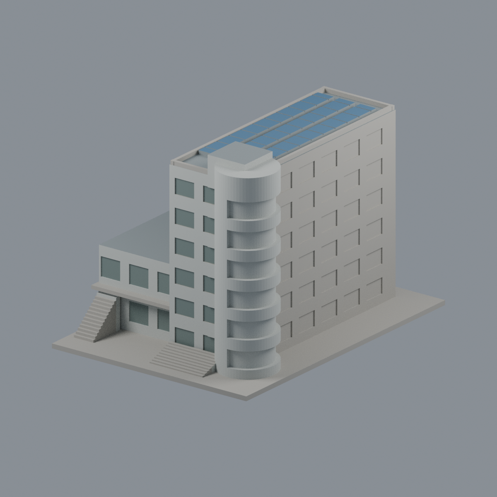
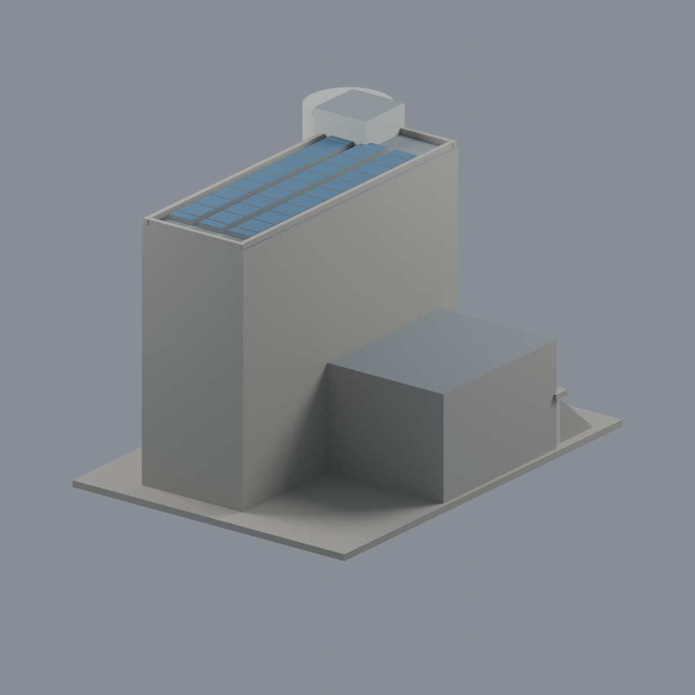
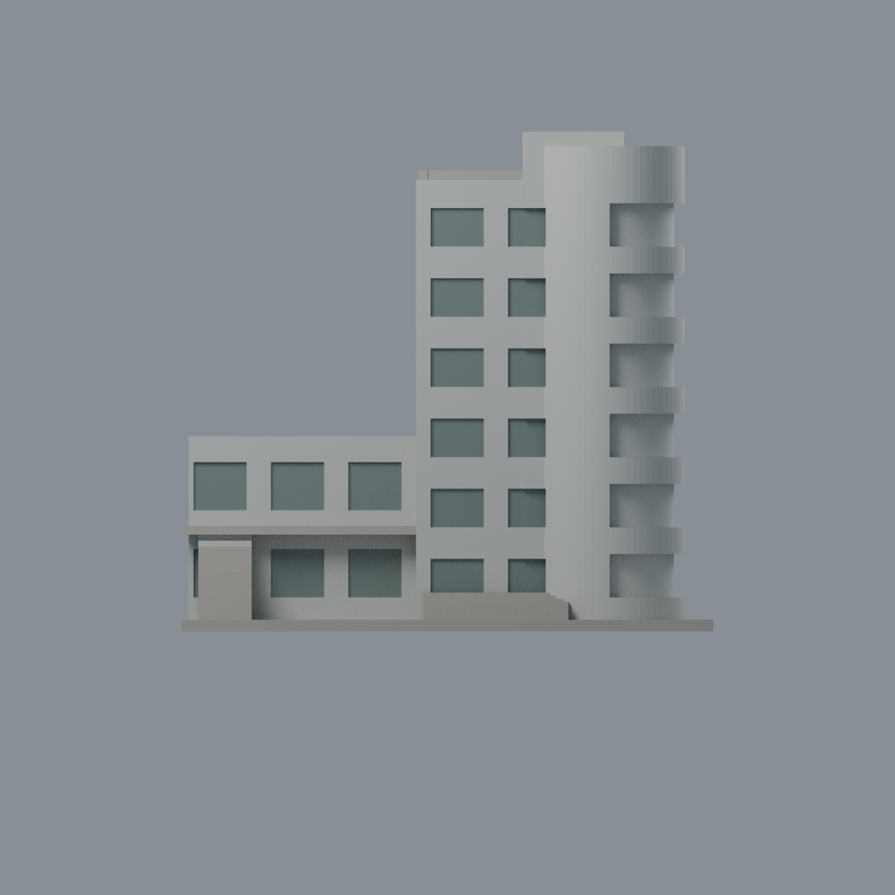
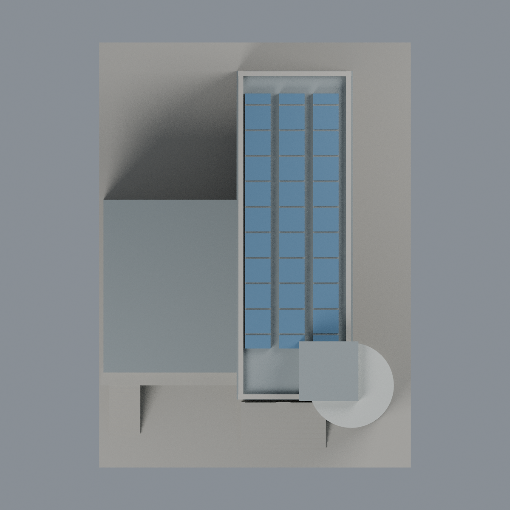

# 聯大二坪教職員宿舍可見群：五材質外觀版

沿用原 **4,240 三角面／2,108 頂點**，不改原 STL 位元、座標、面序或幾何；這是既有模型外觀改版，不增加模型包數。

| 模型預覽 | 模型預覽 | 模型預覽 |
| :---: | :---: | :---: |
| 正面  | 未見長側與背牆中性  |  |
|  |  |  |

[表面色 3MF](nuufac-appearance.3mf) · [可編輯 Blender](scene.blend) · [材質色表](palette.json) · [逐面指派與依據](face-materials.json) · [原 STL](../model.stl)

## 來源與配色邊界

親自核對官方 [教職員宿舍相簿](https://secretary.nuu.edu.tw/p/132-1003-1103.php?Lang=zh-tw) 完整照片 1／2／4，對應前側階梯、低翼、右側圓弧外廊與三排藍色集熱／集能板。精確網址、SHA256 與 EXIF 見 [來源覆核](qa/source-review.json)；日期時區未獨立驗證，不代表 2026 現況。照片不隨包散布。

- 可見前牆、低翼與圓弧塔灰白洗石子。只原矩形窗凹背採灰綠玻璃代理；原網格未具獨立細框，不新增銀框。
- **圓弧凹帶是開放外廊，不是整圈玻璃**；原實心曲面背為厚化代理，維持灰色。來源外廊地板有紅磚與米色差異，原簡化環帶無可靠逐層註冊，保守灰色，不假作整圈紅磁磚。
- 空拍支持三排藍色太陽能集熱／集能板；外觀較像熱集熱器，**不主張已確認為光伏 PV**。只原三排上表面藍，側邊與凹縫灰；原水平厚板忽略實景傾角及管路，不為配色改形或增設備。
- 可見屋頂灰色代理，不烘焙汙痕。未充分可見長側與背牆／底座中性，不將未註冊側窗自動鏡像著色。
- 原 P1/P2 識別限制繼續保留：本包僅一個可見相連群體，不聲稱兩棟各自完整還原，也不增模型計數。不加住戶、室內、招牌文字或監視器。
- 原 STL、座標、面序與歷史 QA 不變，無物理列印成功宣稱。

[原幾何與歷史來源限制](../README.zh-TW.md)

## 重建與核驗

安裝 [依賴](source/requirements.txt)，Blender 使用 4.3.2。由本資料夾上層提供原 model.stl：

1. `python appearance/source/build_appearance.py`
2. `python appearance/source/verify_exchange.py`
3. `blender -b -t 3 --python-exit-code 1 -P appearance/source/render_appearance.py`
4. `blender -b -t 3 --python-exit-code 1 -P appearance/source/verify_scene.py`

[獨立重建 ZIP](rebuild-source.zip)含原 STL、四支程式及依賴，不含第三方照片；不取代原建模腳本。[逐檔 SHA256](SHA256SUMS)

[交換／拓撲 QA](qa/exchange-validation.json)核對原座標與面序、全部面材質、單連通、有向水密邊、頂點 link 單環、正體積與零退化／重複面；lib3mf 嚴格讀取零警告，實際編輯單材質再存讀，其他材質及面指派不變。SDK 六位小數量化誤差另列。

[Blender 存讀與編輯](qa/scene-validation.json) · [渲染記錄](qa/render-manifest.json) · [獨立重建](qa/rebuild-validation.json)

## 製造限制照舊

尺寸仍為 110 × 150 × 103.3 mm；原 STL、建模程式、場景及歷史 QA 保留。原層檢與薄特徵檢查本次未重跑，不能由材質 QA 代替。

3MF 是同一網格的表面色，不是各材質各自封閉的分色實體、切片專案、噴頭映射或 G-code。切片 GUI、多材料路徑與實體列印未測；柱頭、屋簷、窗框及薄邊仍須評估材料、支撐及拆除風險，沒有保證可印或免支撐。
