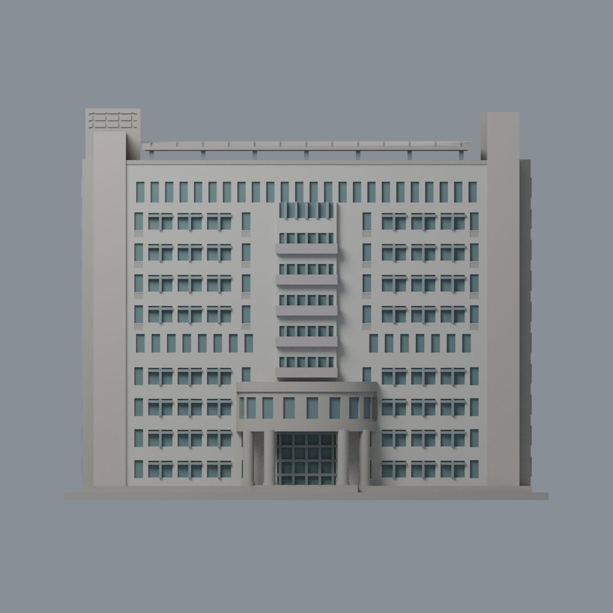
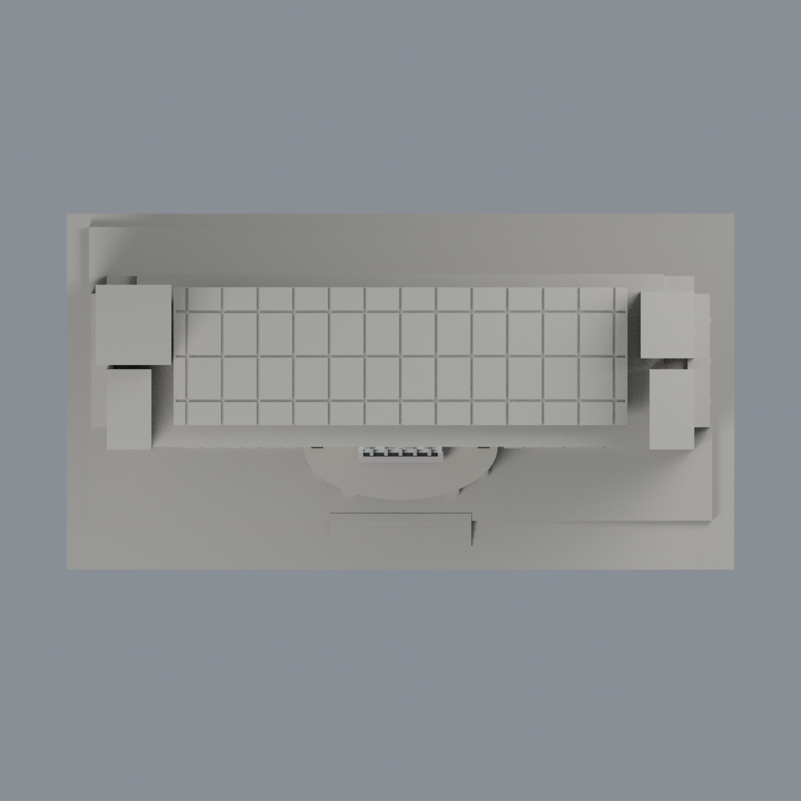

# 聯大二坪 H1 產研創新暨推廣大樓：八材質外觀版

沿用原 **14,848 三角面／7,390 頂點**，不改原 STL 位元、座標、面序或幾何；這是既有模型外觀改版，不增加模型包數。

| 正面 | 背面保持中性 |
|---|---|
|  |  |
|  |  |

[表面色 3MF](nuuh1-appearance.3mf) · [可編輯 Blender](scene.blend) · [材質色表](palette.json) · [逐面指派與依據](face-materials.json) · [原 STL](../model.stl)

## 來源與配色邊界

親自核對官方 [H1 產研創新暨推廣大樓相簿](https://secretary.nuu.edu.tw/p/132-1003-1104.php?Lang=zh-tw) 的[照片 1](https://secretary.nuu.edu.tw/var/file/3/1003/gallery/4/1104/gallery_1104_9901814_27233.jpg)與[照片 2](https://secretary.nuu.edu.tw/var/file/3/1003/gallery/4/1104/gallery_1104_1158667_27233.jpg)完整影像。EXIF 分別為 2025-02-28 10:09:25／10:09:51；2025-03-09 是修改日期。時區與拍攝日期未獨立核實，不代表 2026 現況。來源照片不隨包散布。

- 正面淡象牙灰牆格與略暖的端部核心、灰青窗凹背、灰色既有窗梃分開。實景窗簾／反射不同，使用低飽和代理色，不逐窗仿造內部。
- 中央凸窗列的**厚實窗下帶**灰淡紫，只有凹背採玻璃代理色；不把整個中央凸塊都染玻璃。原窗格數與深度仍是既有簡化。
- 曲面入口量體及四柱暖灰石色；只對原切出的平面窗凹背上色，不染整個彎曲石牆。入口背玻璃與原門梃分開，不添加文字／校名。
- 右外側來源可見的離散窗凹背採灰青，其餘大面及未能確認的左外側保持中性，不把兩側全部對稱還原。
- 原腳本稱屋頂為太陽能棚，但本次照片不足以證實頂面電池片；屋頂平板與槽紋中性，僅來源可見的低部金屬支架灰色，不宣稱 PV 配色。背面／未知屋頂不延伸正面色。
- 原 STL／面序／座標不變；不加空調、樹木、鄰棟、設備或交通。這是外觀改善，不增加模型數，不宣稱物理列印成功。

[原幾何與歷史來源限制](../README.zh-TW.md) · [來源覆核](qa/source-review.json)

## 重建與核驗

安裝 [依賴](source/requirements.txt)，Blender 使用 4.3.2。由本資料夾上層提供原 model.stl：

1. `python appearance/source/build_appearance.py`
2. `python appearance/source/verify_exchange.py`
3. `blender -b -t 3 --python-exit-code 1 -P appearance/source/render_appearance.py`
4. `blender -b -t 3 --python-exit-code 1 -P appearance/source/verify_scene.py`

[獨立重建 ZIP](rebuild-source.zip)含原 STL、四支程式及依賴，不含第三方照片；不取代原建模腳本。[逐檔 SHA256](SHA256SUMS)

[交換／拓撲 QA](qa/exchange-validation.json)核對原座標與面序、全部面材質、單連通、有向水密邊、頂點 link 單環、正體積與零退化／重複面；lib3mf 嚴格讀取零警告，實際編輯單材質再存讀，其他材質及面指派不變。SDK 六位小數量化誤差另列。

[Blender 存讀與編輯](qa/scene-validation.json) · [渲染記錄](qa/render-manifest.json) · [獨立重建](qa/rebuild-validation.json)

## 製造限制照舊

尺寸仍為 150 × 80 × 121.4 mm；原 STL、建模程式、場景及歷史 QA 保留。原層檢與薄特徵檢查本次未重跑，不能由材質 QA 代替。

3MF 是同一網格的表面色，不是八個封閉分色實體、切片專案、噴頭映射或 G-code。切片 GUI、多材料路徑與實體列印未測；柱頭、屋簷、窗框及薄邊仍須評估材料、支撐及拆除風險，沒有保證可印或免支撐。
