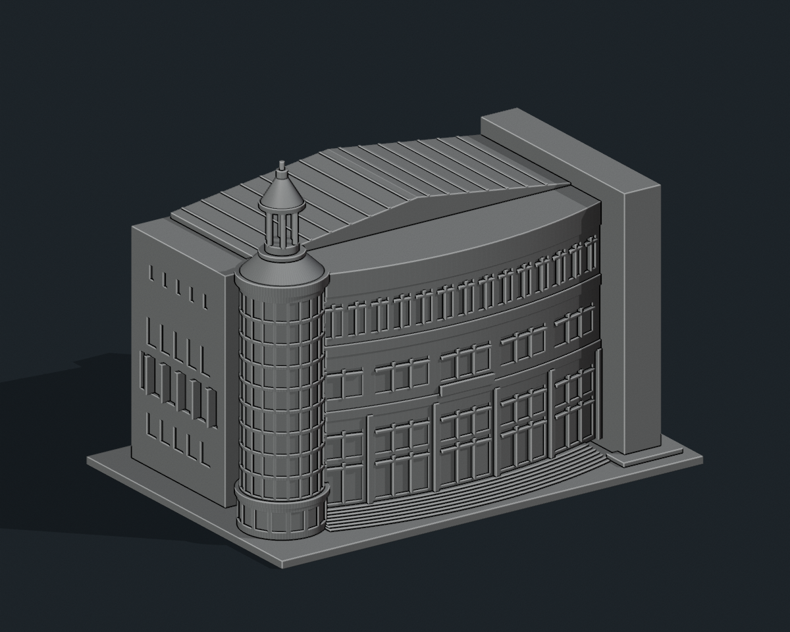

# 國立聯合大學 J1 大禮堂、體育館及活動中心

## 7 材質外觀版（2026-10-21）

| 正面與來源支持區域 | 背牆中性／屋面同系統推估 |
|---|---|
|  |  |

[來源界線與四視角](appearance/README.md) · [表面色 3MF](appearance/nuuj1-appearance.3mf) · [可編輯場景](appearance/scene.blend)

依官方雙照配置淡石曲帶、原切窗背灰藍、圓塔反射灰橄欖代理色及銀灰金屬館頂；左中層柱廊不是玻璃，頂亭與屋面同材料延伸有界，背牆中性。 原 STL 與歷史 QA 不變；這是外觀改善，不是新增幾何。[原單色正面](previews/front.png)／[原單色背面](previews/rear.png)


依聯大官方照片製作的獨立外觀縮印模型，含底座尺寸 **150 × 102 × 117 mm**，單位為毫米。這是照片比例詮釋，不是測繪模型，也不是與其他館舍共同比例的校園模型。

## 建物與範圍

現行二坪校園圖標示 J1 活動中心，校史建物表以「J1 大禮堂、體育館及活動中心」列為同一項；本包將弧形入口、左圓塔、後方體育館屋面及兩側連通量體作為一個列印單元，不把內部大禮堂或會議廳另算一棟。不含前方校門、警衛亭、球場及鄰棟。

已逐圖檢視官方相簿的活動中心外觀 (1)–(4)，保留弧形多層窗帶、左圓形玻璃梯塔及尖頂小亭、右側實牆高柱、淺斜體育館屋面、左側開窗與凹入柱廊、入口弧形台階。第 (5) 張原圖下載失敗，未把它當作已核對證據。

背面沒有可靠近照，故使用無窗簡化牆，不推測背面開口。深度、左側開窗間距、屋面及基地高差是估計。窗格、塔頂細柱與尖端加厚供 FDM 使用；未重建室內、設備或安防資訊。照片中的透明玻璃以有實心背襯的淺凹窗表示。

## 檔案與預覽

- `model.stl`：單一連通封閉實體；STL 無顏色
- `build_model.py`：可攜式幾何生成原始碼
- `scene.blend`：可編輯列印網格與預覽場景，已嵌入同版原始碼
- `previews/front.png`、`rear.png`、`elevation.png`：直接由最終 STL 渲染，單色僅為材質
- `validation.json`、`rebuild_check.json`、`scene_check.json`：數位檢查結果
- `evidence.json`：來源與判讀界線；未附第三方照片
- `SHA256SUMS`：交付檔案雜湊




## 列印

底座平放。建議以 0.4 mm 噴嘴、0.16–0.20 mm 層高、3 圈外牆及 10–15% 填充開始切片。塔頂柱直徑 1.8 mm，尖端直徑 1.6 mm、露出高 2.8 mm；窗格約 0.8–0.85 mm，底座厚 2.4 mm，台階高差約 0.5 mm。尖端與塔亭柱較脆弱，不建議再縮小。

塔亭上蓋跨距約 9 mm、左柱廊及立面窗頂可能需要局部支撐；請用切片預覽確認，不要為每個淺窗自動加支撐。數位檢查已完成，但未做實體試印或切片器驗證。

## 重新生成與驗證

```sh
python -m pip install -r requirements.txt
python build_model.py
python validate_model.py model.stl --longest-edge 150 --output validation.json
python verify_rebuild.py
blender -b -t 4 -P render_preview.py
blender -b -t 2 -P verify_scene.py
```

Python 程式從自身資料夾讀寫，不依賴原製作電腦路徑。Blender 4.3 或較新版可用。重建會覆寫同名檔案；修改前請先備份。網格檢查包含原始 STL 法向、每邊兩面、每頂點單一環狀連結、單連通體、無獨立內腔殼、正體積、平底；乾淨資料夾重建須得到完全相同 STL SHA-256；Blender/STL 比對逐三角形座標至 0.00001 mm。

## 公開來源

查核日期：2026-10-11。

- [現行二坪校園圖](https://www.nuu.edu.tw/p/426-1000-10.php?Lang=zh-tw)
- [官方活動中心外觀相簿](https://secretary.nuu.edu.tw/p/132-1003-1102.php?Lang=zh-tw)，完整照片編號 (1)–(4)
- [官方校史建築清冊](https://nuuarchives.nuu.edu.tw/p/16-1097-27990.php?Lang=zh-tw)
- [官方大樓代碼與樓層名稱](https://ccenter.nuu.edu.tw/p/412-1007-298.php)
