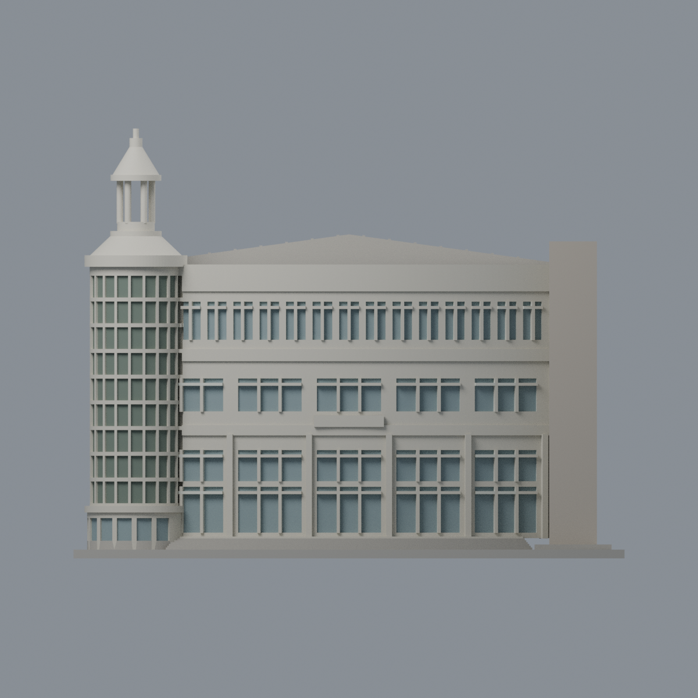
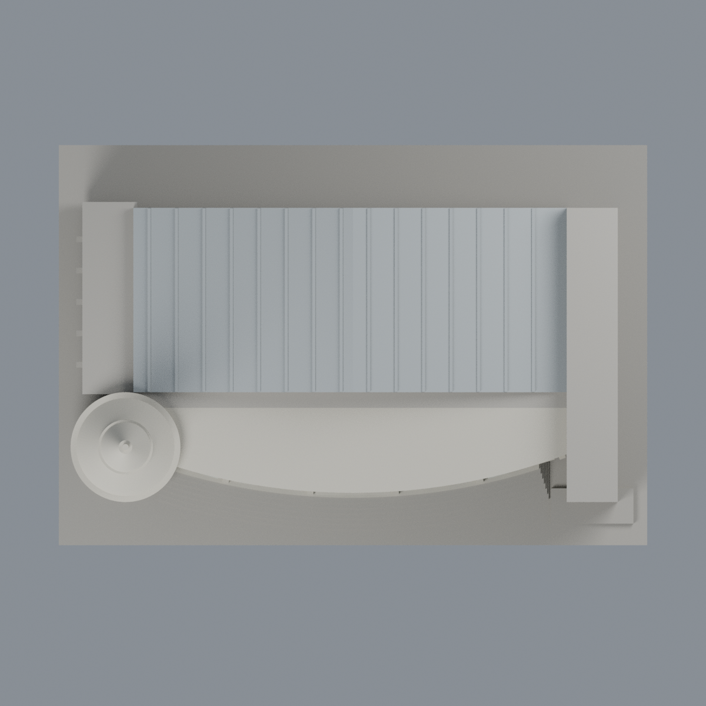

# 聯大二坪 J1 大禮堂、體育館及活動中心：七材質外觀版

沿用原 **16,168 三角面／8,070 頂點**，不改原 STL 位元、座標、面序或幾何；這是既有模型外觀改版，不增加模型包數。

| 模型預覽 | 模型預覽 | 模型預覽 |
| :---: | :---: | :---: |
| 正面  | 背牆中性／屋面同系統推估  |  |
|  |  |  |

[表面色 3MF](nuuj1-appearance.3mf) · [可編輯 Blender](scene.blend) · [材質色表](palette.json) · [逐面指派與依據](face-materials.json) · [原 STL](../model.stl)

## 來源與配色邊界

親自核對官方 [J1 大禮堂、體育館及活動中心相簿](https://secretary.nuu.edu.tw/p/132-1003-1102.php?Lang=zh-tw) 的[照片 1](https://secretary.nuu.edu.tw/var/file/3/1003/gallery/2/1102/gallery_1102_8277325_43968.jpg)與[照片 2](https://secretary.nuu.edu.tw/var/file/3/1003/gallery/2/1102/gallery_1102_4551047_43999.jpg)完整影像。EXIF 分別為 2025-02-28 10:11:41／10:12:39；2025-03-09 是修改日期。時區與拍攝日期未獨立核實，不代表 2026 現況。來源照片不隨包散布。

- 正面曲線寬帶及牆面淡象牙石色；原切出的窗背低飽和灰藍，原窗框淡色。材質按切面登記，不把寬實牆帶染成玻璃，也不加名稱。
- 圓樓梯塔玻璃凹背使用灰橄欖色**照片反射代理**，不是證實玻璃本體固有綠色；原細柱及環帶保留淡石色。下鼓座只有離散凹背上色，不整圈當透明玻璃。
- 塔亭原開孔不填玻璃；塔亭周向石材色及體育館銀灰金屬屋面延伸屬**同系統材料有界推估**，不宣稱每個背面直接看見。體育館屋面不是 PV，不增添設備。
- 左側中層是凹廊／柱廊而非窗，保持中性不染玻璃；只對離散窗背著色。右高核心正面米灰實牆，未見背面維持中性。
- 原頂亭比例、槽紋、台階、後側底部退縮等均保留既有幾何，不藉配色聲稱修復或列印驗證。沒有加旁邊校門／警衛亭；那些獨立模型不重複計入。
- 原 STL／面序／座標不變；這是外觀改善，不增加模型數，不宣稱物理列印成功。

[原幾何與歷史來源限制](../README.zh-TW.md) · [來源覆核](qa/source-review.json)

## 重建與核驗

安裝 [依賴](source/requirements.txt)，Blender 使用 4.3.2。由本資料夾上層提供原 model.stl：

1. `python appearance/source/build_appearance.py`
2. `python appearance/source/verify_exchange.py`
3. `blender -b -t 3 --python-exit-code 1 -P appearance/source/render_appearance.py`
4. `blender -b -t 3 --python-exit-code 1 -P appearance/source/verify_scene.py`

[獨立重建 ZIP](rebuild-source.zip)含原 STL、四支程式及依賴，不含第三方照片；不取代原建模腳本。[逐檔 SHA256](SHA256SUMS)

[交換／拓撲 QA](qa/exchange-validation.json)核對原座標與面序、全部面材質、單連通、有向水密邊、頂點 link 單環、正體積與零退化／重複面；lib3mf 嚴格讀取零警告，實際編輯單材質再存讀，其他材質及面指派不變。SDK 六位小數量化誤差另列。

[Blender 存讀與編輯](qa/scene-validation.json) · [渲染記錄](qa/render-manifest.json) · [獨立重建](qa/rebuild-validation.json)

## 製造限制照舊

尺寸仍為 150 × 102 × 117 mm；原 STL、建模程式、場景及歷史 QA 保留。原層檢與薄特徵檢查本次未重跑，不能由材質 QA 代替。

3MF 是同一網格的表面色，不是七個封閉分色實體、切片專案、噴頭映射或 G-code。切片 GUI、多材料路徑與實體列印未測；柱頭、屋簷、窗框及薄邊仍須評估材料、支撐及拆除風險，沒有保證可印或免支撐。
