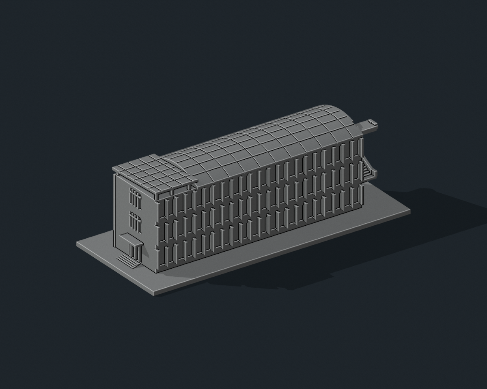

# 國立聯合大學 K2 教學大樓（一）

## 7 材質外觀版（2026-10-21）

| 模型預覽 | 模型預覽 | 模型預覽 |
| :---: | :---: | :---: |
| 正面與來源支持區域<br> | 有來源支持的遮陽肋側<br> |  |

[來源界線與四視角](appearance/README.md) · [表面色 3MF](appearance/nuuk2-appearance.3mf) · [可編輯場景](appearance/scene.blend)

依四張官方照片限定灰牆、淡色遮陽肋、綠框與離散玻璃；空拍確認兩種屋頂光電板，僅原粗格上面深藍，非實際逐片覆蓋率復刻。 原 STL 與歷史 QA 不變；這是外觀改善，不是新增幾何。[原單色正面](previews/front.png)／[原單色背面](previews/rear.png)


依官方外觀照片製作的獨立建築縮印模型，含底座 **150 × 64 × 47.7 mm**。照片比例詮釋，未實測，不是與其他館舍共同比例的校園模型。STL 單位為毫米且無顏色；預覽單色只是材質。

## 建物範圍與照片判讀

現行二坪校園圖與教室代碼表將教學大樓（一）標為 K2。完整相簿標題、教學大樓(1)入口牌和空拍相互核對；另有一張照片仍見第一研究大樓舊牌，未因此另計一棟。僅包含這一棟、端部外梯與屋頂，不含平行 K3、後方 F2 或教室內部。

已逐圖檢視官方相簿完整照片 (1)–(5)。保留三排長立面窗、另一長立面的密集垂直遮陽肋、端部交錯外梯、另一端入口與雨棚、長弧形屋頂及端部獨立斜面太陽能棚；照片 (3)、(4) 提供屋頂空拍依據。正面預覽偏向窗戶長立面與外梯，背面預覽顯示遮陽肋及另一端入口。

尺寸、進深、柱距、外梯踏階數與屋頂曲率為照片估計；屋頂太陽能板僅保留足夠粗的分格，未逐電池片複製。被樹木遮擋的低處採簡化，管線、冷氣與細金屬欄杆不製作。

所有玻璃窗皆以有實心背襯的淺凹窗表示，不含室內格局、設備與安防配置。未附第三方參考照片。

## 預覽與交付

| 模型預覽 | 模型預覽 | 模型預覽 |
| :---: | :---: | :---: |
|  |  |  |

- `model.stl`：單一連通封閉實體
- `build_model.py`：可攜式完整幾何原始碼
- `scene.blend`：可編輯 STL 網格、攝影機、燈光與嵌入原始碼
- `previews/front.png`、`rear.png`、`elevation.png`：最終實際 STL 的完整取景
- `validation.json`：原 STL 法向、邊／頂點連結、封閉性、連通體、無獨立內腔殼、尺寸與平底檢查
- `rebuild_check.json`：乾淨資料夾重建後的相同 STL SHA-256
- `scene_check.json`：Blender/STL 逐三角形座標至 0.00001 mm 比對與嵌入原始碼比對
- `evidence.json`、`manifest.json`、`SHA256SUMS`：來源、範圍及交付雜湊

## 列印建議

底座平放，匯入選毫米。可從 0.4 mm 噴嘴、0.16–0.20 mm 層高、3 圈外牆與 10–15% 填充開始調整。

底座厚 2.4 mm；窗格 0.75–0.8 mm、遮陽肋厚 1.15 mm、棚柱 1.3–1.35 mm、棚板厚約 1.5 mm、外梯底板約 2 mm、外梯側牆厚 1.4 mm。外梯底部及端部太陽能棚有懸空，需切片檢查局部支撐；棚柱和細窗格較脆弱。

已完成數位網格、原始碼重建與 Blender 幾何一致性檢查，未做實體試印或切片器驗證。局部細節依材料、機器與切片策略調整；不建議直接大幅縮小。

## 重新生成

```sh
python -m pip install -r requirements.txt
python build_model.py
python validate_model.py model.stl --longest-edge 150 --output validation.json
python verify_rebuild.py
blender -b -t 4 -P render_preview.py
blender -b -t 2 -P verify_scene.py
```

Python 從自身資料夾讀寫，不依賴原製作環境路徑或照片。Blender 4.3 或較新版可用。重建會覆寫同名檔案；修改前先備份。

模型三角面數：18,702。STL SHA-256：`501d32dc430a058083b97ca162f63a64786fe85b285edd67878d62fd87a4a605`。

## 公開來源

查核日期：2026-10-11。

- [現行二坪校園圖](https://www.nuu.edu.tw/p/426-1000-10.php?Lang=zh-tw)
- [現行教室與大樓代碼](https://nss.nuu.edu.tw/p/412-1037-5747.php)
- [官方教學大樓（一）外觀相簿，照片 (1)–(5)](https://secretary.nuu.edu.tw/p/132-1003-1105.php?Lang=zh-tw)
