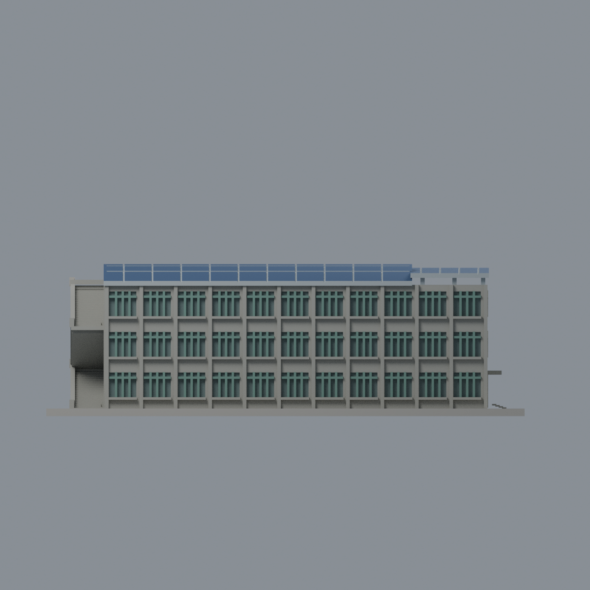
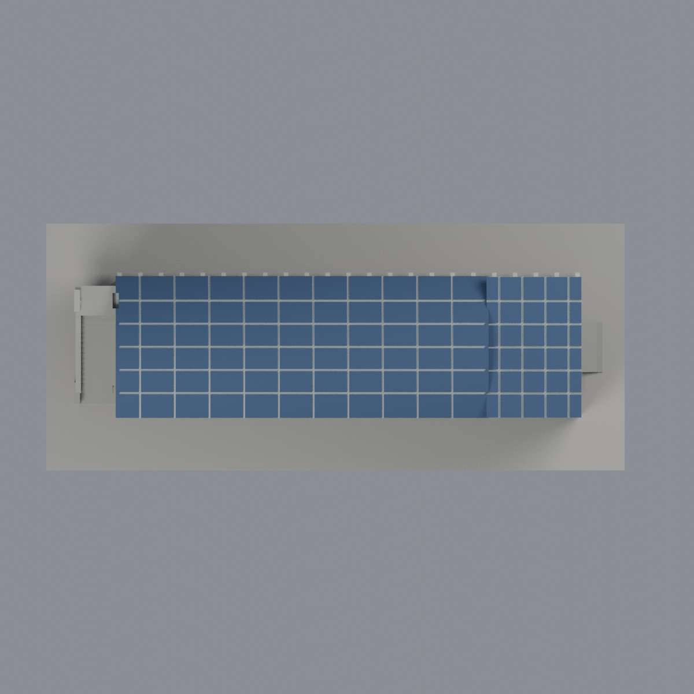

# 聯大二坪 K2 教學大樓（一）：七材質外觀版

沿用原 **18,702 三角面／9,213 頂點**，不改原 STL 位元、座標、面序或幾何；這是既有模型外觀改版，不增加模型包數。

| 正面 | 有來源支持的遮陽肋側 |
|---|---|
|  |  |
|  |  |

[表面色 3MF](nuuk2-appearance.3mf) · [可編輯 Blender](scene.blend) · [材質色表](palette.json) · [逐面指派與依據](face-materials.json) · [原 STL](../model.stl)

## 來源與配色邊界

親自核對官方 [教學大樓（一）相簿](https://secretary.nuu.edu.tw/p/132-1003-1105.php?Lang=zh-tw) 的四張完整照片，直接網址與 SHA256 見 [來源覆核](qa/source-review.json)。本輪私有照片 1/2/3/4 分別對應官方照片 5/1/2/3；官方照片 4 請求失敗，不列為本輪已核對。EXIF 為 2025-02-24 或 2025-02-28，未獨立驗證時間及時區，非 2026 現況證明。第一研究大樓舊牌與教學大樓(1)同棟形體及相簿互證，不另計建築；來源圖不隨包散布。

- 灰色洗石子牆、外梯、窗臺，淡暖灰遮陽肋與入口端窗框；長立面原有細窗格綠灰，僅離散凹窗背灰綠玻璃代理色，不把整面牆作玻璃。
- 完整空拍明確支持**長弧形屋頂及入口端小斜棚皆有 PV**；只對原上表面給深藍色，邊緣、凹格底、支架及底面銀灰。
- 原模型已把板片分格粗化，這次未增加細電池片／板間走道，色面不代表實際精確 PV 覆蓋率；被植栽遮擋區沿用原簡化，不臆造設備。
- 四張不同視角支持兩長側與入口／樓梯端，但沒有逐面測繪；無法可靠配準的面維持中性。未加空調、管線、文字或鄰棟，底座不假造草坪。
- 原 STL／面序／座標不變；不宣稱物理列印成功。歷史文件的其他來源覆核紀錄不等於本輪重新親看。

[原幾何與歷史來源限制](../README.zh-TW.md)

## 重建與核驗

安裝 [依賴](source/requirements.txt)，Blender 使用 4.3.2。由本資料夾上層提供原 model.stl：

1. `python appearance/source/build_appearance.py`
2. `python appearance/source/verify_exchange.py`
3. `blender -b -t 3 --python-exit-code 1 -P appearance/source/render_appearance.py`
4. `blender -b -t 3 --python-exit-code 1 -P appearance/source/verify_scene.py`

[獨立重建 ZIP](rebuild-source.zip)含原 STL、四支程式及依賴，不含第三方照片；不取代原建模腳本。[逐檔 SHA256](SHA256SUMS)

[交換／拓撲 QA](qa/exchange-validation.json)核對原座標與面序、全部面材質、單連通、有向水密邊、頂點 link 單環、正體積與零退化／重複面；lib3mf 嚴格讀取零警告，實際編輯單材質再存讀，其他材質及面指派不變。SDK 六位小數量化誤差另列。

[Blender 存讀與編輯](qa/scene-validation.json) · [渲染記錄](qa/render-manifest.json) · [獨立重建](qa/rebuild-validation.json)

## 製造限制照舊

尺寸仍為 150 × 64 × 47.7 mm；原 STL、建模程式、場景及歷史 QA 保留。原層檢與薄特徵檢查本次未重跑，不能由材質 QA 代替。

3MF 是同一網格的表面色，不是各材質各自封閉的分色實體、切片專案、噴頭映射或 G-code。切片 GUI、多材料路徑與實體列印未測；柱頭、屋簷、窗框及薄邊仍須評估材料、支撐及拆除風險，沒有保證可印或免支撐。
