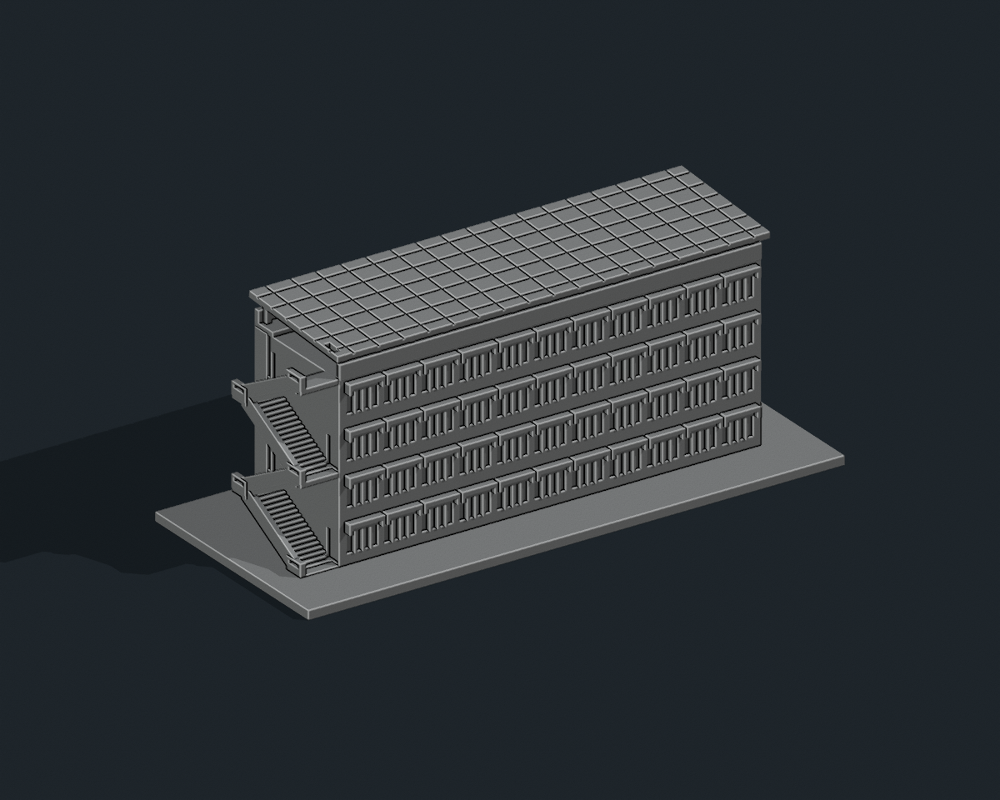

# 國立聯合大學 K3 教學大樓（二）

依官方外觀照片製作的獨立建築縮印模型，含底座 **150 × 64 × 59.99 mm**。照片比例詮釋，未實測，不是與其他館舍共同比例的校園模型。STL 單位為毫米且無顏色；預覽單色只是材質。

## 建物範圍與照片判讀

現行二坪校園圖和教室代碼表將教學大樓（二）標為 K3；校史表亦稱綜合大樓。完整相簿與端部教學大樓(2)牌已互核。只包含此長棟、端部外梯與屋頂棚，不含前方紅磚低屋、平行 K2 或 F2。舊代碼頁曾用 K2 稱綜合大樓，本包依現行校園圖 K3，不把新舊名稱另計。

已逐圖檢視官方相簿 (1)–(6)。保留四排長立面窗、窗上倒 U 形混凝土遮陽框、另一面的長向開放走廊與帶橫縫護牆、端部交錯外梯、平直實牆端頭和屋頂大型單斜太陽能棚。空拍 (1) 顯示太陽能棚與相鄰 K2 弧形屋頂的差異，近照 (3) 提供階梯與護牆細節。

建築尺寸、進深、柱距、樓梯踏階數及遮擋區開口位置為照片估計。四排窗依像素核對，屋頂棚下另保留露台；未用同一排窗格整面鏡射到走廊側。太陽能板僅做粗分格，樹木、管線、冷氣及細金屬欄杆未製作。

所有玻璃窗皆以有實心背襯的淺凹窗表示，不含室內格局、設備與安防配置。未附第三方參考照片。

## 預覽與交付




- `model.stl`：單一連通封閉實體
- `build_model.py`：可攜式完整幾何原始碼
- `scene.blend`：可編輯 STL 網格、攝影機、燈光與嵌入原始碼
- `previews/front.png`、`rear.png`、`elevation.png`：最終實際 STL 的完整取景
- `validation.json`：原 STL 法向、邊／頂點連結、封閉性、連通體、無獨立內腔殼、尺寸與平底檢查
- `rebuild_check.json`：乾淨資料夾重建後的相同 STL SHA-256
- `scene_check.json`：Blender/STL 逐三角形座標至 0.00001 mm 比對與嵌入原始碼比對
- `evidence.json`、`manifest.json`、`SHA256SUMS`：來源、範圍及交付雜湊

## 列印建議

底座平放，匯入選毫米。可從 0.4 mm 噴嘴、0.16–0.20 mm 層高、3 圈外牆與 10–15% 填充開始調整。

底座厚 2.4 mm；窗格厚 0.8 mm、窗上遮陽框厚 1–1.25 mm、走廊柱厚 1.4 mm、護牆厚 1.7 mm、外梯底板約 2 mm、外梯側牆厚 1.5 mm、太陽能棚柱 1.5 mm、棚板厚 1.7 mm。外梯下方、長走廊與太陽能棚均有懸空，必須在切片預覽檢查支撐；不宜把此模型當作無支撐列印。

已完成數位網格、原始碼重建與 Blender 幾何一致性檢查，未做實體試印或切片器驗證。局部細節依材料、機器與切片策略調整；不建議直接大幅縮小。

## 重新生成

```sh
python -m pip install -r requirements.txt
python build_model.py
python validate_model.py model.stl --longest-edge 150 --output validation.json
python verify_rebuild.py
blender -b -t 4 -P render_preview.py
blender -b -t 2 -P verify_scene.py
```

Python 從自身資料夾讀寫，不依賴原製作環境路徑或照片。Blender 4.3 或較新版可用。重建會覆寫同名檔案；修改前先備份。

模型三角面數：18,436。STL SHA-256：`42a6fe43719062167e2b11dfec74c17ddf107c3dc74ad2f62b4ae6a2c03b0ddc`。

## 公開來源

查核日期：2026-10-11。

- [現行二坪校園圖](https://www.nuu.edu.tw/p/426-1000-10.php?Lang=zh-tw)
- [現行教室與大樓代碼](https://nss.nuu.edu.tw/p/412-1037-5747.php)
- [官方教學大樓（二）外觀相簿，照片 (1)–(6)](https://secretary.nuu.edu.tw/p/132-1003-1106.php?Lang=zh-tw)
- [校史建物清冊，K3 綜合大樓](https://nuuarchives.nuu.edu.tw/p/16-1097-27990.php?Lang=zh-tw)
