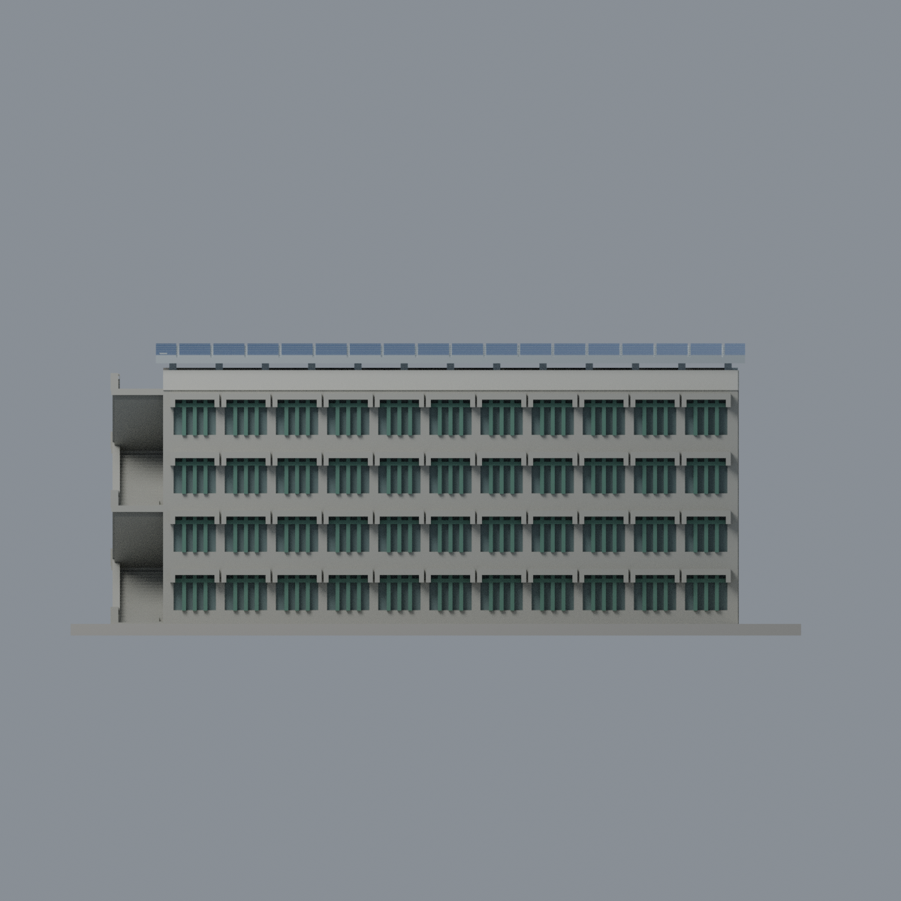
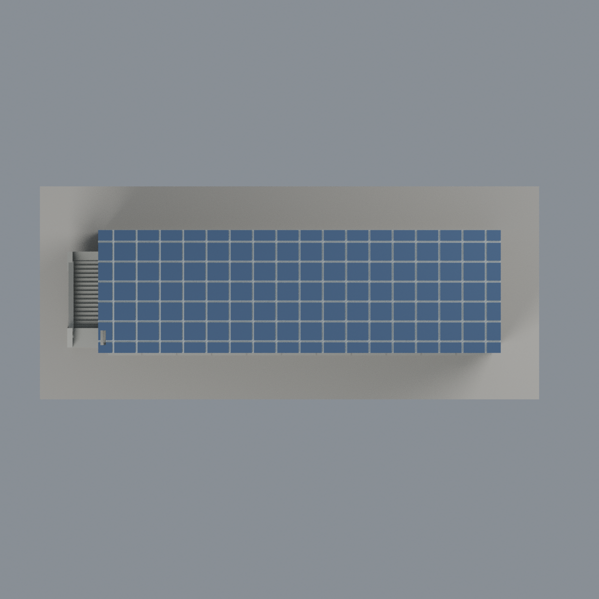

# 聯大二坪 K3 教學大樓（二）：七材質外觀版

沿用原 **18,436 三角面／8,952 頂點**，不改原 STL 位元、座標、面序或幾何；這是既有模型外觀改版，不增加模型包數。

| 正面 | 開放走廊／內窗材質有界延伸 |
|---|---|
|  |  |
|  |  |

[表面色 3MF](nuuk3-appearance.3mf) · [可編輯 Blender](scene.blend) · [材質色表](palette.json) · [逐面指派與依據](face-materials.json) · [原 STL](../model.stl)

## 來源與配色邊界

親自核對官方 [教學大樓（二）相簿](https://secretary.nuu.edu.tw/p/132-1003-1106.php?Lang=zh-tw) 的三張完整照片，直接網址與 SHA256 見 [來源覆核](qa/source-review.json)。EXIF 為 2025-02-28 10:59:08、11:18:03、11:19:28，未獨立驗證日期及時區，不代表 2026 現況。與後方 K2 長弧棚分開辨識；本包只有 K3，來源圖不隨包散布。

- 灰色牆、端部交錯外梯與正面倒 U 型遮陽帽，綠色原窗格與灰綠離散窗凹背；不添空調、鋁格、文字或樹影。
- 背側是開放外走廊、灰色樓板與有狹縫的實欄板，不整片塗玻璃；僅原走廊內壁離散窗凹以同窗系統代理色有界延伸，並非逐窗直接照片核實。
- 空拍支持單一大斜棚為 PV，僅既有上表面深藍，支柱／邊緣／凹格底銀灰。原粗分格與實際板間距、走道及細電池格不同，並非精確覆蓋率復刻。
- 原樓梯及欄板的比例為歷史簡化；未分面的奶白樓梯底不另切三角面造色塊。未知部位及底座中性，不臆造草地、設備或鄰棟。
- 原 STL、座標、面序與歷史 QA 不變；無物理列印成功宣稱。

[原幾何與歷史來源限制](../README.zh-TW.md)

## 重建與核驗

安裝 [依賴](source/requirements.txt)，Blender 使用 4.3.2。由本資料夾上層提供原 model.stl：

1. `python appearance/source/build_appearance.py`
2. `python appearance/source/verify_exchange.py`
3. `blender -b -t 3 --python-exit-code 1 -P appearance/source/render_appearance.py`
4. `blender -b -t 3 --python-exit-code 1 -P appearance/source/verify_scene.py`

[獨立重建 ZIP](rebuild-source.zip)含原 STL、四支程式及依賴，不含第三方照片；不取代原建模腳本。[逐檔 SHA256](SHA256SUMS)

[交換／拓撲 QA](qa/exchange-validation.json)核對原座標與面序、全部面材質、單連通、有向水密邊、頂點 link 單環、正體積與零退化／重複面；lib3mf 嚴格讀取零警告，實際編輯單材質再存讀，其他材質及面指派不變。SDK 六位小數量化誤差另列。

[Blender 存讀與編輯](qa/scene-validation.json) · [渲染記錄](qa/render-manifest.json) · [獨立重建](qa/rebuild-validation.json)

## 製造限制照舊

尺寸仍為 150 × 64 × 60 mm；原 STL、建模程式、場景及歷史 QA 保留。原層檢與薄特徵檢查本次未重跑，不能由材質 QA 代替。

3MF 是同一網格的表面色，不是六個封閉分色實體、切片專案、噴頭映射或 G-code。切片 GUI、多材料路徑與實體列印未測；柱頭、屋簷、窗框及薄邊仍須評估材料、支撐及拆除風險，沒有保證可印或免支撐。
