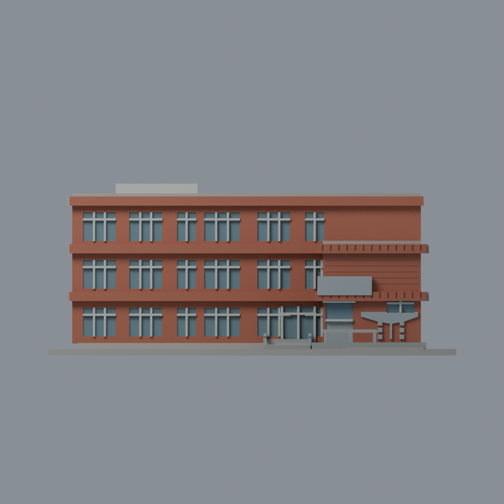
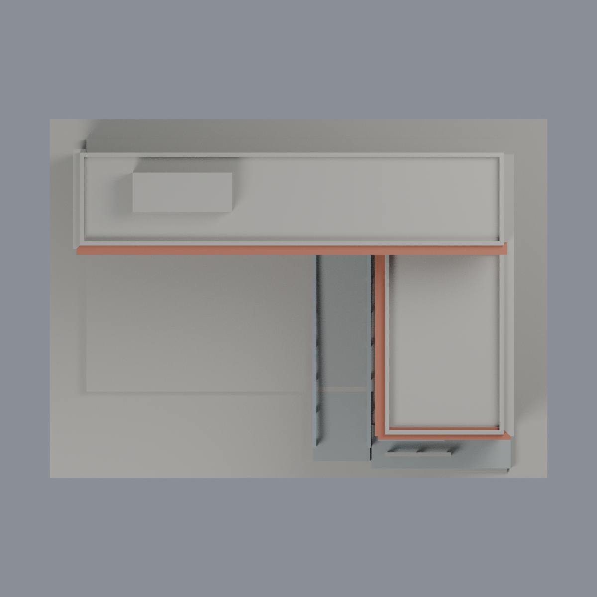

# 聯大二坪 M1 水雲樓：六材質外觀版

沿用原 **5,446 三角面／2,683 頂點**，不改原 STL 位元、座標、面序或幾何；這是既有模型外觀改版，不增加模型包數。

| 模型預覽 | 模型預覽 | 模型預覽 |
| :---: | :---: | :---: |
| 正面  | 背牆與主屋頂中性  |  |
|  |  |  |

[表面色 3MF](nuum1-appearance.3mf) · [可編輯 Blender](scene.blend) · [材質色表](palette.json) · [逐面指派與依據](face-materials.json) · [原 STL](../model.stl)

## 來源與配色邊界

親自核對官方 [水雲樓相簿](https://secretary.nuu.edu.tw/p/132-1003-1112.php?Lang=zh-tw) 的短端正面照片與住宿中心的完整內院照片，精確網址與 SHA256 見 [來源覆核](qa/source-review.json)。EXIF 分別為 2025-02-24 11:17:34、2023-07-30 12:41:46，日期與時區未獨立核實。這是跨年外觀參考，不代表 2026 現況；來源照片不隨包散布。

- 內院兩翼與短端正面紅磚，原凸樓層帶紅磚、可分辨底面淡灰；細窗框與原凸橫格淡灰，只有實際窗凹背灰藍，未把窗下實牆染玻璃。
- 原牌匾、碗形浮飾及小方塊銀灰，牌匾保持空白，沒有假造金字。前門下部中性金屬，上部只有原網格能分開的面採玻璃代理色；沒有為配色切面。
- 原坡道與前平台灰色，既有欄杆銀灰。底座混合草地／磚路／植栽而未分面，保持中性不硬套綠色或紅色。
- 高翼屋頂前方原屏體僅正面淡灰；未見屋頂、外長側及後面中性。2023 照片低翼上有更複雜窗室，原模型未作，本次不新增。
- 原窗格與浮飾為厚化簡化，某些框線跨出窗洞，色彩不修正這些歷史幾何差異。不加冷氣、管線、住戶資訊或旁邊身分未定低山牆棟。
- 原 STL、座標、面序與歷史 QA 不變，無物理列印成功宣稱。

[原幾何與歷史來源限制](../README.zh-TW.md)

## 重建與核驗

安裝 [依賴](source/requirements.txt)，Blender 使用 4.3.2。由本資料夾上層提供原 model.stl：

1. `python appearance/source/build_appearance.py`
2. `python appearance/source/verify_exchange.py`
3. `blender -b -t 3 --python-exit-code 1 -P appearance/source/render_appearance.py`
4. `blender -b -t 3 --python-exit-code 1 -P appearance/source/verify_scene.py`

[獨立重建 ZIP](rebuild-source.zip)含原 STL、四支程式及依賴，不含第三方照片；不取代原建模腳本。[逐檔 SHA256](SHA256SUMS)

[交換／拓撲 QA](qa/exchange-validation.json)核對原座標與面序、全部面材質、單連通、有向水密邊、頂點 link 單環、正體積與零退化／重複面；lib3mf 嚴格讀取零警告，實際編輯單材質再存讀，其他材質及面指派不變。SDK 六位小數量化誤差另列。

[Blender 存讀與編輯](qa/scene-validation.json) · [渲染記錄](qa/render-manifest.json) · [獨立重建](qa/rebuild-validation.json)

## 製造限制照舊

尺寸仍為 150 × 108 × 63.1 mm；原 STL、建模程式、場景及歷史 QA 保留。原層檢與薄特徵檢查本次未重跑，不能由材質 QA 代替。

3MF 是同一網格的表面色，不是六個封閉分色實體、切片專案、噴頭映射或 G-code。切片 GUI、多材料路徑與實體列印未測；柱頭、屋簷、窗框及薄邊仍須評估材料、支撐及拆除風險，沒有保證可印或免支撐。
