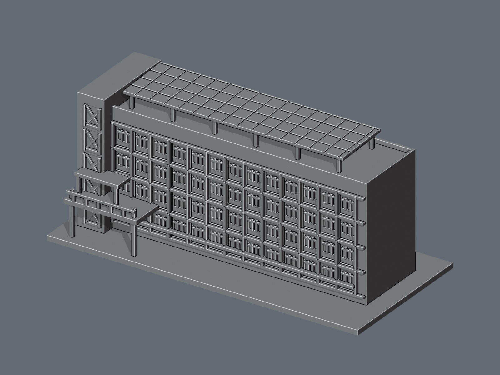

# M2 第二宿舍（紅夢樓）｜可列印外觀近似模型

國立聯合大學二坪山校區。2026-10-11 核對官方校區名錄與外觀照片後建模。這是獨立縮尺展示模型，不是測繪、建築竣工或精確復原資料。

## 名稱與範圍

現行代碼為 **M2 第二宿舍（紅夢樓）**。校史使用執照表列 M3 第一女生宿舍（紅夢樓）。歷史代碼與現行代碼不同，不能用舊代碼另計一棟，也不能把樓層、房號或附屬機能當成獨立建築。

相簿 1110 全部四張照片與住宿服務中心三張外觀照片；招牌的現行 Dorm 2 與舊女生第一宿舍字樣按年代分別記錄。

## 可辨識特徵

低長矩形宿舍、規律四列主要窗帶與深柱梁框格；左端外加電梯塔的交叉框；中低位置入口平台、短雨棚與屋頂架高長棚。

## 證據限制與近似處

官方照片集中在同一長立面與左端電梯，完整對側長立面、最遠端、屋頂俯視及確切深度尚未確認。模型背面與端部依照片可見量體作簡化實牆。長立面窗格數、深度與平台長度為照片比例近似。照片通往鄰棟的外廊只保留本站入口平台，不延伸納入另一棟或校園通道。

所有實際長寬高、基地高程、朝向、部分重複間距與細部尺度均為目測近似。本套件只處理公開外觀；不含室內、住戶細節、機電設備或保全配置。窗為實體牆面淺凹、沒有建造房間。背面未見部分不以正面鏡像補造。

## 尺寸與 STL

- 含底座約 **150 × 70 × 64.8 mm**，最長邊 150 mm；底座厚 2.4 mm，底面位於 Z=0。
- 此棟各自縮放以適合桌上列印，與其他校舍不是共同校園縮尺。
- 正面為模型座標 -Y；不是實地羅盤方向。
- STL 為單一連通、封閉實體外殼；無獨立封閉內腔殼。屋頂女兒牆、橋下與框架間可有通向外界的開放空間。
- 預覽由實際 STL 匯入 Blender 製作；預覽色彩只作顯示，STL 本身沒有顏色。未重現細小招牌字，以牌匾位置與量體取代。

## 列印建議與脆弱部位

建議平底朝下，0.4 mm 噴嘴、0.16–0.20 mm 層高、3 道外壁；填充率可先從 10–15% 試切片。這些是起始建議，不是已測試的參數。

- 窗分格 0.8 mm；電梯交叉肋 0.95 mm；平台欄杆 1.2 mm；棚架柱 1.5 mm；屋頂板 1.4 mm（格線凹刻後局部約 1.0 mm）。
- 架高屋頂的主要支柱間距約 20 mm，前後柱列約 24 mm；入口平台下方有約 16–30 mm 空間跨度，雨棚及薄簷亦可能需要局部支撐。請檢查支撐可拆除性。
- 不建議直接縮小，0.8 mm 細肋與淺凹細節可能消失。若要縮小，請先修改原始碼加粗。
- 尚未實體試印，也未宣稱通過特定切片器測試。數位封閉性檢查不能保證所有機器都能免支撐列印；請在切片器逐層檢視、確認支撐與拆除空間。

## 檔案

- `model.stl`：毫米單位列印網格。
- `scene.blend`：可編輯 Blender 場景，列印物件名為 `Print-ready exterior (mm)`；相機不是列印幾何。
- `build_model.py`：原創可攜幾何程式，無私人路徑、網路下載或參考影像依賴。
- `requirements.txt`：固定版本的 Python 依賴。
- `render_preview.py`：由 STL 產生場景與正／背預覽。
- `validate_model.py`、`validation.json`：STL 原始法向量、邊、頂點連結、方向、連通、內腔殼與尺寸檢查。
- `rebuild_check.py`、`rebuild-check.json`：在新暫存資料夾以原始碼重建，確認 STL SHA-256 一致。
- `check_blend.py`、`blend_validation.json`：Blender 與 STL 三角幾何一致性驗證。
- `evidence.json`：官方來源、逐張照片網址與限制。
- `SHA256SUMS`：交付檔案雜湊清單，不含清單自身。

## 重建與驗證

Python 3.12 及 Blender 4.x 測試環境。先在虛擬環境執行 `python -m pip install -r requirements.txt`。以下指令皆從解壓後的單棟資料夾執行：

1. `python build_model.py`
2. `python validate_model.py model.stl --longest-edge 150 --output validation.json`
3. `python rebuild_check.py`
4. `blender -b -t 4 -P render_preview.py`
5. `blender -b scene.blend -t 4 -P check_blend.py`

驗證原始 STL 中的每條邊恰有兩面、頂點連結為單一環、儲存法向量與繞向一致，以及單一正體積外殼。這些檢查未獨立證明所有幾何自交均不存在；本模型另以實體布林運算建構。

## 官方來源

- [現行二坪山校區名錄](https://www.nuu.edu.tw/p/426-1000-10.php?Lang=zh-tw)
- [官方建築照片索引](https://secretary.nuu.edu.tw/p/412-1003-7831.php?Lang=zh-tw)
- [本棟官方外觀相簿](https://secretary.nuu.edu.tw/p/132-1003-1110.php?Lang=zh-tw)
- [住宿服務中心本棟照片頁，僅使用外觀照片](https://dorm.nuu.edu.tw/p/405-1101-44750%2Cc5638.php)
- [校史校園規劃與歷史使用執照表](https://nuuarchives.nuu.edu.tw/p/16-1097-27990.php?Lang=zh-tw)

照片權利屬原權利人，本套件不附第三方照片，也不授予第三方照片的使用權。本模型與文件為依公開證據獨立製作的近似作品，不表示校方認證。
