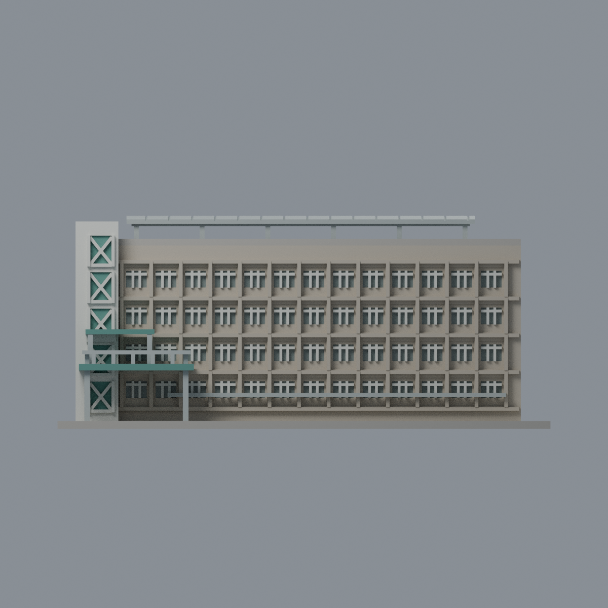
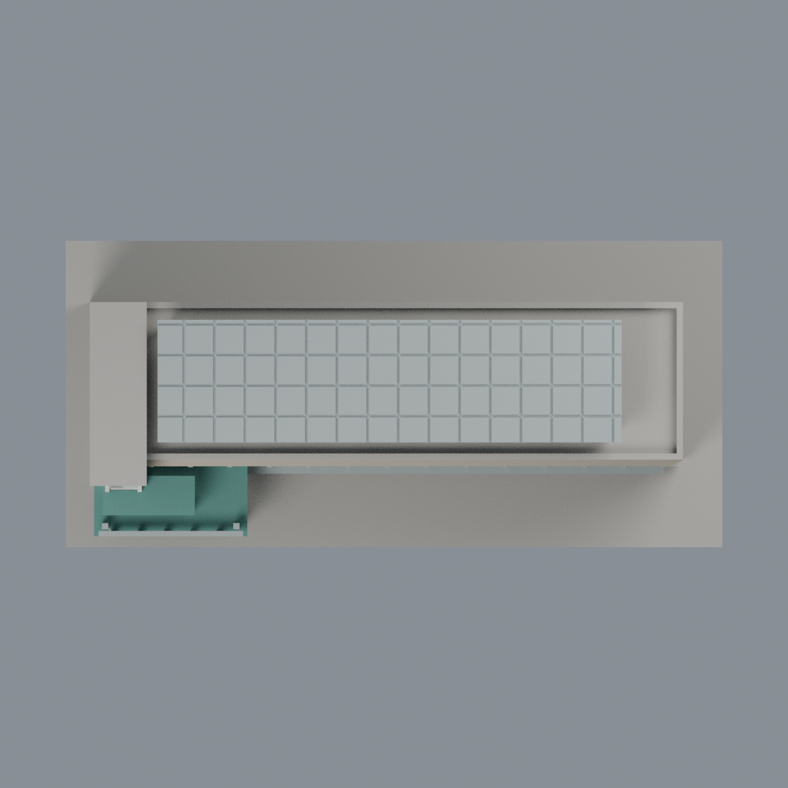

# 聯大二坪 M2 紅夢樓：六材質外觀版

沿用原 **13,702 三角面／6,761 頂點**，不改原 STL 位元、座標、面序或幾何；這是既有模型外觀改版，不增加模型包數。

| 正面 | 背牆與主屋頂中性 |
|---|---|
|  |  |
|  |  |

[表面色 3MF](nuum2-appearance.3mf) · [可編輯 Blender](scene.blend) · [材質色表](palette.json) · [逐面指派與依據](face-materials.json) · [原 STL](../model.stl)

## 來源與配色邊界

親自核對官方 [紅夢樓相簿](https://secretary.nuu.edu.tw/p/132-1003-1110.php?Lang=zh-tw) 的照片 1／4 完整影像，精確網址與 SHA256 見 [來源覆核](qa/source-review.json)。EXIF 分別為 2025-02-28 12:55:56、2025-03-02 13:58:35，未獨立驗證日期與時區，不代表 2026 現況；來源圖不隨包散布。

- 主立面暖灰混凝土與淡色窗框，**只有內層小窗凹背採玻璃代理色**，外層大凹口和窗下實牆不是整片玻璃。
- 原電梯前凹窗灰青綠、X 撐與外框淡灰白。左側照片有綠色帶，但原牆面未分出完整帶界，採淡中性白，不把整面塔樓強染綠，也不新增切面。
- 小入口棚與原縮短連橋平台灰綠，欄杆／支柱灰色。連橋未向模型外延伸，牌匾空白，不加標字、空調或住戶資訊。
- **照片只清楚顯示屋頂棚底與支架，不能由歷史腳本的 solar 名稱確認 PV 頂面。** 原棚採保守銀灰代理色，包含同棚上表面的明示材料延伸，不宣稱實景頂部已證實；不染深藍光電。
- 未見後面、另一端與平屋頂中性；汙漬、陰影不烘焙。原外窗層次、粗棚格與實景不同，維持既有幾何。
- 原 STL、座標、面序與歷史 QA 不變，無物理列印成功宣稱。

[原幾何與歷史來源限制](../README.zh-TW.md)

## 重建與核驗

安裝 [依賴](source/requirements.txt)，Blender 使用 4.3.2。由本資料夾上層提供原 model.stl：

1. `python appearance/source/build_appearance.py`
2. `python appearance/source/verify_exchange.py`
3. `blender -b -t 3 --python-exit-code 1 -P appearance/source/render_appearance.py`
4. `blender -b -t 3 --python-exit-code 1 -P appearance/source/verify_scene.py`

[獨立重建 ZIP](rebuild-source.zip)含原 STL、四支程式及依賴，不含第三方照片；不取代原建模腳本。[逐檔 SHA256](SHA256SUMS)

[交換／拓撲 QA](qa/exchange-validation.json)核對原座標與面序、全部面材質、單連通、有向水密邊、頂點 link 單環、正體積與零退化／重複面；lib3mf 嚴格讀取零警告，實際編輯單材質再存讀，其他材質及面指派不變。SDK 六位小數量化誤差另列。

[Blender 存讀與編輯](qa/scene-validation.json) · [渲染記錄](qa/render-manifest.json) · [獨立重建](qa/rebuild-validation.json)

## 製造限制照舊

尺寸仍為 150 × 70 × 64.8 mm；原 STL、建模程式、場景及歷史 QA 保留。原層檢與薄特徵檢查本次未重跑，不能由材質 QA 代替。

3MF 是同一網格的表面色，不是六個封閉分色實體、切片專案、噴頭映射或 G-code。切片 GUI、多材料路徑與實體列印未測；柱頭、屋簷、窗框及薄邊仍須評估材料、支撐及拆除風險，沒有保證可印或免支撐。
