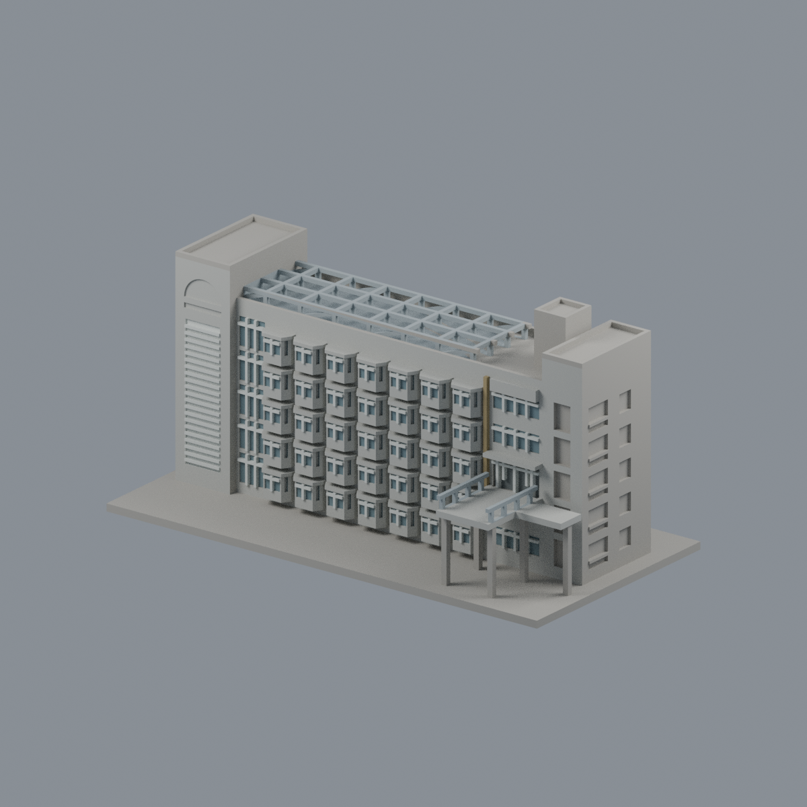
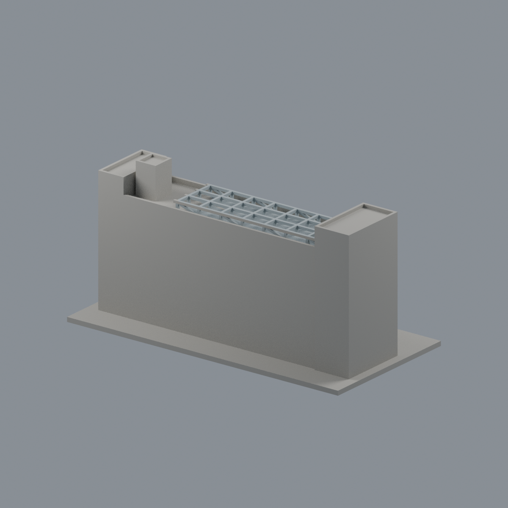
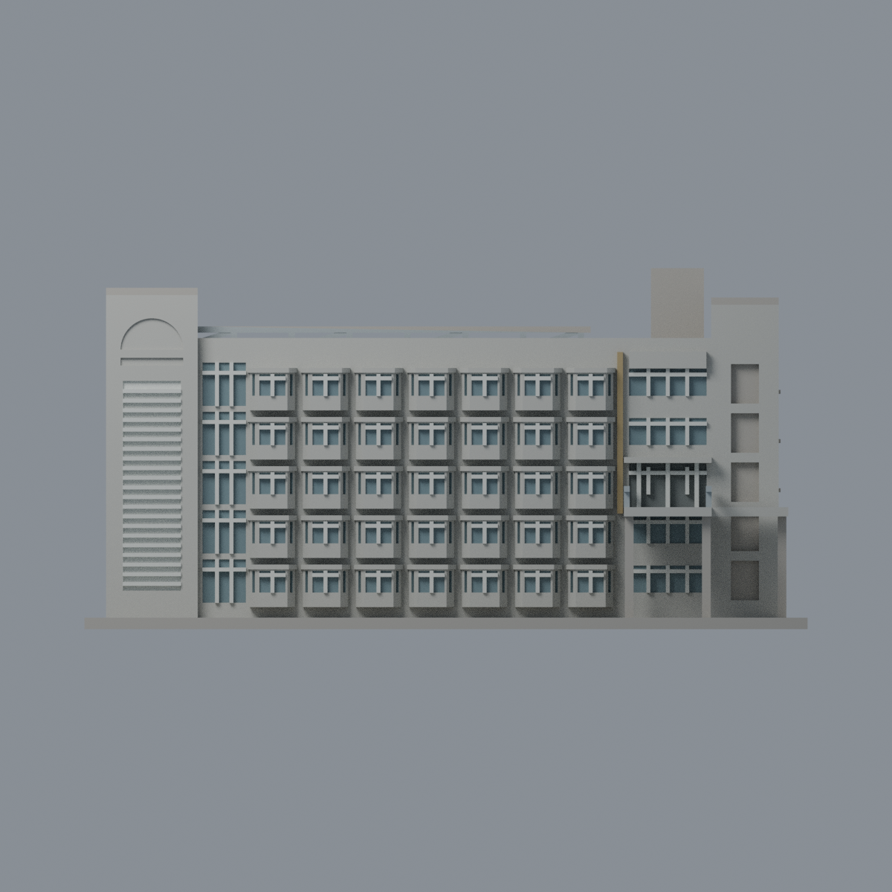
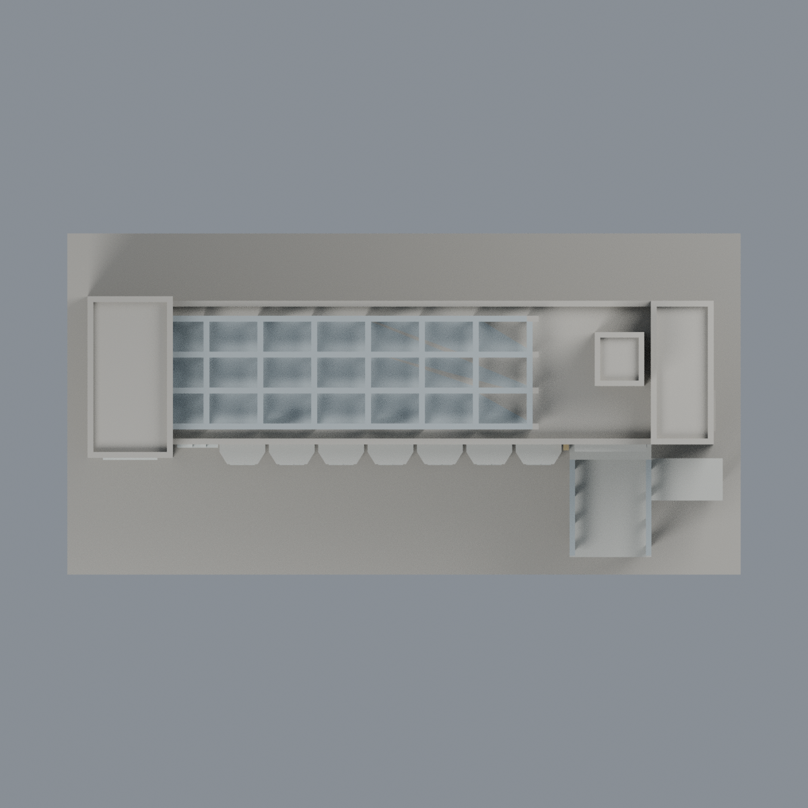

# 聯大二坪 M3 影山樓：七材質外觀版

沿用原 **11,200 三角面／5,466 頂點**，不改原 STL 位元、座標、面序或幾何；這是既有模型外觀改版，不增加模型包數。

| 模型預覽 | 模型預覽 | 模型預覽 |
| :---: | :---: | :---: |
| 正面  | 背牆與主屋頂中性  |  |
|  |  |  |

[表面色 3MF](nuum3-appearance.3mf) · [可編輯 Blender](scene.blend) · [材質色表](palette.json) · [逐面指派與依據](face-materials.json) · [原 STL](../model.stl)

## 來源與配色邊界

親自核對官方 [影山樓相簿](https://secretary.nuu.edu.tw/p/132-1003-1114.php?Lang=zh-tw) 的完整入口俯視照與住宿中心高位全景，直接網址、SHA256、EXIF 見 [來源覆核](qa/source-review.json)。影像跨 2023／2025 年，日期與時區未獨立驗證，不代表 2026 現況；不散布來源照片。

- 主前牆與原切角凸窗的實牆／帽板淡灰，只有原前窗及斜側窗的凹背灰藍；原白色窗格保留，窗下實牆不是玻璃。
- 全景支持左塔淺灰、百葉板淡白與左側狹長窗；右端入口旁原細條淡褐，牌匾空白不造金字。入口深凹採灰暗代理色，不斷言整個入口為玻璃。
- **屋頂清楚是裸露金屬網架，不添加 PV 或任何覆蓋板。** 既有粗框架銀灰，同框架材料有界延伸；模型網格節奏與實際細桁架不同。
- 原連橋平台灰色、欄杆灰金屬，不染前景樹綠／陰影。未見後面、未在本輪照片配準的右回折窗及屋頂設備量體中性。
- 全景有樹木遮蔽下層，簡化照原幾何保留；不新增熱水器、水塔、空調、線路、文字或鄰樓。
- 原 STL、座標、面序及歷史 QA 不變；無物理列印成功宣稱。

[原幾何與歷史來源限制](../README.zh-TW.md)

## 重建與核驗

安裝 [依賴](source/requirements.txt)，Blender 使用 4.3.2。由本資料夾上層提供原 model.stl：

1. `python appearance/source/build_appearance.py`
2. `python appearance/source/verify_exchange.py`
3. `blender -b -t 3 --python-exit-code 1 -P appearance/source/render_appearance.py`
4. `blender -b -t 3 --python-exit-code 1 -P appearance/source/verify_scene.py`

[獨立重建 ZIP](rebuild-source.zip)含原 STL、四支程式及依賴，不含第三方照片；不取代原建模腳本。[逐檔 SHA256](SHA256SUMS)

[交換／拓撲 QA](qa/exchange-validation.json)核對原座標與面序、全部面材質、單連通、有向水密邊、頂點 link 單環、正體積與零退化／重複面；lib3mf 嚴格讀取零警告，實際編輯單材質再存讀，其他材質及面指派不變。SDK 六位小數量化誤差另列。

[Blender 存讀與編輯](qa/scene-validation.json) · [渲染記錄](qa/render-manifest.json) · [獨立重建](qa/rebuild-validation.json)

## 製造限制照舊

尺寸仍為 150 × 76 × 74.9 mm；原 STL、建模程式、場景及歷史 QA 保留。原層檢與薄特徵檢查本次未重跑，不能由材質 QA 代替。

3MF 是同一網格的表面色，不是各材質各自封閉的分色實體、切片專案、噴頭映射或 G-code。切片 GUI、多材料路徑與實體列印未測；柱頭、屋簷、窗框及薄邊仍須評估材料、支撐及拆除風險，沒有保證可印或免支撐。
