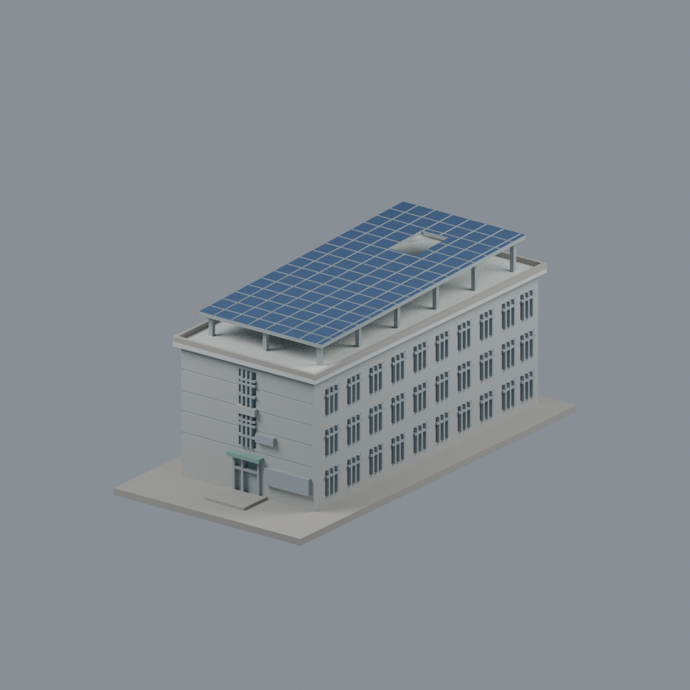
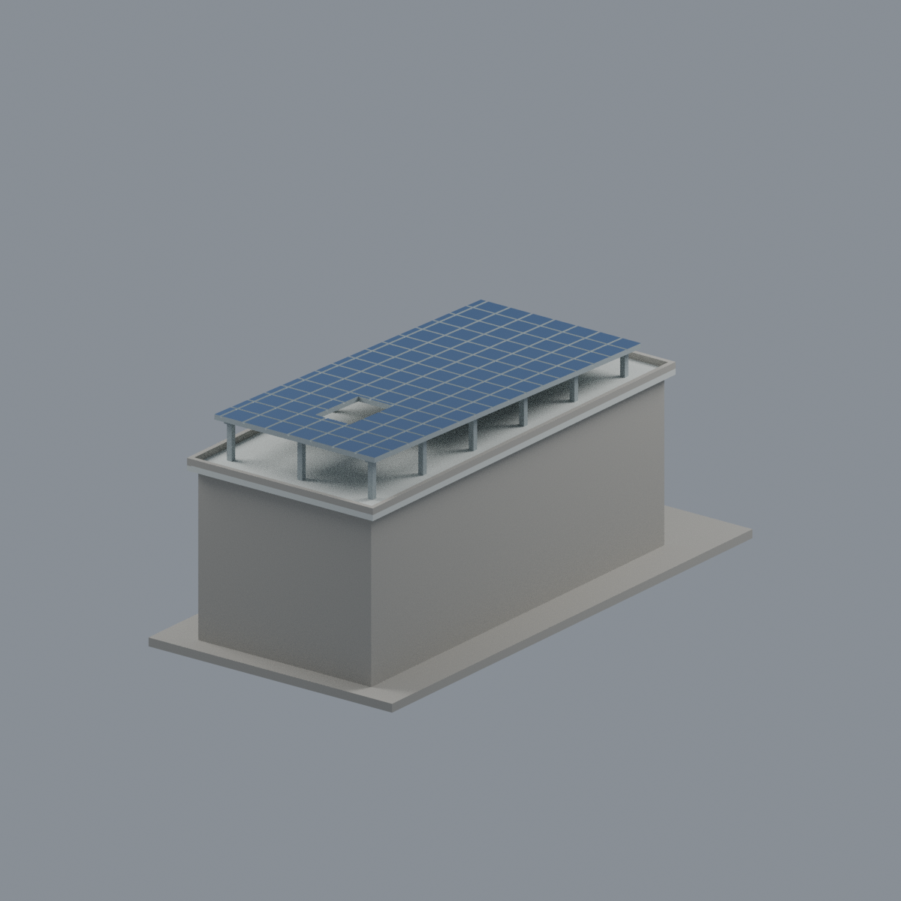

# M4 第四宿舍（霽齋樓）｜可列印外觀近似模型

## 模型預覽

| 模型預覽 | 模型預覽 | 模型預覽 |
| :---: | :---: | :---: |
| 正面與來源支持區域  | 背牆中性／整體凸簷材質延伸  |  |

## 7 材質外觀版（2026-10-21）

[來源界線與四視角](appearance/README.md) · [表面色 3MF](appearance/nuum4-appearance.3mf) · [可編輯場景](appearance/scene.blend)

依官方空拍與近照限定淺灰前／右牆、銀框、灰藍離散窗與綠小棚；PV 僅原上面深藍，保留屋頂開口，不造水箱或金字。 原 STL 與歷史 QA 不變；這是外觀改善，不是新增幾何。[原單色正面](previews/front.png)／[原單色背面](previews/rear.png)

國立聯合大學二坪山校區。2026-10-11 核對官方校區名錄與外觀照片後建模。這是獨立縮尺展示模型，不是測繪、建築竣工或精確復原資料。

## 名稱與範圍

現行代碼為 **M4 第四宿舍（霽齋樓）**。校史使用執照表列 M1 第五女生宿舍（霽齋樓）。歷史代碼與現行代碼不同，不能用舊代碼另計一棟，也不能把樓層、房號或附屬機能當成獨立建築。

相簿 1111 五張外觀照片與住宿服務中心一張外觀照片；現行 Dorm 4 與舊 Men’s Dorm 3 的招牌屬不同時期，不作新增棟數。

## 可辨識特徵

狹長三層板狀樓體；短端入口、兩層直向格柵窗帶及偏置牌匾；大幅外挑平屋簷；長矩形架高太陽能棚及棚面後段局部開口。

## 證據限制與近似處

相簿第 4 張高位照片可辨短端與右長立面及屋頂；樹木遮蔽較低窗列與背端。模型右長立面只以可見窗節奏作概略延伸；左長立面與背端尚未有完整證據，保持簡化實牆。屋頂開口的精確位置、面板細格、長寬高與基地坡度均為近似。

所有實際長寬高、基地高程、朝向、部分重複間距與細部尺度均為目測近似。本套件只處理公開外觀；不含室內、住戶細節、機電設備或保全配置。窗為實體牆面淺凹、沒有建造房間。背面未見部分不以正面鏡像補造。

## 尺寸與 STL

- 含底座約 **76 × 150 × 62.1 mm**，最長邊 150 mm；底座厚 2.4 mm，底面位於 Z=0。
- 此棟各自縮放以適合桌上列印，與其他校舍不是共同校園縮尺。
- 正面為模型座標 -Y；不是實地羅盤方向。
- STL 為單一連通、封閉實體外殼；無獨立封閉內腔殼。屋頂女兒牆、橋下與框架間可有通向外界的開放空間。
- 預覽由實際 STL 匯入 Blender 製作；預覽色彩只作顯示，STL 本身沒有顏色。未重現細小招牌字，以牌匾位置與量體取代。

## 列印建議與脆弱部位

建議平底朝下，0.4 mm 噴嘴、0.16–0.20 mm 層高、3 道外壁；填充率可先從 10–15% 試切片。這些是起始建議，不是已測試的參數。

- 格柵／窗分格 0.8 mm；屋頂女兒牆 1.3 mm、棚柱 1.5 mm；棚板 1.4 mm（格線凹刻後局部約 1.0 mm）；面板刻線寬 0.65 mm。
- 棚架柱距約 21–22 mm，太陽能棚與主屋頂之間高約 7–11 mm，需檢查棚板下的橋接與支撐。外挑屋簷約 2 mm；門上雨棚亦可能需局部支撐。
- 不建議直接縮小，0.8 mm 細肋與淺凹細節可能消失。若要縮小，請先修改原始碼加粗。
- 尚未實體試印，也未宣稱通過特定切片器測試。數位封閉性檢查不能保證所有機器都能免支撐列印；請在切片器逐層檢視、確認支撐與拆除空間。

## 檔案

- `model.stl`：毫米單位列印網格。
- `scene.blend`：可編輯 Blender 場景，列印物件名為 `Print-ready exterior (mm)`；相機不是列印幾何。
- `build_model.py`：原創可攜幾何程式，無私人路徑、網路下載或參考影像依賴。
- `requirements.txt`：固定版本的 Python 依賴。
- `render_preview.py`：由 STL 產生場景與正／背預覽。
- `validate_model.py`、`validation.json`：STL 原始法向量、邊、頂點連結、方向、連通、內腔殼與尺寸檢查。
- `rebuild_check.py`、`rebuild-check.json`：在新暫存資料夾以原始碼重建，確認 STL SHA-256 一致。
- `check_blend.py`、`blend_validation.json`：Blender 與 STL 三角幾何一致性驗證。
- `evidence.json`：官方來源、逐張照片網址與限制。
- `SHA256SUMS`：交付檔案雜湊清單，不含清單自身。

| 模型預覽 | 模型預覽 | 模型預覽 |
| :---: | :---: | :---: |
|  |  |  |

## 重建與驗證

Python 3.12 及 Blender 4.x 測試環境。先在虛擬環境執行 `python -m pip install -r requirements.txt`。以下指令皆從解壓後的單棟資料夾執行：

1. `python build_model.py`
2. `python validate_model.py model.stl --longest-edge 150 --output validation.json`
3. `python rebuild_check.py`
4. `blender -b -t 4 -P render_preview.py`
5. `blender -b scene.blend -t 4 -P check_blend.py`

驗證原始 STL 中的每條邊恰有兩面、頂點連結為單一環、儲存法向量與繞向一致，以及單一正體積外殼。這些檢查未獨立證明所有幾何自交均不存在；本模型另以實體布林運算建構。

## 官方來源

- [現行二坪山校區名錄](https://www.nuu.edu.tw/p/426-1000-10.php?Lang=zh-tw)
- [官方建築照片索引](https://secretary.nuu.edu.tw/p/412-1003-7831.php?Lang=zh-tw)
- [本棟官方外觀相簿](https://secretary.nuu.edu.tw/p/132-1003-1111.php?Lang=zh-tw)
- [住宿服務中心本棟照片頁，僅使用外觀照片](https://dorm.nuu.edu.tw/p/405-1101-44747%2Cc5638.php)
- [校史校園規劃與歷史使用執照表](https://nuuarchives.nuu.edu.tw/p/16-1097-27990.php?Lang=zh-tw)

照片權利屬原權利人，本套件不附第三方照片，也不授予第三方照片的使用權。本模型與文件為依公開證據獨立製作的近似作品，不表示校方認證。
