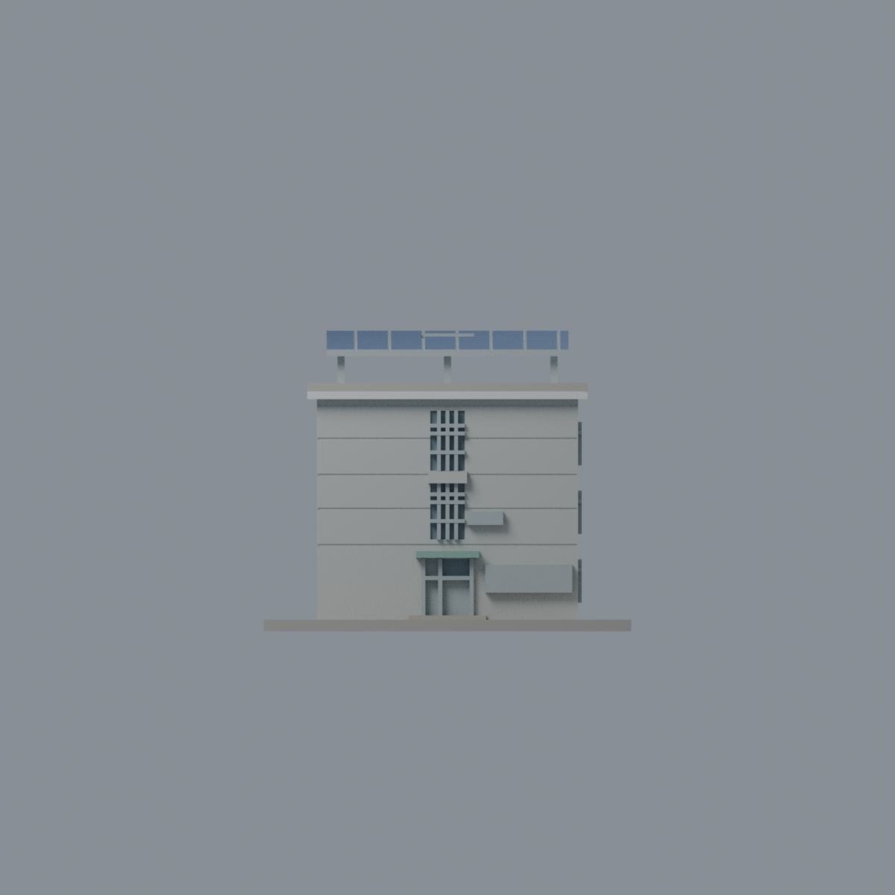
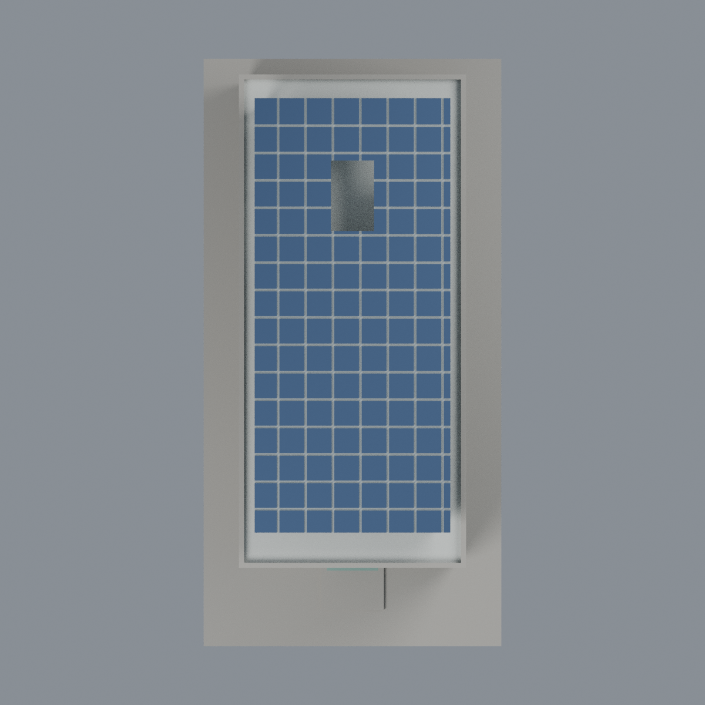

# 聯大二坪 M4 霽齋樓：七材質外觀版

沿用原 **9,940 三角面／4,936 頂點**，不改原 STL 位元、座標、面序或幾何；這是既有模型外觀改版，不增加模型包數。

| 正面 | 背牆與主屋頂中性 |
|---|---|
|  |  |
|  |  |

[表面色 3MF](nuum4-appearance.3mf) · [可編輯 Blender](scene.blend) · [材質色表](palette.json) · [逐面指派與依據](face-materials.json) · [原 STL](../model.stl)

## 來源與配色邊界

親自核對官方 [霽齋樓相簿](https://secretary.nuu.edu.tw/p/132-1003-1111.php?Lang=zh-tw) 的完整空拍與入口近照，網址、SHA256、EXIF 見 [來源覆核](qa/source-review.json)。影像 EXIF 為 2025 年，日期與時區未獨立驗證，非 2026 現況證明；來源圖不隨包散布。

- 正面及可見右長側淺灰洗石子牆，原窗格銀灰、離散窗凹背灰藍；樹影不作黑牆。部分下層被樹遮蔽，沿用原離散窗系統代理色而非逐窗測繪。
- 近照支持銀牌匾與綠色小雨棚；不造金字、公告、門禁或線路。原門的金屬／玻璃分界不完整，未能依原面分開的下段維持金屬；只採既有可分離上部窗面。
- **空拍清楚支持 PV 頂面**，只原棚頂面深藍，支架與凹分格銀灰；保留原矩形開口、不填補，不新增照片內水箱。
- 原粗分格、開口與實際電池片、走道、模組覆蓋不完全相同；不為材質改幾何。整體凸簷淺灰屬同構件材料有界延伸，不聲稱每個背面都直接看見。
- 未見左面／背面與平屋頂中性；底座未區分草地／鋪面，也不染成虛構草坪。
- 原 STL、座標、面序與歷史 QA 不變，無物理列印成功宣稱。

[原幾何與歷史來源限制](../README.zh-TW.md)

## 重建與核驗

安裝 [依賴](source/requirements.txt)，Blender 使用 4.3.2。由本資料夾上層提供原 model.stl：

1. `python appearance/source/build_appearance.py`
2. `python appearance/source/verify_exchange.py`
3. `blender -b -t 3 --python-exit-code 1 -P appearance/source/render_appearance.py`
4. `blender -b -t 3 --python-exit-code 1 -P appearance/source/verify_scene.py`

[獨立重建 ZIP](rebuild-source.zip)含原 STL、四支程式及依賴，不含第三方照片；不取代原建模腳本。[逐檔 SHA256](SHA256SUMS)

[交換／拓撲 QA](qa/exchange-validation.json)核對原座標與面序、全部面材質、單連通、有向水密邊、頂點 link 單環、正體積與零退化／重複面；lib3mf 嚴格讀取零警告，實際編輯單材質再存讀，其他材質及面指派不變。SDK 六位小數量化誤差另列。

[Blender 存讀與編輯](qa/scene-validation.json) · [渲染記錄](qa/render-manifest.json) · [獨立重建](qa/rebuild-validation.json)

## 製造限制照舊

尺寸仍為 76 × 150 × 62.1 mm；原 STL、建模程式、場景及歷史 QA 保留。原層檢與薄特徵檢查本次未重跑，不能由材質 QA 代替。

3MF 是同一網格的表面色，不是各材質各自封閉的分色實體、切片專案、噴頭映射或 G-code。切片 GUI、多材料路徑與實體列印未測；柱頭、屋簷、窗框及薄邊仍須評估材料、支撐及拆除風險，沒有保證可印或免支撐。
