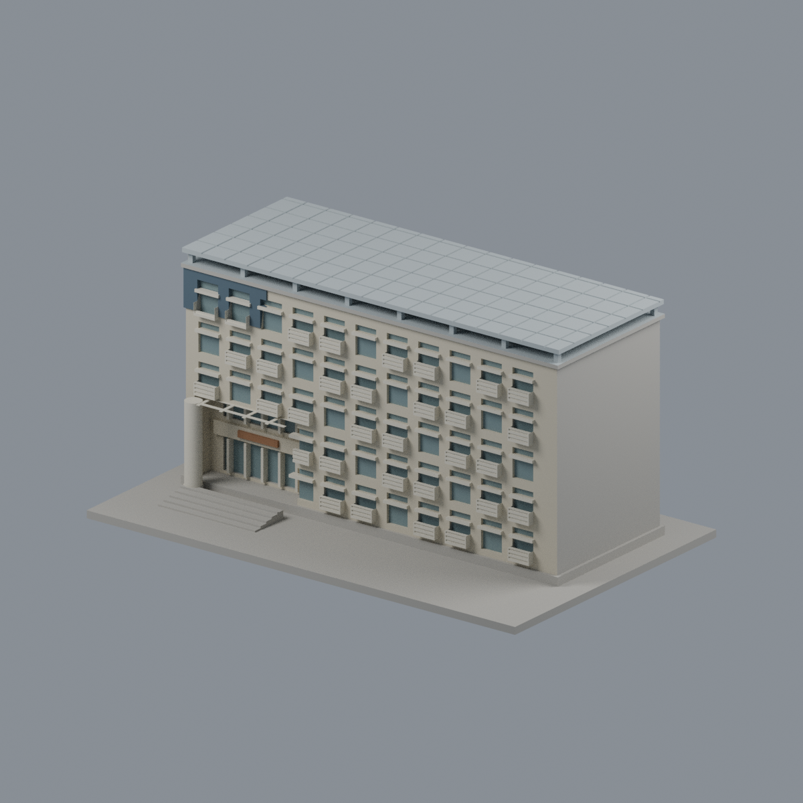
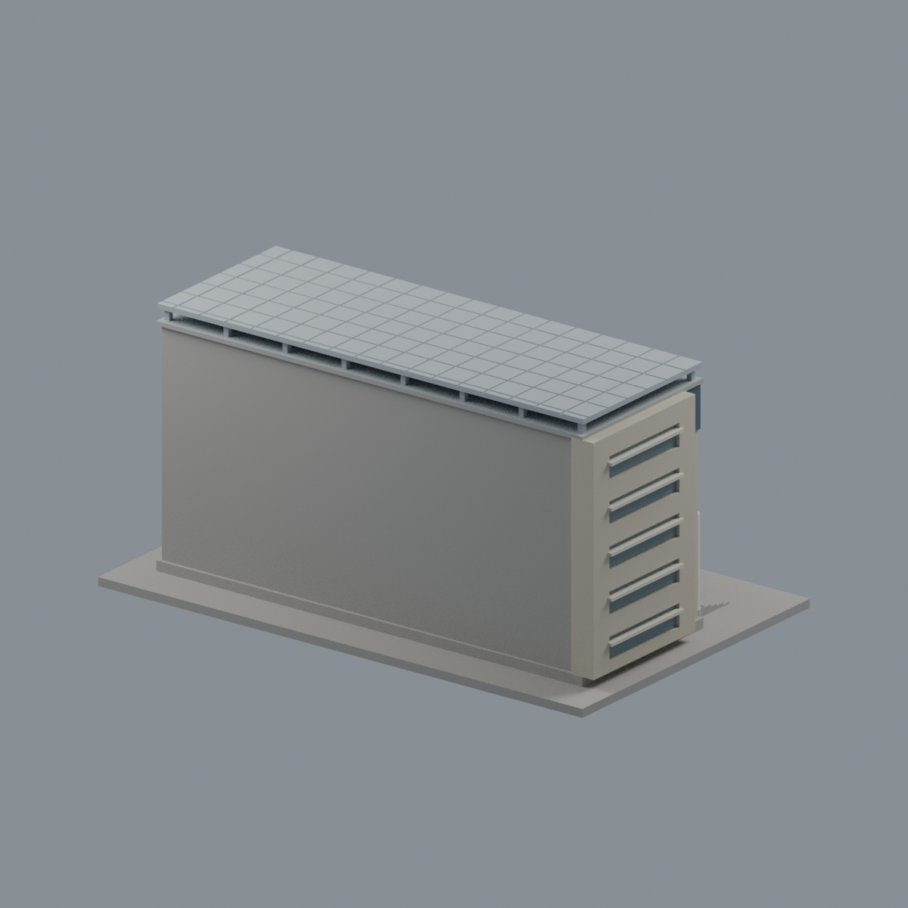
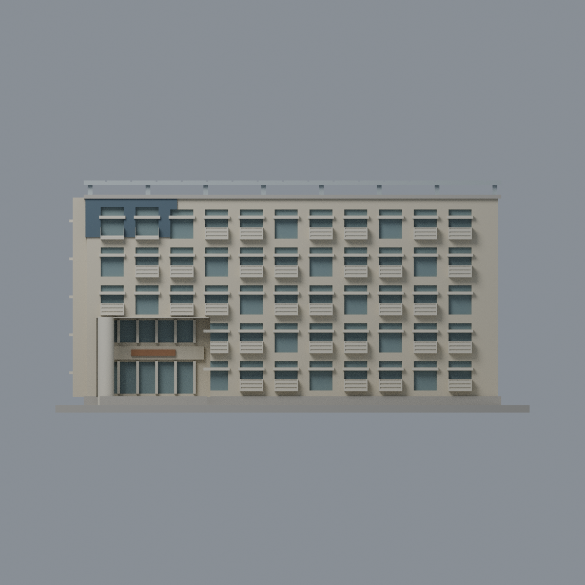
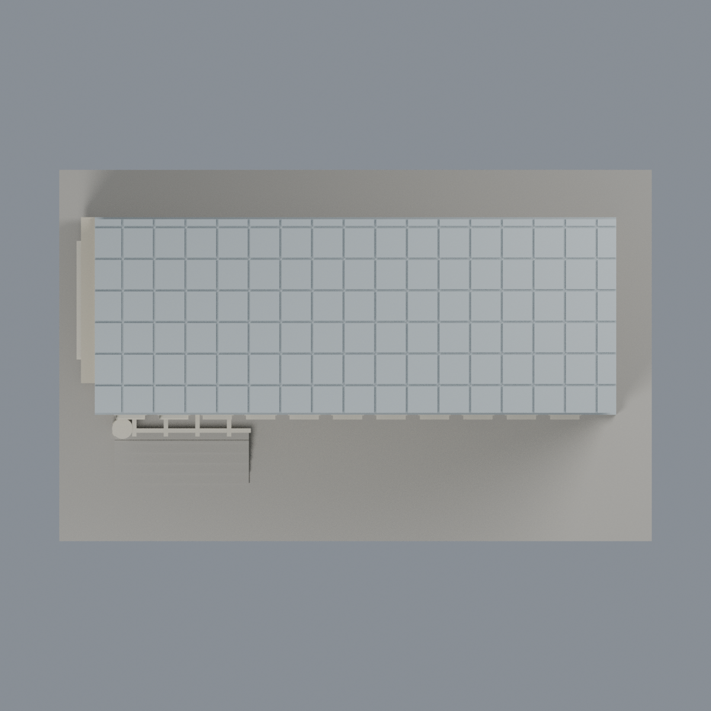

# 聯大二坪 M5 恕先樓：七材質外觀版

沿用原 **8,826 三角面／4,357 頂點**，不改原 STL 位元、座標、面序或幾何；這是既有模型外觀改版，不增加模型包數。

| 模型預覽 | 模型預覽 | 模型預覽 |
| :---: | :---: | :---: |
| 正面  | 背牆中性／棚銀灰代理  |  |
|  |  |  |

[表面色 3MF](nuum5-appearance.3mf) · [可編輯 Blender](scene.blend) · [材質色表](palette.json) · [逐面指派與依據](face-materials.json) · [原 STL](../model.stl)

## 來源與配色邊界

親自核對官方 [恕先樓相簿](https://secretary.nuu.edu.tw/p/132-1003-1113.php?Lang=zh-tw) 的完整照片 2／4：遠處入口與近照可對應左側圓柱、雙層門廊、百葉及深藍灰上角覆板。精確影像網址、SHA256 與 EXIF 見 [來源覆核](qa/source-review.json)；拍攝日期及時區未獨立驗證，不代表 2026 現況。來源照片不隨包散布。

- 主立面暖淺米磚與淡色百葉、窗框／圓柱；右側重複立面延續已見材料，是有界推估，不聲稱整段直接可見。既有模型規律窗距和實景不同，不改幾何。
- 深藍灰僅限原左上覆板。玻璃只指派原離散窗凹背與門廊窗背，不將百葉、窗下牆或整面廊口塗成玻璃。
- 原入口小牌採木棕代理色但保持空白，不造書法、標字、空調或住戶資訊。原白色棚底格梁、淡色柱維持既有形狀。
- **來源只見屋頂棚底與支架，不能確認 PV 上表面。** 全棚銀灰為保守同構件代理，包括明示的未知上表面延伸；不染深藍光電，不把歷史函數 solar 當作照片證據。
- 未見右端／背牆、主平屋頂與底座中性；路面、植物和設備不新增。窗框與百葉為原簡化實體，非照片逐片重建。
- 原 STL、座標、面序與歷史 QA 不變，無物理列印成功宣稱。

[原幾何與歷史來源限制](../README.zh-TW.md)

## 重建與核驗

安裝 [依賴](source/requirements.txt)，Blender 使用 4.3.2。由本資料夾上層提供原 model.stl：

1. `python appearance/source/build_appearance.py`
2. `python appearance/source/verify_exchange.py`
3. `blender -b -t 3 --python-exit-code 1 -P appearance/source/render_appearance.py`
4. `blender -b -t 3 --python-exit-code 1 -P appearance/source/verify_scene.py`

[獨立重建 ZIP](rebuild-source.zip)含原 STL、四支程式及依賴，不含第三方照片；不取代原建模腳本。[逐檔 SHA256](SHA256SUMS)

[交換／拓撲 QA](qa/exchange-validation.json)核對原座標與面序、全部面材質、單連通、有向水密邊、頂點 link 單環、正體積與零退化／重複面；lib3mf 嚴格讀取零警告，實際編輯單材質再存讀，其他材質及面指派不變。SDK 六位小數量化誤差另列。

[Blender 存讀與編輯](qa/scene-validation.json) · [渲染記錄](qa/render-manifest.json) · [獨立重建](qa/rebuild-validation.json)

## 製造限制照舊

尺寸仍為 150 × 94 × 73.4 mm；原 STL、建模程式、場景及歷史 QA 保留。原層檢與薄特徵檢查本次未重跑，不能由材質 QA 代替。

3MF 是同一網格的表面色，不是各材質各自封閉的分色實體、切片專案、噴頭映射或 G-code。切片 GUI、多材料路徑與實體列印未測；柱頭、屋簷、窗框及薄邊仍須評估材料、支撐及拆除風險，沒有保證可印或免支撐。
