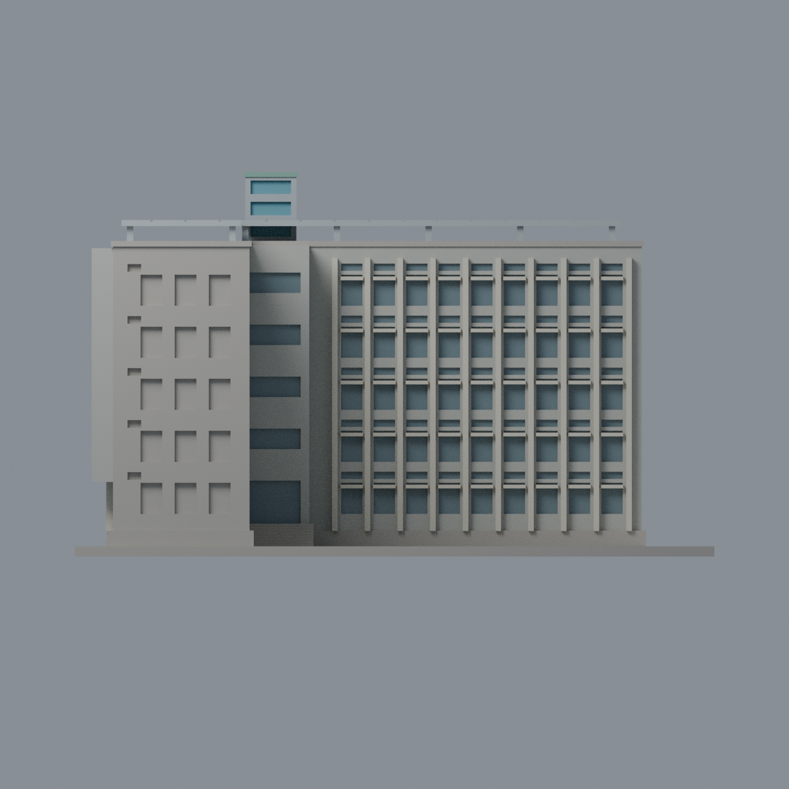
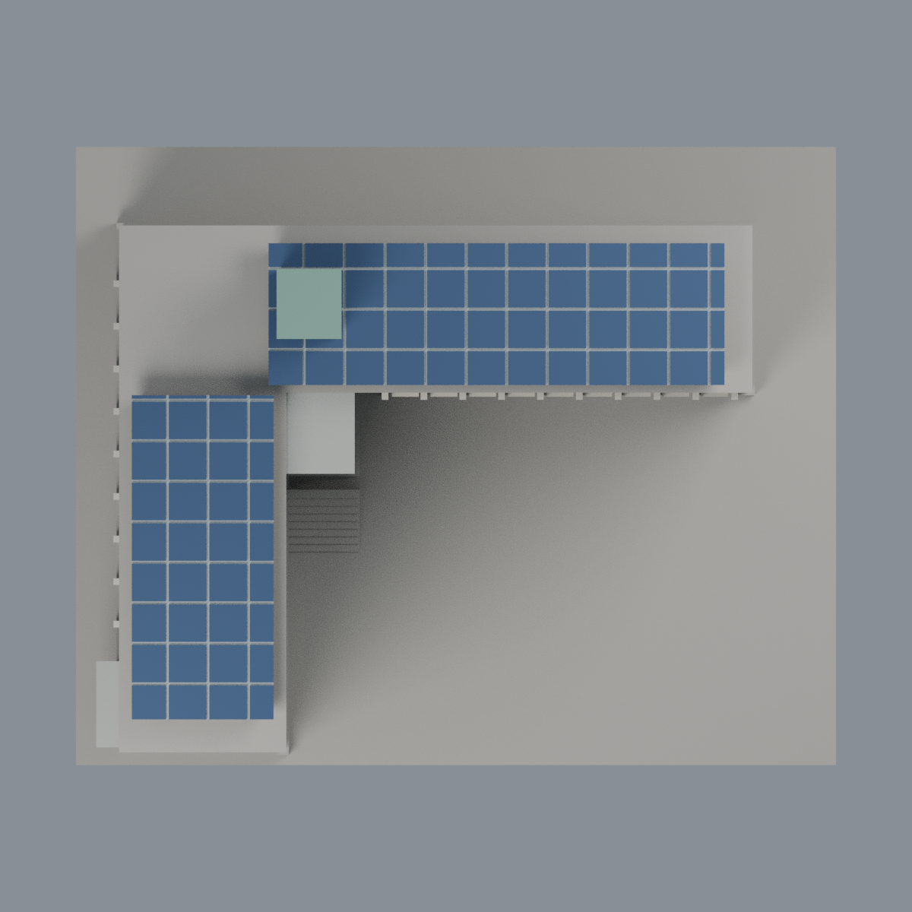

# 聯大二坪 M7 雙巔樓：八材質外觀版

沿用原 **7,778 三角面／3,859 頂點**，不改原 STL 位元、座標、面序或幾何；這是既有模型外觀改版，不增加模型包數。

| 模型預覽 | 模型預覽 | 模型預覽 |
| :---: | :---: | :---: |
| 正面  | 未知短端與背牆中性  |  |
|  |  |  |

[表面色 3MF](nuum7-appearance.3mf) · [可編輯 Blender](scene.blend) · [材質色表](palette.json) · [逐面指派與依據](face-materials.json) · [原 STL](../model.stl)

## 來源與配色邊界

親自核對官方 [雙巔樓相簿](https://secretary.nuu.edu.tw/p/132-1003-1109.php?Lang=zh-tw) 的完整照片 1／4：入口近景與高位外觀可對應 L 形兩翼、內角樓梯、直柱節奏、藍綠電梯塔與兩組光電頂面。精確影像網址、SHA256 與 EXIF 見 [來源覆核](qa/source-review.json)；拍攝日期及時區未獨立驗證，不代表 2026 現況。來源照片不隨包散布。

- 院側與可見左長側灰色牆、淺暖色直柱，離散窗凹背採灰藍代理色；原窗框與柱距為既有簡化，非逐窗測繪，不把窗下實牆染玻璃。
- 原內角連接段灰牆、有限既有窗背與門背採玻璃代理；現實窗帶、入口比例與網格不完全相同，維持原形。
- **高位照片清楚支持兩翼 PV 頂面**，只既有面板上表面深藍，分格凹槽、支架與側邊銀灰；粗分格、水平坡度與照片實際電池格和斜度不完全相同，不能當精確發電工程模型。
- 頂部電梯塔僅可見前／左凹窗青藍、原框銀灰與綠色帽頂；框架背側屬同構件有界延伸。未新增照片內小型額外光電板、空調、管線、水箱或文字。
- 未充分註冊的短端既有窗面與未見背牆中性，主屋頂／地面不假染草地；照片中的污漬與投影不烘焙。
- 原 STL、座標、面序與歷史 QA 不變，無物理列印成功宣稱。

[原幾何與歷史來源限制](../README.zh-TW.md)

## 重建與核驗

安裝 [依賴](source/requirements.txt)，Blender 使用 4.3.2。由本資料夾上層提供原 model.stl：

1. `python appearance/source/build_appearance.py`
2. `python appearance/source/verify_exchange.py`
3. `blender -b -t 3 --python-exit-code 1 -P appearance/source/render_appearance.py`
4. `blender -b -t 3 --python-exit-code 1 -P appearance/source/verify_scene.py`

[獨立重建 ZIP](rebuild-source.zip)含原 STL、四支程式及依賴，不含第三方照片；不取代原建模腳本。[逐檔 SHA256](SHA256SUMS)

[交換／拓撲 QA](qa/exchange-validation.json)核對原座標與面序、全部面材質、單連通、有向水密邊、頂點 link 單環、正體積與零退化／重複面；lib3mf 嚴格讀取零警告，實際編輯單材質再存讀，其他材質及面指派不變。SDK 六位小數量化誤差另列。

[Blender 存讀與編輯](qa/scene-validation.json) · [渲染記錄](qa/render-manifest.json) · [獨立重建](qa/rebuild-validation.json)

## 製造限制照舊

尺寸仍為 150 × 122 × 90.2 mm；原 STL、建模程式、場景及歷史 QA 保留。原層檢與薄特徵檢查本次未重跑，不能由材質 QA 代替。

3MF 是同一網格的表面色，不是各材質各自封閉的分色實體、切片專案、噴頭映射或 G-code。切片 GUI、多材料路徑與實體列印未測；柱頭、屋簷、窗框及薄邊仍須評估材料、支撐及拆除風險，沒有保證可印或免支撐。
