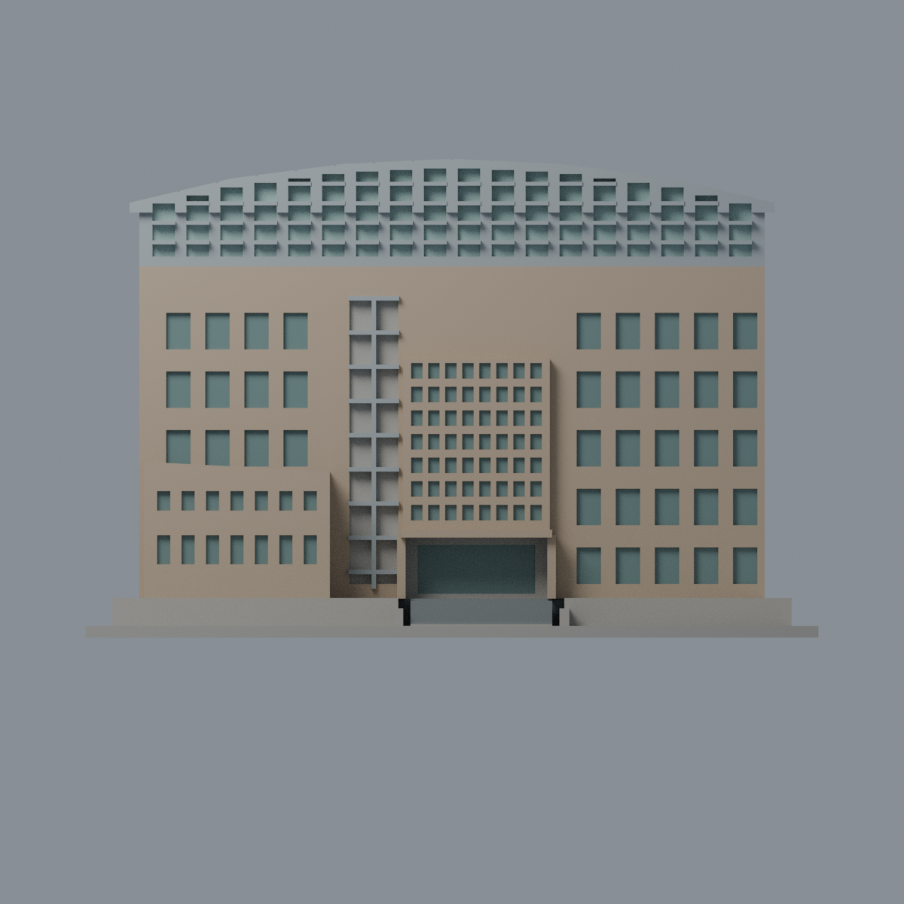
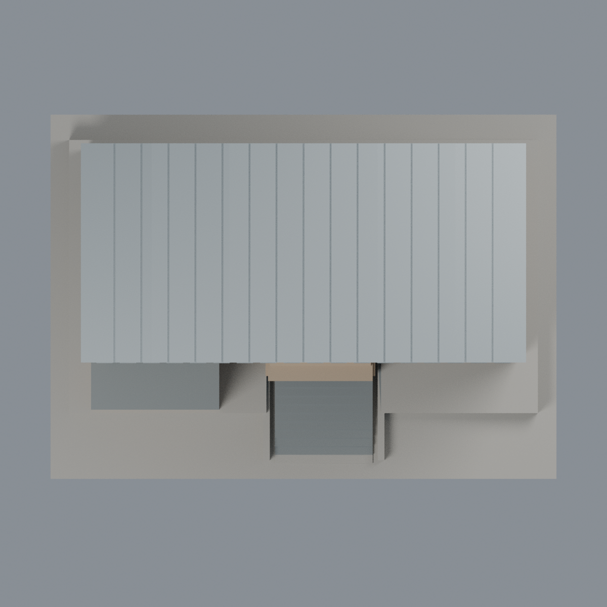

# 聯大二坪 M8 國鼎館宿舍：六材質外觀版

沿用原 **6,398 三角面／3,193 頂點**，不改原 STL 位元、座標、面序或幾何；這是既有模型外觀改版，不增加模型包數。

| 正面 | 背牆中性／屋面保守代理 |
|---|---|
|  |  |
|  |  |

[表面色 3MF](nuum8-appearance.3mf) · [可編輯 Blender](scene.blend) · [材質色表](palette.json) · [逐面指派與依據](face-materials.json) · [原 STL](../model.stl)

## 來源與配色邊界

親自核對官方 [國鼎館第八宿舍相簿](https://secretary.nuu.edu.tw/p/132-1003-1108.php?Lang=zh-tw) 的完整照片 1／2／4，對應暖赭磚、左低附樓、中央方格窗與上層金屬框／弧頂。此為國鼎館宿舍，**不是國鼎圖書館**。精確網址、SHA256 與 EXIF 見 [來源覆核](qa/source-review.json)；日期時區未獨立驗證，不代表 2026 現況。原照不隨包散布。

- 正面與可見右側暖赭磚，離散窗背灰綠；中央方格之間仍為磚，不塗成金屬。原窗距與實景不完全一致。
- 左側高窗帶混合窗玻璃與不透明窗間板，原凹背未具足夠材料分界，**整段背面留中性**，只原突框銀灰；不為配色切面，也不把整條當玻璃。
- 上層只原離散凹背採淡薄荷玻璃色，原金屬框銀灰。左低附樓屋頂深灰，不將局部綠色風化塗滿；階梯與矮擋牆灰色。入口字樣保持空白。
- **空拍已確認實景有 PV 陣列，但原模型是連續弧屋面，沒有相應陣列間隙／分片。** 本版選擇銀灰整體屋面代理，包含未知背側的明示同構件延伸，並不表示實景沒有光電，也不是現場屋面色精確還原；不把整頂染藍假稱精確覆蓋。
- 未見背牆與左側牆中性；不新增空調、欄杆、設備、金字、住戶或草地。上層後側實牆維持中性，弧頂同材料延伸另如上。
- 原 STL、座標、面序與歷史 QA 不變，無物理列印成功宣稱。

[原幾何與歷史來源限制](../README.zh-TW.md)

## 重建與核驗

安裝 [依賴](source/requirements.txt)，Blender 使用 4.3.2。由本資料夾上層提供原 model.stl：

1. `python appearance/source/build_appearance.py`
2. `python appearance/source/verify_exchange.py`
3. `blender -b -t 3 --python-exit-code 1 -P appearance/source/render_appearance.py`
4. `blender -b -t 3 --python-exit-code 1 -P appearance/source/verify_scene.py`

[獨立重建 ZIP](rebuild-source.zip)含原 STL、四支程式及依賴，不含第三方照片；不取代原建模腳本。[逐檔 SHA256](SHA256SUMS)

[交換／拓撲 QA](qa/exchange-validation.json)核對原座標與面序、全部面材質、單連通、有向水密邊、頂點 link 單環、正體積與零退化／重複面；lib3mf 嚴格讀取零警告，實際編輯單材質再存讀，其他材質及面指派不變。SDK 六位小數量化誤差另列。

[Blender 存讀與編輯](qa/scene-validation.json) · [渲染記錄](qa/render-manifest.json) · [獨立重建](qa/rebuild-validation.json)

## 製造限制照舊

尺寸仍為 150 × 108 × 98 mm；原 STL、建模程式、場景及歷史 QA 保留。原層檢與薄特徵檢查本次未重跑，不能由材質 QA 代替。

3MF 是同一網格的表面色，不是各材質各自封閉的分色實體、切片專案、噴頭映射或 G-code。切片 GUI、多材料路徑與實體列印未測；柱頭、屋簷、窗框及薄邊仍須評估材料、支撐及拆除風險，沒有保證可印或免支撐。
