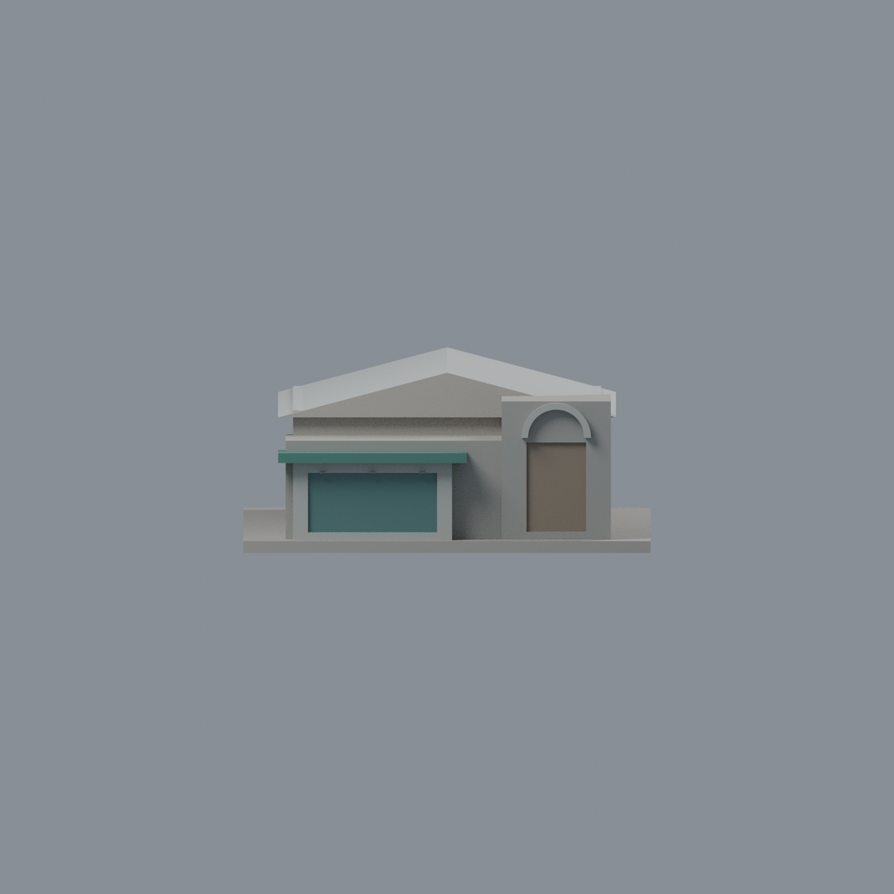
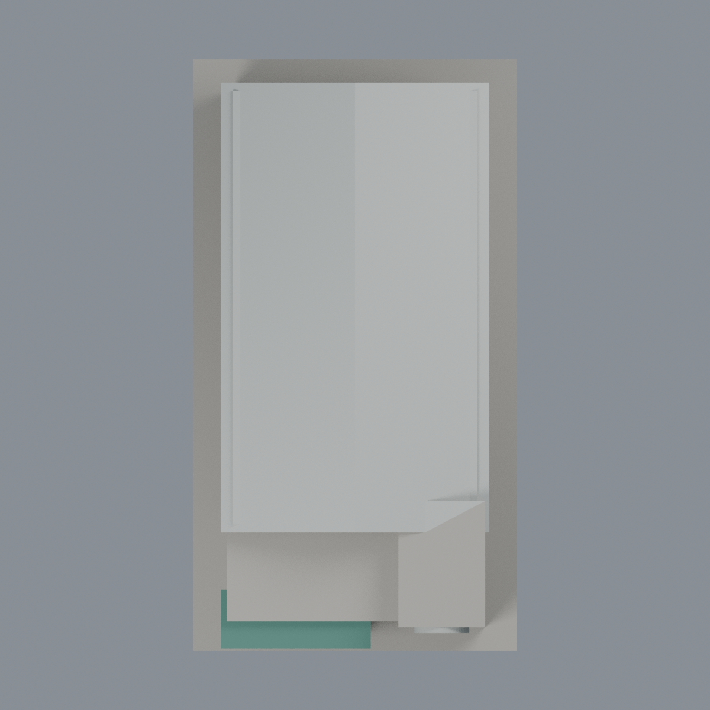

# 聯大二坪 S1 蓮荷水世界：七材質外觀版

沿用原 **1,234 三角面／579 頂點**，不改原 STL 位元、座標、面序或幾何；這是既有模型外觀改版，不增加模型包數。

| 模型預覽 | 模型預覽 | 模型預覽 |
| :---: | :---: | :---: |
| 正面  | 背牆中性／屋面同材料有界推估  |  |
|  |  |  |

[表面色 3MF](nuus1-appearance.3mf) · [可編輯 Blender](scene.blend) · [材質色表](palette.json) · [逐面指派與依據](face-materials.json) · [原 STL](../model.stl)

## 來源與配色邊界

親自核對官方 [二坪蓮荷水世界相簿](https://secretary.nuu.edu.tw/p/132-1003-1089.php?Lang=zh-tw) 的完整 [照片 1](https://secretary.nuu.edu.tw/var/file/3/1003/gallery/89/1089/gallery_1089_6211046_18514.jpg)。EXIF DateTimeOriginal **2025-03-02 14:20:47**，時區與日期未獨立核實，不聲稱 2026 現況。照片 2 在本次研究時多次傳輸不完整，**不作本版來源或完整核驗證據**。照片不隨包散布。

- 已見入口前牆與抬高牆面採灰色混凝土／洗石代理，不烘焙污漬；入口雨棚採低彩度綠，仍為原實心薄塊，不假稱半透明材料或精密支架。
- 原入口凹背灰青玻璃，外框銀灰；原生成器的窗梃被後續切割去除，本版只保留實際存活面，不宣稱有完整門窗細框。右側門凹背為暖灰褐實門，不染藍玻璃；原半圓凸框銀灰，不添加放射花格。
- 原主泳池館屋頂銀灰色；照片可見左坡，**右坡以同一屋面的同材質作有限推估**，不是獨立觀察證據。原簡化山形屋頂與現況屋頂線條未必完全一致，不用配色掩蓋幾何限制。
- 兩長側與背面窗槽保持中性：照片受樹木及鄰棟遮擋，不能以部分所見推斷所有窗數。前廳平屋頂保持中性，不將照片上缺席於原模型的水塔、管線、設備、招牌或煙管畫上去。
- 左側高教職員宿舍不屬本模型；原深度、比例、窗數與凹背皆照片概略推估／封實代理。原 STL／面序／座標不變，不增加模型數，不宣稱物理列印成功。

[原幾何與來源限制](../README.zh-TW.md) · [來源覆核](qa/source-review.json)

## 重建與核驗

安裝 [依賴](source/requirements.txt)，Blender 使用 4.3.2。由本資料夾上層提供原 model.stl：

1. `python appearance/source/build_appearance.py`
2. `python appearance/source/verify_exchange.py`
3. `blender -b -t 3 --python-exit-code 1 -P appearance/source/render_appearance.py`
4. `blender -b -t 3 --python-exit-code 1 -P appearance/source/verify_scene.py`

[獨立重建 ZIP](rebuild-source.zip)含原 STL、四支程式及依賴，不含第三方照片；不取代原建模腳本。[逐檔 SHA256](SHA256SUMS)

[交換／拓撲 QA](qa/exchange-validation.json)核對原座標與面序、全部面材質、單連通、有向水密邊、頂點 link 單環、正體積與零退化／重複面；lib3mf 嚴格讀取零警告，實際編輯單材質再存讀，其他材質及面指派不變。SDK 六位小數量化誤差另列。

[Blender 存讀與編輯](qa/scene-validation.json) · [渲染記錄](qa/render-manifest.json) · [獨立重建](qa/rebuild-validation.json)

## 製造限制照舊

尺寸仍為 82 × 150 × 35 mm；原 STL、建模程式、場景及歷史 QA 保留。原層檢與薄特徵檢查本次未重跑，不能由材質 QA 代替。

3MF 是同一網格的表面色，不是各材質各自封閉的分色實體、切片專案、噴頭映射或 G-code。切片 GUI、多材料路徑與實體列印未測；柱頭、屋簷、窗框及薄邊仍須評估材料、支撐及拆除風險，沒有保證可印或免支撐。
