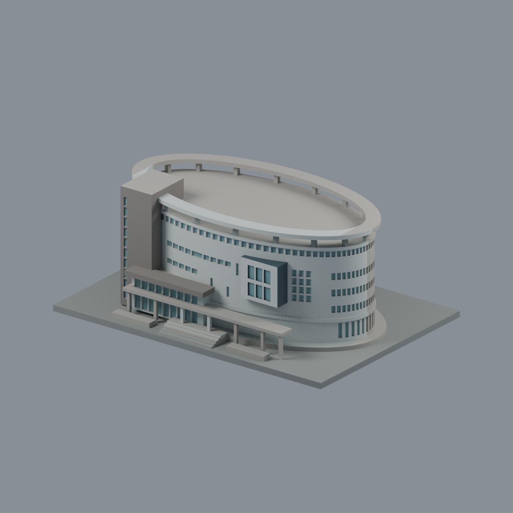
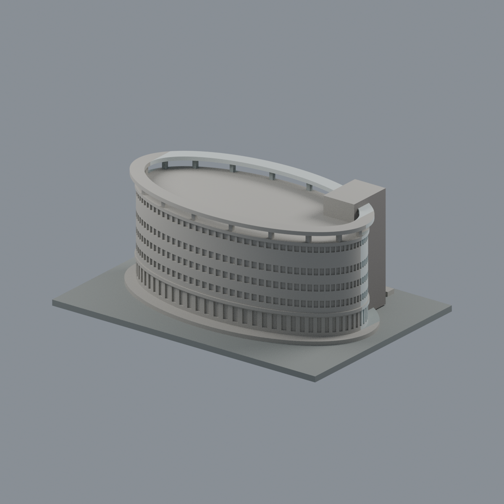
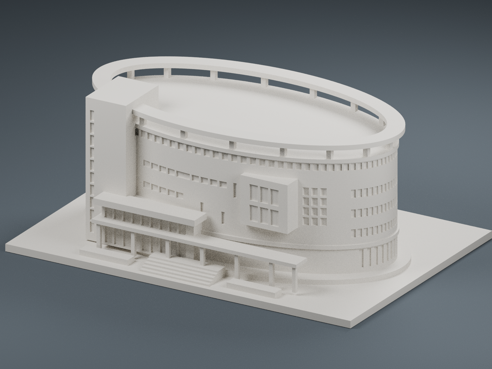
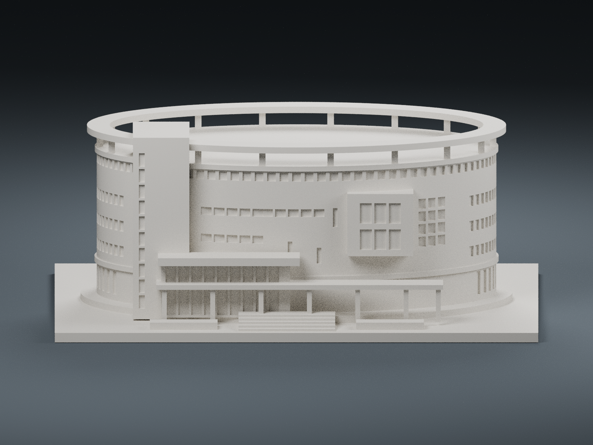

# 國立聯合大學國鼎圖書館 3D 列印模型

## 模型預覽

| 模型預覽 | 模型預覽 | 模型預覽 |
| :---: | :---: | :---: |
| 正面與來源支持區域<br> | 未見外側背面中性<br> |  |

## 八材質外觀版（2026-10-20）


[來源界線與四視角](appearance/README.md) · [表面色 3MF](appearance/nuulib-appearance.3mf) · [可編輯場景](appearance/scene.blend)

已見前半淡色磁磚、灰褐塔樓與入口腰帶、既有窗槽灰青玻璃；突出矩形只對有完整面界的外側配深色，中央實牆保留淺色。未分割框線保守省略，背面與未見屋頂中性，不把缺席光伏棚畫上平屋頂。 原 STL 與歷史 QA 不變；這是外觀改善，不是新增幾何。[原單色正面](front_perspective.png)／[原單色背面](rear_perspective.png)


國立聯合大學八甲校區國鼎圖書館的照片詮釋版建築模型，成品尺寸為 **150 × 104 × 61.05 mm**，包含底座。

保留橢圓形建築量體、懸高的橢圓屋頂環、左側高塔、入口雨棚、階梯，以及正面凸出的方形窗框。模型依外觀照片製作，並非實測建築圖或精確比例複製；背面窗帶採簡化配置，未重建內部格局、全部坡地樓層及鄰接資訊大樓。

## 預覽

下列圖片直接由同一份 STL 幾何渲染，使用單色材質與攝影棚光照；窗戶是實際凹槽。

### 正面透視

| 模型預覽 | 模型預覽 | 模型預覽 |
| :---: | :---: | :---: |
|  |  |  |

### 正面視圖

| 模型預覽 | 模型預覽 | 模型預覽 |
| :---: | :---: | :---: |
|  |  |  |

### 背面透視

| 模型預覽 | 模型預覽 | 模型預覽 |
| :---: | :---: | :---: |
|  |  |  |

## 下載與檔案

- [可列印 STL](guoding_library_150mm.stl)：單一連通、封閉網格，單位為 mm。
- [Blender 編輯檔](guoding_library.blend)：包含相同建築網格、攝影機與燈光。
- [完整原始檔 ZIP](guoding_library_150mm_source.zip)：模型、程式、圖片、說明與驗證資料。
- [build_model.py](build_model.py)：以 Python 生成模型幾何。
- [render_preview.py](render_preview.py)：使用 Blender 4.3 渲染預覽。
- [validate_mesh.py](validate_mesh.py)：重新讀取 STL 並檢查網格。
- [validation.json](validation.json)：網格驗證結果。
- [requirements.txt](requirements.txt)：Python 依賴套件版本。

## 列印建議

- 以底座平放在列印平台，匯入切片軟體時選擇 **毫米**。
- 可從 0.4 mm 噴嘴、0.16–0.20 mm 層高、3 圈外牆、10–15% 填充開始調整。
- **屋頂環與入口雨棚有水平懸空部分，請檢查切片預覽並設定適當支撐。**
- 柱子約 1.5–2.0 mm，屋頂環厚約 2.0 mm。窗戶以淺凹槽表現。
- 不建議直接大幅縮小，細節及柱子可能變得脆弱。
- 已完成數位網格檢查，**尚未實際列印測試**。列印參數仍需配合機器、材料與支撐設定調整。

## 編輯與重新生成

將儲存庫下載或複製到同一資料夾。Python 程式會以自身所在資料夾尋找輸入與寫入輸出，不依賴外部照片或原製作環境的路徑。

```bash
python -m pip install -r requirements.txt
python build_model.py
python validate_mesh.py
```

在 Blender 4.3 開啟 `guoding_library.blend` 即可編輯建築網格。物件名稱為 `Guoding Library | printable mesh`；場景已設定為公制，比例為 0.001。

如需重新渲染全部預覽與建立 Blender 場景：

```bash
blender -b -t 6 -P render_preview.py
```

這些命令會覆寫資料夾內同名的 STL、預覽、Blender 檔及驗證結果。修改前請保留需要的版本。

## 驗證

- 尺寸：150 × 104 × 61.05 mm
- 三角面數：16,742
- 單一連通體、封閉網格、法向一致
- 非流形邊與非流形頂點連接：均為 0
- 底面最低 Z：0 mm
- 從另一個資料夾重新生成，STL 與已確認版本的 SHA-256 完全一致
- Blender 編輯檔不含外部連結資產

STL SHA-256：

```text
1835376abf92fd7d961d43567fd4cf221e7478eba42176e4507cea165a7bab28
```

## 建築參考資料

- [維基百科：國立聯合大學圖書館](https://zh.wikipedia.org/zh-tw/%E5%9C%8B%E7%AB%8B%E8%81%AF%E5%90%88%E5%A4%A7%E5%AD%B8%E5%9C%96%E6%9B%B8%E9%A4%A8)：建築辨識與館史。
- [升學互動網：國立聯合大學](https://edufair.fsi.com.my/nuu.tw)：校園與圖書館外觀照片參考。
- [國立聯合大學校方資料（PDF）](https://secretary.nuu.edu.tw/var/file/3/1003/img/612569308.pdf)：館舍為七層橢圓建築的背景資料。

本儲存庫的預覽圖為模型渲染圖，未收錄第三方原始參考照片。外部連結資料的權利屬各原權利人。本模型為非官方的簡化建築詮釋。
