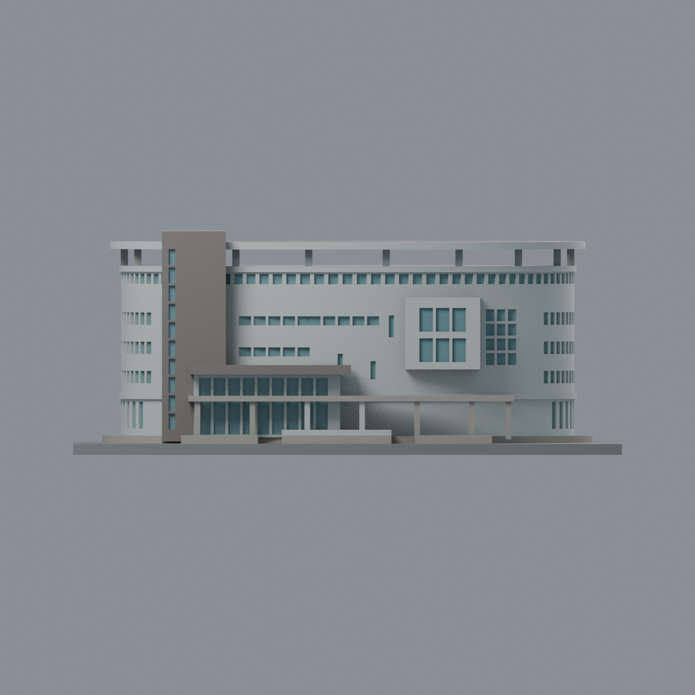
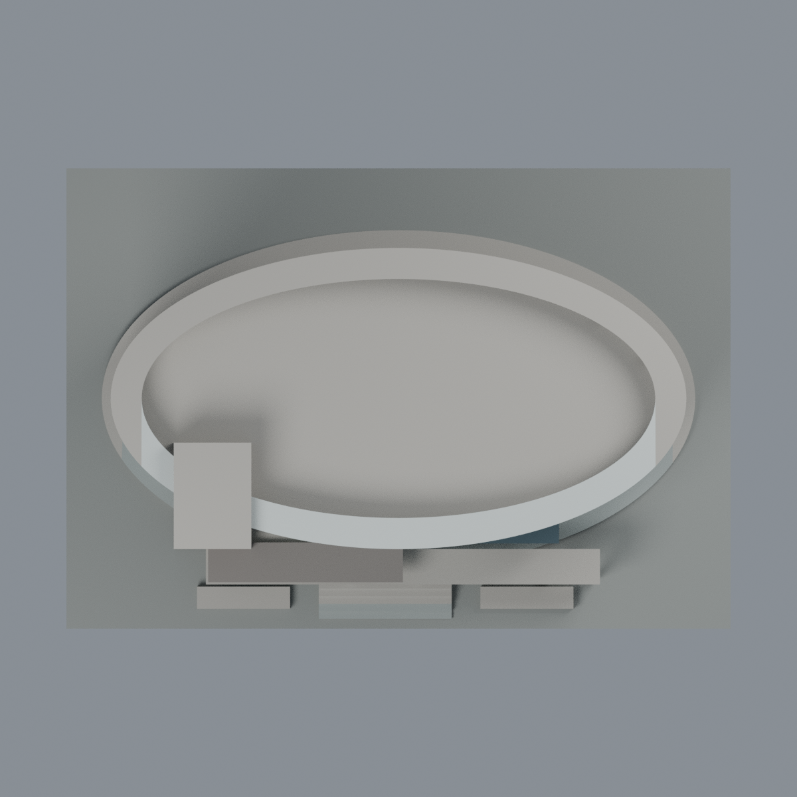

# 聯大八甲 國鼎圖書館：八材質外觀版

沿用原 **16,742 三角面／8,315 頂點**，不改原 STL 位元、座標、面序或幾何；這是既有模型外觀改版，不增加模型包數。

| 模型預覽 | 模型預覽 | 模型預覽 |
| :---: | :---: | :---: |
| 正面  | 背面保持中性  |  |
|  |  |  |

[表面色 3MF](nuulib-appearance.3mf) · [可編輯 Blender](scene.blend) · [材質色表](palette.json) · [逐面指派與依據](face-materials.json) · [原 STL](../guoding_library_150mm.stl)

## 來源與配色邊界

親自核對官方 [國鼎圖書館相簿](https://secretary.nuu.edu.tw/p/132-1003-1094.php?Lang=zh-tw) 的 [照片 5](https://secretary.nuu.edu.tw/var/file/3/1003/gallery/94/1094/gallery_1094_5717190_25479.jpg)、[照片 7](https://secretary.nuu.edu.tw/var/file/3/1003/gallery/94/1094/gallery_1094_1905808_25479.jpg)、[照片 10](https://secretary.nuu.edu.tw/var/file/3/1003/gallery/94/1094/gallery_1094_9931369_25478.jpg)。EXIF DateTimeOriginal 分別為 **2025-03-10 15:00:59／15:02:37／15:13:23**，時區與拍攝日期未獨立核實，不聲稱 2026 現況；照片不隨包散布。

- 已見前半橢圓館身與屋頂環採淺灰白磁磚代理，左塔及上層入口雨棚腰帶採灰褐色。原名牌留白，不補金色文字。
- **突出矩形的中央大片實牆保持淺色，不能整塊染黑**。只對原外側面與完整落在邊帶內的三角面配低彩度深灰；原正面部分大三角形跨越實景深框與淺牆，保守留淺色，不為配色切分原幾何。因此框線不完整，並非宣稱實景如此。
- 原正面橫窗、窄窗、塔樓小窗、入口與矩形窗凹背配低彩度灰青玻璃。只映射已存在且能登錄的窗槽；棕色細窗框、紫色窗簾與不同玻璃反射未獨立建模，不假造貼圖或追加幾何。原封實凹背不是實際透明室內。
- 原薄下層長雨棚與較高灰褐入口腰帶分開，未充分支持區中性。前環支柱與前階梯灰色；原階梯、樓層、窗數、橢圓環比例均為概略造型，非測繪。
- 背半館身、後窗及未觀察屋頂保持中性，屋頂照片中的光伏棚在原網格缺席，**不把原平屋頂染藍冒充光伏板**。現有整片屋頂也不聲稱是實景完整重建。
- 原 STL／面序／座標不變，不增加模型數；不烘焙陰影、樹木、設備或鄰棟，不宣稱物理列印成功。

[原幾何與來源限制](../README.md) · [來源覆核](qa/source-review.json)

## 重建與核驗

安裝 [依賴](source/requirements.txt)，Blender 使用 4.3.2。由本資料夾上層提供原 model.stl：

1. `python appearance/source/build_appearance.py`
2. `python appearance/source/verify_exchange.py`
3. `blender -b -t 3 --python-exit-code 1 -P appearance/source/render_appearance.py`
4. `blender -b -t 3 --python-exit-code 1 -P appearance/source/verify_scene.py`

[獨立重建 ZIP](rebuild-source.zip)含原 STL、四支程式及依賴，不含第三方照片；不取代原建模腳本。[逐檔 SHA256](SHA256SUMS)

[交換／拓撲 QA](qa/exchange-validation.json)核對原座標與面序、全部面材質、單連通、有向水密邊、頂點 link 單環、正體積與零退化／重複面；lib3mf 嚴格讀取零警告，實際編輯單材質再存讀，其他材質及面指派不變。SDK 六位小數量化誤差另列。

[Blender 存讀與編輯](qa/scene-validation.json) · [渲染記錄](qa/render-manifest.json) · [獨立重建](qa/rebuild-validation.json)

## 製造限制照舊

尺寸仍為 150 × 104 × 61.05 mm；原 STL、建模程式、場景及歷史 QA 保留。原層檢與薄特徵檢查本次未重跑，不能由材質 QA 代替。

3MF 是同一網格的表面色，不是八個封閉分色實體、切片專案、噴頭映射或 G-code。切片 GUI、多材料路徑與實體列印未測；柱頭、屋簷、窗框及薄邊仍須評估材料、支撐及拆除風險，沒有保證可印或免支撐。
