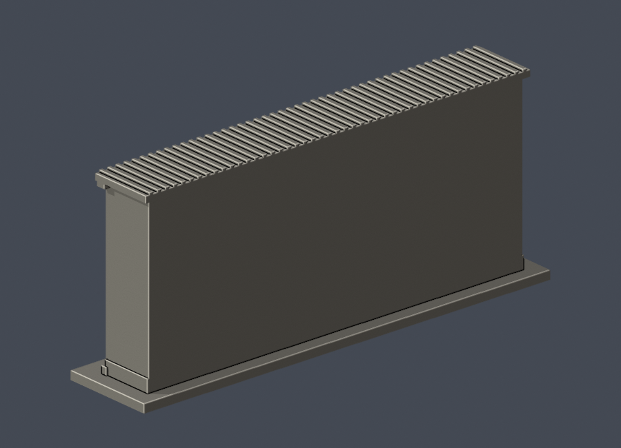

# 國立臺中教育大學｜林之助紀念館畫室庭院側立面段

這是一件依校方公開VR實拍自行建造的局部外觀近似模型，不是全館，也不是測繪或實際比例測量。未下載或改作第三方模型。

 

## 已有證據與範圍
- 保留庭院側一門、兩個分開窗組、上部木板高牆、門上氣窗、分開窗簷及木板分格。
- 模型尺寸150 × 32 × 64.9毫米，含底座；每件獨立視覺縮放，不提供建築真實比例尺。
- 為避免憑空補全，背面刻意留白，進深是任意截取厚度，不代表真實館舍進深。屋頂只保留截斷的近簷帶；其平頂截口不是宣稱真實屋頂形狀。
- 格柵加粗至约1毫米並減少根數；門窗以有背板凹槽表達，不是透明玻璃或穿牆大洞。格柵為窗框，並非主柱。雨淋板、瓦緣及磚基為可列印簡化。
- VR拍攝日期未標，依2015修復後外觀研讀。官方2025-01-07紀錄顯示門匾及大門入口改造；本件不含入口圍牆、大門、鐵雕和旗桿，因此不得當作2025入口模型。
- 全館其他側面、完整屋脊、後側增建仍未完成證據核對，不在此模型範圍。

## 檔案與重建
- `build_model.py`：獨立參數化自建來源。Python依賴見`requirements.txt`。
- `model.stl`：毫米、單實體列印用原始STL。`model.obj`為同源網格。
- `scene.blend`：由交付STL匯入的可編輯網格。`render_preview.py`重生場景與實際STL正、背、立面、頂視PNG。
- `validate_model.py`：原始STL法向、繞序、水密、邊兩面、vertex link、單殼、尺寸、獨立重建SHA及Blend幾何。
- `check_layers.py`：z=0.071起，每0.2毫米封閉輪廓及個別/合成Polygon有效性，invalid直接失敗。
- `check_thin_features.py`：已核SHA之canonical fail-closed v3，0.8毫米形態opening辅助篩檢。無buffer(0)修補。
- `sources.json`：精確來源連結與支持範圍。原始第三方照片/配置圖不附公開包。
- `validation.json`、`layer-check.json`、`thin-feature-check.json`、`qa-summary.json`、`SHA256SUMS`：數位驗證與逐檔清單。

重建：python build_model.py；blender -b -t 2 -P render_preview.py；python validate_model.py；python check_layers.py；python check_thin_features.py。

## 列印注意
底座朝下。窗簷与凹槽可能需要支撐；請依噴嘴、層高和材料自行切片核對。細格柵已加粗，但拆支撐仍可能損傷。數位幾何QA不等同實體試印，也不等同Cura或PrusaSlicer實際工具路徑驗證，不保證無支撐或必定可印。

## 狀態
2026-10-13外觀覆核准許以此明示局部模型凍結；獨立幾何QA另由發布者核對，未通過前不可發布。
