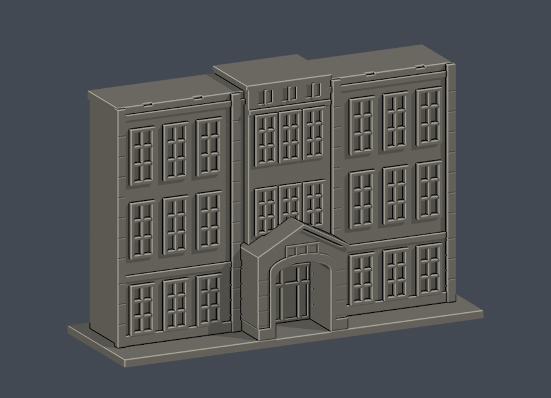
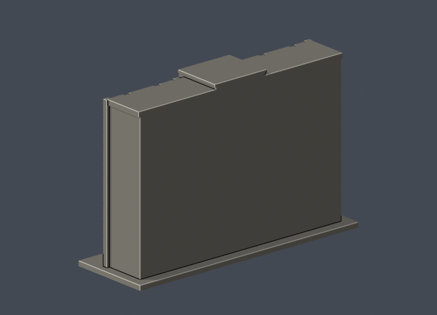

# 國立臺中教育大學｜民生校區｜行政樓中央入口段

依官方公開實拍自建的局部建築外觀近似模型。不是全棟、不是測繪，也不提供真實建築比例尺。原照片不隨公開包散布。

 

## 範圍與辨識特徵
三層主體、中央突出窄三窗組、兩側各三扇獨立高窗、下層石造帶、中央淺弧拱門與三角山牆入口、上部低女兒牆。

尺寸：150 × 50 × 99.8毫米，含底座，獨立視覺縮放。不含完整U形兩端翼樓、背立面與内部院落。背面是任意截斷留白，平頂是模型截口，不代表真實屋頂。建物完整進深、屋頂設備未推測。

實拍拍攝日未標，資料頁更新日不等於拍攝日期。因此這是公開影像所示形體的局部研究，不保證2026現況所有外觀細節不變。浮雕式窗框、玻璃凹槽是列印簡化；沒有將窗框當主柱。未複製任何第三方3D模型。

## 重建與交付
- `build_model.py`：獨立Python參數化自建。依賴版本見`requirements.txt`。
- `model.stl`、`model.obj`：同一毫米網格；STL是正式幾何驗證標的。
- `scene.blend`：正式STL匯入的可編輯網格；`render_preview.py`由實際STL產生front/rear/elevation/top四圖。
- `validate_model.py` / `validation.json`：原STL二面邊、vertex link、單連通殼、正法向/繞序/體積、尺寸、獨立重建SHA与Blend幾何一致。
- `check_layers.py` / `layer-check.json`：起點z=0.071，每0.2毫米檢查閉合輪廓与個別及合成Polygon有效；invalid直接失敗，未修補。
- `check_thin_features.py` / `thin-feature-check.json`：canonical fail-closed v3；0.8毫米形態opening是輔助篩檢，非全面最小壁厚。
- `sources.json`、`qa-summary.json`、`SHA256SUMS`：來源限制、數位QA與逐檔雜湊。

執行順序：python build_model.py；blender -b -t 2 -P render_preview.py；python validate_model.py；python check_layers.py；python check_thin_features.py。

## 列印提醒
底座朝下，單位毫米。門廊深拱和窗框凹槽需自行切片檢查支撐；拱框、石造線腳已加粗，未複製微小雕花、旗杆、告示或空調。

數位QA不等於實體試印或Cura/PrusaSlicer工具路徑驗證，不宣稱保證可印或免支撐。請依噴嘴、材料與層高自行切片並檢查懸空區。

## 驗收狀態
2026-10-13外觀覆核已准，以此版本凍結交獨立QA；發布前須由獨立驗證者放行。

中央頂端三個淺凹飾格是女兒牆裝飾，不是額外樓層。
