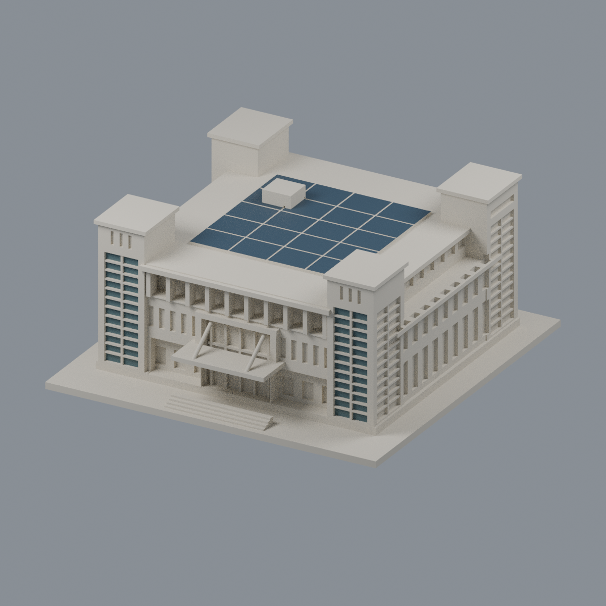

# 國立臺北商業大學

累計4件：臺北校區1件主立面局部，桃園校區3件全形量體／局部立面未核近似。**全校尚未完成，沒有宣稱四件皆為完整精確全館。** 原照片／PDF均未放入公開包。

| 建築模型 | 建築模型 | 建築模型 |
| :---: | :---: | :---: |
| 學生活動中心西向主立面段（2023）  | 公能樓全形量體（局部未核）  [有限原面彩色外觀](桃園校區/buildings/ntub-gongneng/appearance/README.md) | 北商學舍U形量體（局部未核）  |
|  **[國立臺北商業大學｜桃園校區弘毅樓](桃園校區/buildings/ntub-hongyi/README.md)** |  |  |

- [臺北校區](臺北校區/README.md)
- [桃園校區](桃園校區/README.md)
- [全校研究清單](inventory.json)：10主要建築、附屬及校外範圍，區分已做／局部／未研究／缺證。

每件底座朝下、毫米、最大150mm。光電分组、坡角及未拍立面限制詳各件README。幾何QA不等於實體試印或切片工具路徑驗證。

弘毅樓U形量體（未知側／光電未完整重建）

第四件另列，不重複其他建物湊滿三欄。弘毅樓光電存在有官方證據，但位置／邊界不明，本版省略，非完整現況屋頂。
