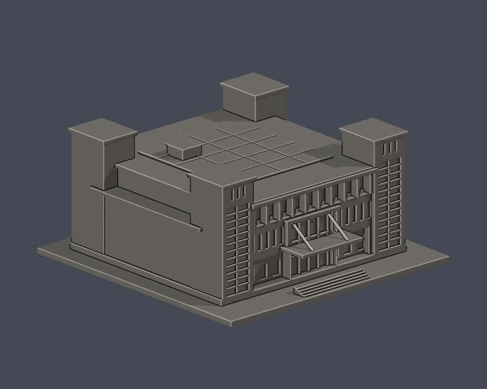
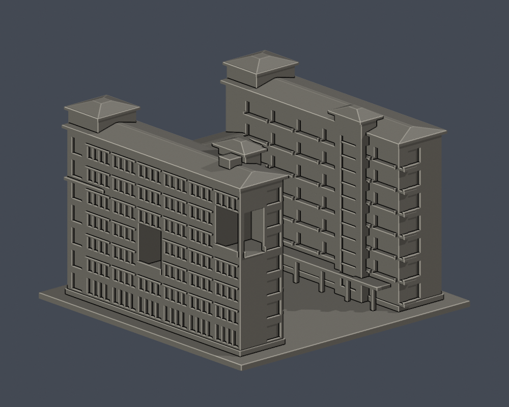

# 國立臺北商業大學｜桃園校區

兩件全形量體近似，局部立面尚未核實，非2026現況測繪：

| [公能樓](buildings/ntub-gongneng/) | [北商學舍](buildings/ntub-dormitory/) |
|---|---|
|  |  |

弘毅樓仍未建模。公能樓光電以官方屋頂實拍支持中央板區，4×5是列印粗化非真實片數；學舍U庭與不同高雙層凹口保留，坡角估計，未拍外立面留白。
