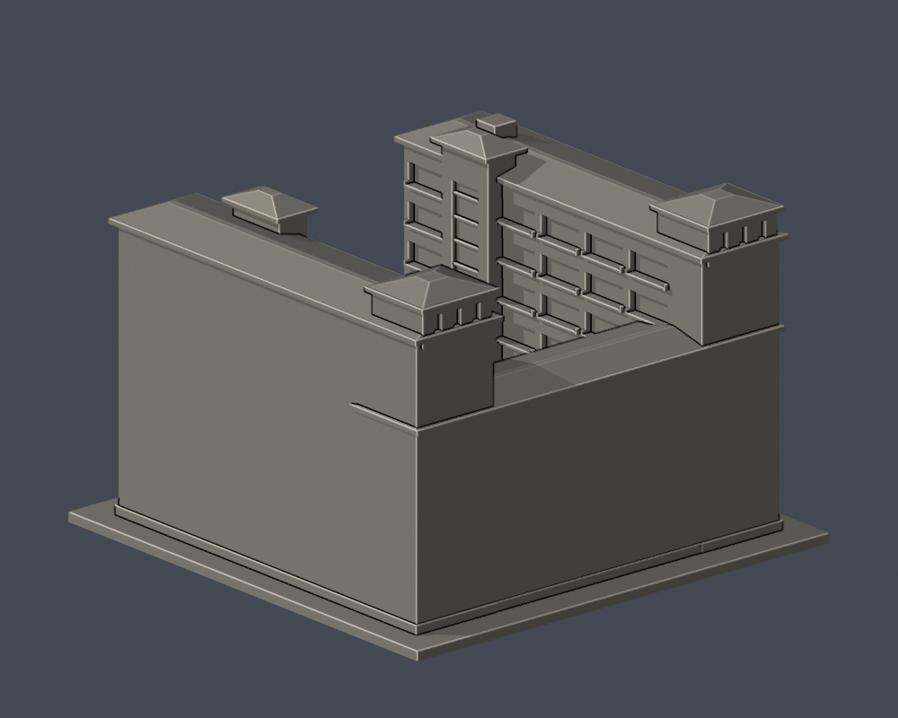

# 國立臺北商業大學｜北商學舍U形全形量體近似（局部立面未核）

**全形量體近似，局部立面未核；不是精確全館測繪，亦不代表2026年現況。**

官方環境照片及114學年度新生手冊；照片攝影年月未完全核定。各館獨立比例，尺寸均由照片估計，沒有固定建築比例尺。第三方原照片與PDF不包含於公開包。

 

## 已保留的外觀
- C棟是同一U形宿舍：兩長翼地上7層，連接翼依空間配置示意及手冊照片採5層；地下室未重建。
- 保留開放中庭與可見低層沿邊連廊；中央露天空間不填實、不以屋頂封口。
- 球場侧6個大窗跨每跨含兩窗組，3–4層中央、5–6層端部有兩層高深凹，不能做成均一網格。
- 北端兩翼不對稱：一端有高位深凹，另一端有疊層陽台。坡屋頂與突出樓梯核有實拍及配置圖支持。

## 明確限制
- 西側外長立面及南側外連接翼欠清晰实拍，刻意留白，不鏡射東側窗列。全形量體不等於全館細節完整。
- 每層窗格細分、室內廊道进深與未見内侧局部仍是照片近似；未重建室內、房間或地下室。
- 兩層高深凹採深挖並保留内侧薄背牆，是否完全貫穿與背侧構件未核；不宣稱實測真通道。
- 低層連廊沿西／後方可見範圍建模；未見另一侧不添造。樓梯核的水平偏移及屋頂坡角為近似。
- 没有本棟太陽能板證據，因此未把公能樓／弘毅樓的光電外推到宿舍。部分屋頂機電及細栏杆省略。

## 列印與來源

- 單位毫米，含底座最大150mm，底座朝下。尺寸詳validation.json。
- 開廊、雨棚、凹口頂部和屋檐可能需要支撐。窗框及獨立柱做加粗／背牆連接，仍須實際切片檢查工具路徑。
- 數位幾何QA不是實體試印，不是Cura／Prusa切片驗證，不能保證免支撐可列印。
- [model.stl](model.stl)是列印網格；[scene.blend](scene.blend)由該STL匯入，可編修三角網格。
- [build_model.py](build_model.py)是自行撰寫參數來源，未下載第三方3D；所有previews PNG均由交付STL渲染。
- [sources.json](sources.json)、[validation.json](validation.json)、[contour-validity-check.json](contour-validity-check.json)、[thin-feature-check.json](thin-feature-check.json)詳載依據與QA。
- 0.2mm逐層輪廓、固定z偏移0.071mm，單環與合成多邊形都須有效。薄篩採已核SHA的canonical fail-closed v3，0.8mm opening不是完整最小壁厚證明。

## 重跑

Python 3.12安裝requirements.txt，且PATH內有Blender 4.3以上，再執行：

```sh
python build_model.py
blender -b -t 2 -P render_preview.py
python validate_model.py
python check_contour_validity.py
python check_thin_features.py
python check_recess_rays.py
python check_manifest.py
```

## 原STL深凹／開放空間射線

[check_recess_rays.py](check_recess_rays.py)只讀交付STL，確認第一正向命中位置；[recess-ray-check.json](recess-ray-check.json)保存逐條射線起點、方向、預期範圍與命中。這驗證模型幾何，不證明實際建築凹深。

玻璃細框為可列印的粗化分格，不是牆柱數。六個主窗組分跨及兩處不同樓層凹口依照片保存，沒有為了整齊再加窗列。東侧兩處雙層凹口從x=-66外牆至x=-42.5背面，模型凹深23.5mm；中心與入口側垂直射線僅撞底座z=3mm，U庭未封頂。
