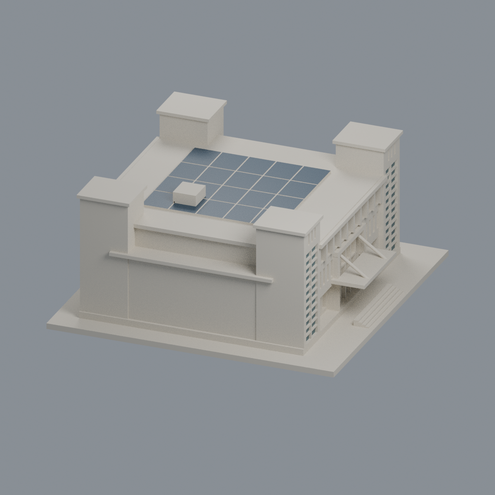
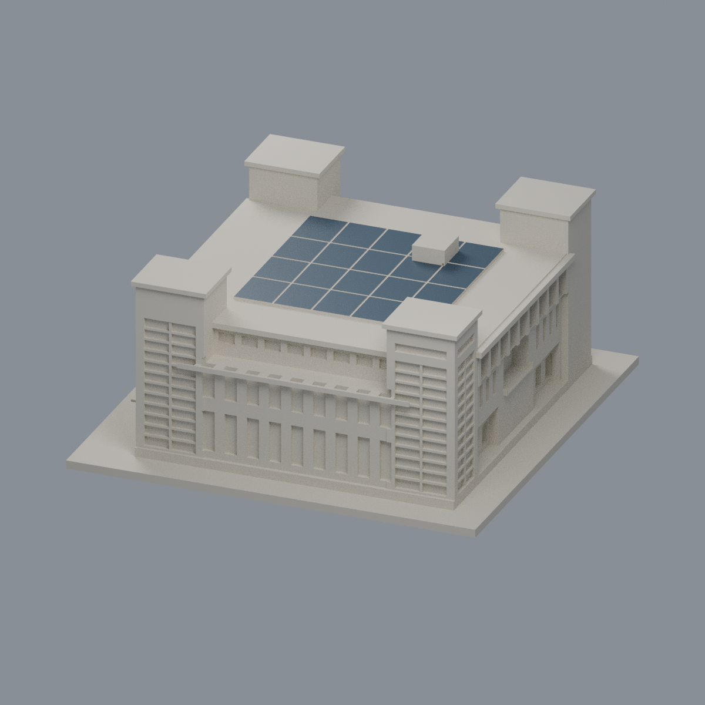
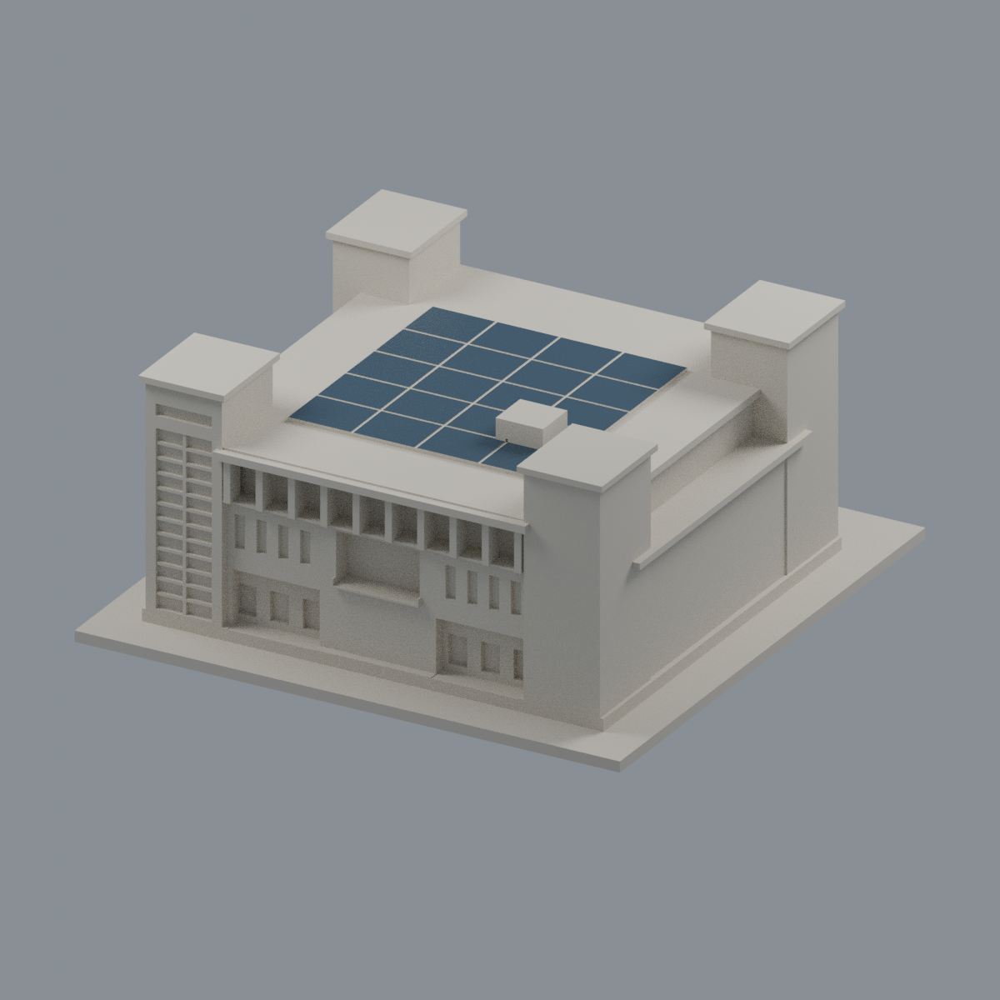
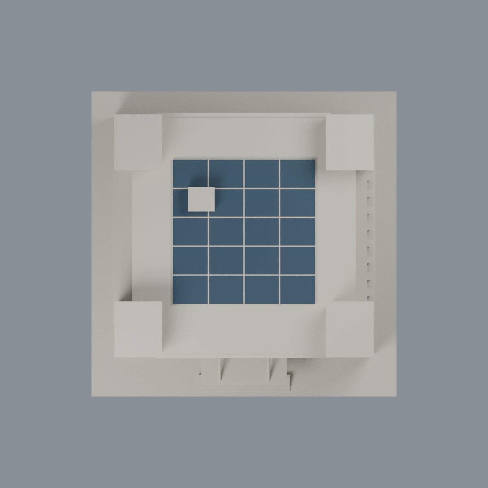

# 國立臺北商業大學｜公能樓全形量體近似（局部立面未核）

## 模型預覽


| 新版模型預覽 | 新版模型預覽 | 新版模型預覽 |
| :---: | :---: | :---: |
|  |  |  |
|  |  |  |

**全形量體近似，局部立面未核；不是精確全館測繪，亦不代表2026年現況。**

官方環境照片與2022–2024光電資料混合，非單一日期現況。各館獨立比例，尺寸均由照片估計，沒有固定建築比例尺。第三方原照片與PDF不包含於公開包。


## 已保留的外觀
- 公能樓為B棟，圖書、行政、資訊、會議用途在同棟，不重複計棟。
- 入口面左右塔體、3層翼，上層9跨退縮開廊；反向有深凹陽台，長窗側有上下兩列、每列9個長窗跨。
- 玻璃幕牆以浅凹及细橫分格表示，玻璃細框不當結構柱。
- 各向高差、入口雨棚和地面階梯保留。光電位於中央屋頂，以70×71mm連續板區及4×5淺刻組表示；不是凸出的線條。4×5是列印粗化分組，非真實板片數。

## 明確限制
- 未拍側立面留白；平面圖是用途配置示意，不是測繪。不能稱精確全館外觀或2026現況。
- 屋頂中央區域依官方俯視小圖近似；太陽能板實際片數、排數、支架高度、斜率、遮擋及下方設備不確定，模型僅表示可見的光電設施帶。
- 沒有證據可把本棟中央區域認定為露天中庭，因此沒有虛構天井；本模型不是內部空間模型。
- 主要翼比例及深度為照片估計，未採用地籍或竣工尺寸。低坡檐與退縮高度為近似；機房位置細節有简化。

## 列印與來源

- 單位毫米，含底座最大150mm，底座朝下。尺寸詳validation.json。
- 開廊、雨棚、凹口頂部和屋檐可能需要支撐。窗框及獨立柱做加粗／背牆連接，仍須實際切片檢查工具路徑。
- 數位幾何QA不是實體試印，不是Cura／Prusa切片驗證，不能保證免支撐可列印。
- [model.stl](model.stl)是列印網格；[scene.blend](scene.blend)由該STL匯入，可編修三角網格。
- [build_model.py](build_model.py)是自行撰寫參數來源，未下載第三方3D；所有previews PNG均由交付STL渲染。
- [sources.json](sources.json)、[validation.json](validation.json)、[contour-validity-check.json](contour-validity-check.json)、[thin-feature-check.json](thin-feature-check.json)詳載依據與QA。
- 0.2mm逐層輪廓、固定z偏移0.071mm，單環與合成多邊形都須有效。薄篩採已核SHA的canonical fail-closed v3，0.8mm opening不是完整最小壁厚證明。

## 重跑

Python 3.12安裝requirements.txt，且PATH內有Blender 4.3以上，再執行：

```sh
python build_model.py
blender -b -t 2 -P render_preview.py
python validate_model.py
python check_contour_validity.py
python check_thin_features.py
python check_recess_rays.py
python check_manifest.py
```

## 原STL深凹／開放空間射線

[check_recess_rays.py](check_recess_rays.py)只讀交付STL，確認第一正向命中位置；[recess-ray-check.json](recess-ray-check.json)保存逐條射線起點、方向、預期範圍與命中。這驗證模型幾何，不證明實際建築凹深。

入口中央凹深2.5mm，旁侧底層廊口最深5.6mm；反向陽台凹深6mm，均以原STL射線命中验证。光電只採官方PDF第5頁中可用雙塔狹槽女兒牆識別的公能樓俯視圖；另一張有「北商大」塔牌的圖屬弘毅樓，不混用。原公能樓圖僅251×188像素：可支持中央屋頂集中板區及外圍檐廊未滿鋪，無法核定精確邊界、支架、片數、斜率或最新遮擋物，故本模型均不宣稱精準還原。

## 既有中央PV頂與正面雙塔窗的有限純色外觀

[3MF、可編輯Blend與五視角](appearance/README.md)：僅144完整原面（48既有粗化PV頂三角＋96前雙塔窗），3有限域、5651.247314568758mm²；5150原中性面和native材質不變。5294原三角2567原頂點／有向序exact，22原件全備份。PV48三角不是48真板，4×5／70×71mm為原粗化，非新精確PV邊界；來源251×188僅支持存在及大概位置。開廊、磚牆、入口、框、屋頂與未知面均不染。2017相機／2016後製倒序未解，2022PV跨年，不宣稱2026現況。原344／69QA不是實印；原全部估計、支撐、工具路徑與未實印限制照留。純色非全樓復原，不附照片。

