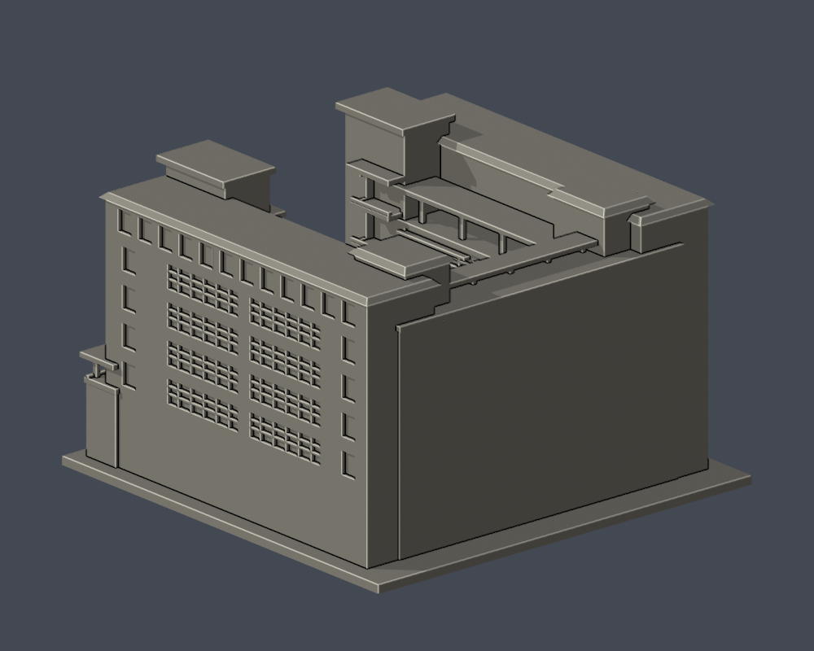
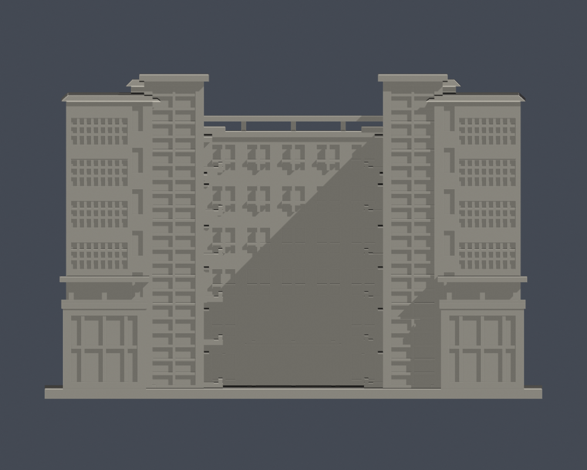
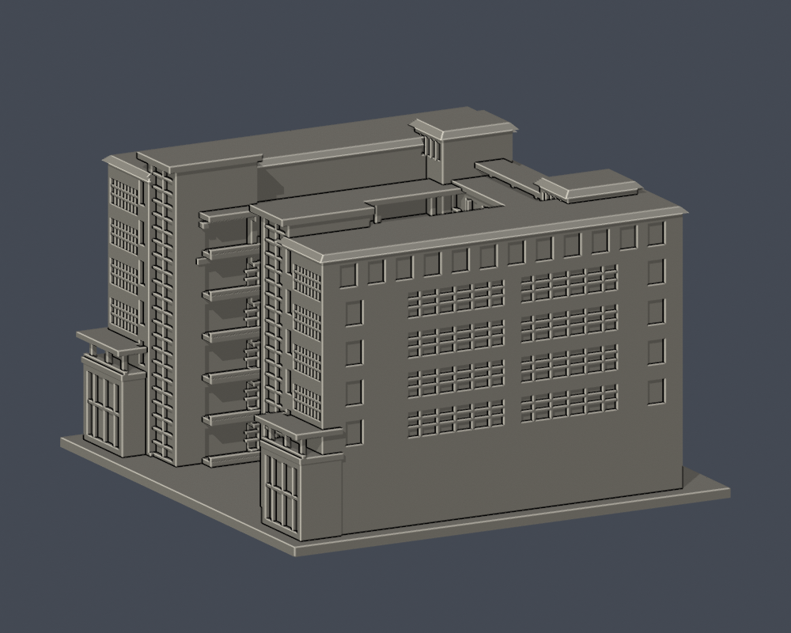
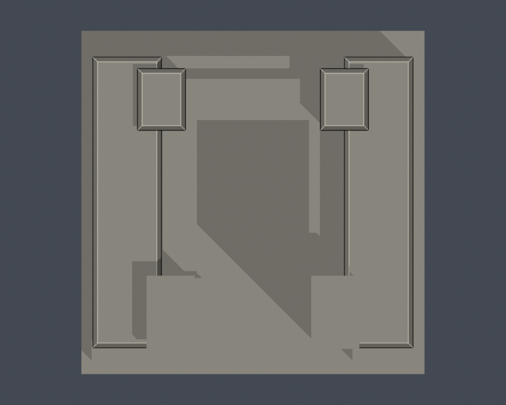

# 國立臺北商業大學｜桃園校區弘毅樓

全形量體與有證立面近似；未知立面及光電未完整重建。非測繪、非全棟完整復原，也不代表 2026 年現況。

| 模型預覽 | 模型預覽 | 模型預覽 |
| :---: | :---: | :---: |
| 院落及已核側<br> | 未核側與背面<br> |  |

[正立面](previews/elevation.png) · [已核外側](previews/east.png) · [頂視](previews/top.png) · [原始STL](model.stl) · [Blender](scene.blend) · [參數來源](build_model.py)

| 模型預覽 | 模型預覽 | 模型預覽 |
| :---: | :---: | :---: |
| 正立面<br> | 已核外側<br> | 頂視<br> |

## 證據與限制

- 校方校區圖、2021-04-20空間配置圖及5張官方地面實拍，共同支持開放式U院落、兩翼、較低後連接部。配置圖是樓層使用示意，不是比例施工平面。模型座標是局部座標，未指定測量方位。
- 兩翼外側為7層量體；院落側為5層、每層2大長窗組，上方開敞棚廊；後連接部6層。後院落面上4層每列7窗位，下2層因入口及名牌構造變化，沒有套用整面規則窗格。
- 廣場向端面有4道主要窗帶、8格×3排可見小分格，下有露臺與兩層高玻璃基部；旁邊窄窗帶及高玻璃梯塔分開。塔內側6層凹陽臺保留真進深。
- 單一已核外側頂層12窗；中間兩大窗組及兩端獨立窗列。未核另一外側、後側、被樹木／圍牆遮蔽的低層留白，不推定對稱。室內、地下停車場與室內通路未重建。
- 窗框與欄杆依150mm比例加粗／部分細分粗化；其數量不是結構柱數。院落保持露天空間，屋頂退縮與高度差保留。斜屋頂外形有照片依據，但角度、出簷、樓高、進深與平面尺寸均估計。
- 地面照片EXIF DateTimeOriginal線索為2015、2017、2018年，不是獨立證實的拍攝年月；另一院落照無日期。並未把網頁更新日當拍摄日。
- **屋頂光電未重建。** 校方111–113成效報告記載桃園弘毅樓與公能樓光電於2022-08-23完成；小幅屋頂照可核弘毅樓招牌塔旁有連續光電板區，但無法確定哪一翼、完整範圍、精確板數或兩翼是否相同。沒有以猜測陣列補造。不得將本模型當成完整現況屋頂，也不宣稱確定的光電前歷史狀態。詳見[sources.json](sources.json)。

## 尺寸與列印

- 單位毫米；含底座150×150×97.6mm，底座朝下。比例並非實測固定縮尺。
- 陽臺、雨遮、棚廊與屋簷可能需要支撐；拆支撐時注意細框。可放大模型改善細節，但若縮小需重新檢查。
- 原STL單一連通水密表面。數位檢查不等於實體試印，不是Cura/Prusa切片工具路徑保證，也不保證免支撐。
- scene.blend是由實際STL匯入的可編修網格；重建來源是build_model.py。PNG全部由交付STL渲染，沒有用想像圖代替模型。

## 可重跑

在本資料夾執行（Python依[requirements.txt](requirements.txt)，另需Blender）：

```sh
python build_model.py
blender -b -t 4 -P render_preview.py
python validate_model.py
python check_contour_validity.py
python check_thin_features.py
python check_recess_rays.py
python check_manifest.py
```

驗證器檢原STL法向、邊、頂點link、單殼、水密、正體積、150mm、重建SHA及Blend一致。輪廓以0.2mm、z偏移0.071mm檢488層，invalid直接失敗，沒有修補後冒稱通過。canonical薄篩v3的0.8mm形態opening只作輔助，不是全面最小壁厚。11條原STL process=False射線核院落／入口通透、陽臺深凹及高低退臺；深度為模型值，不是現場測量。

來源照片與PDF不在公開附件中；sources.json只記URL和支持範圍。
